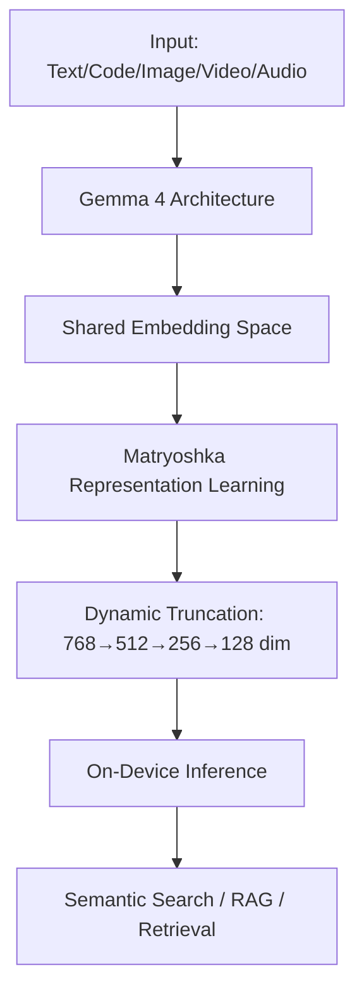
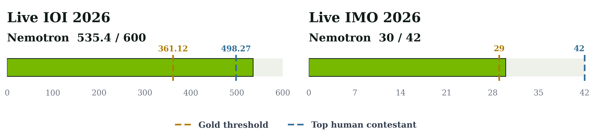
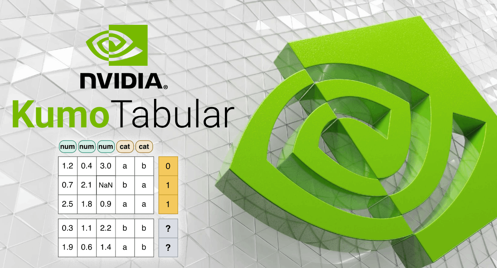

> 🎙️ **Listen to the podcast version of this article:**
> <audio controls src="index.mp3"></audio>

---

> 💡 **TL;DR:** Google’s EmbeddingGemma 2 introduces a lightweight, open-source multimodal embedding model that unifies text, code, image, video, and audio in a single shared space, optimized for on-device use with dynamic vector truncation and state-of-the-art performance. Meanwhile, NVIDIA’s Nemotron models achieve gold-level results in the International Olympiad in Informatics (IOI) and International Mathematical Olympiad (IMO) through fine-tuning and reinforcement learning, releasing open checkpoints for community replication. Mistral’s latest model, Mistral Large 4, pushes for AI sovereignty, offering enterprises greater control over deployment and usage.

| Metric / Innovation Area | Insight / Takeaway |
|--------------------------|--------------------|
| **EmbeddingGemma 2 Architecture** | Built on Gemma 4, 740M parameters, Apache 2.0 license, unifies text/code/image/video/audio in a single embedding space. |
| **On-Device Efficiency** | ~191MB RAM for text-only on Google Pixel 11 Pro; 8K token context for 5.5 mins audio, 29 images, or 58 video frames. |
| **Matryoshka Representation Learning (MRL)** | Dynamic vector truncation from 768→128 dimensions, enabling up to 6x storage reduction. |
| **Nemotron IOI 2026 Score** | 535.4/600 (gold threshold: 361.12), using SFT + RL + generate-verify-refine inference. |
| **Nemotron IMO 2026 Score** | 30/42 (gold threshold: 29), with SFT/RL checkpoints and a generate-verify-refine loop. |
| **Mistral Large 4** | Competitive performance with a focus on enterprise sovereignty and deployment control. |

---

### EmbeddingGemma 2: The Multimodal Embedding Revolution on Your Device

Last year, Google introduced **EmbeddingGemma** as a lightweight solution for high-quality text embeddings, enabling on-device semantic search and privacy-first retrieval-augmented generation (RAG). With over **20 million downloads**, its impact was undeniable. Now, **EmbeddingGemma 2** takes a quantum leap forward by unifying **text, code, images, video, and audio** into a single, shared embedding space—all while maintaining its lightweight, on-device efficiency.

#### Architecture and Innovation
EmbeddingGemma 2 is built on the **Gemma 4 architecture** and packs **740 million parameters** under an Apache 2.0 license, making it commercially permissive. Its modular design allows for **text-only workloads with just 270M parameters**, while optional vision (170M) and audio (300M) encoders enable full multimodal support. This flexibility ensures developers can tailor the model to their needs without unnecessary overhead.

One of its standout features is **Matryoshka Representation Learning (MRL)**, which allows dynamic truncation of output vectors from **768 dimensions down to 128**. This isn’t just a storage optimization—it’s a **6x reduction** in memory usage for local vector databases, making it ideal for edge devices. For example, on a **Google Pixel 11 Pro**, the model requires as little as **~191MB of active RAM for text-only tasks** and **~567MB for full multimodal inference** when quantized.

#### Performance and Benchmarks
EmbeddingGemma 2 doesn’t just match its predecessors—it **outperforms them across the board**. It achieves **leading scores among sub-1B multimodal embedders** on benchmarks like **MTEB (Massive Text Embedding Benchmark) Code** and **MAEB (Massive Audio Embedding Benchmark)**. For instance, it delivers a **9.92-point improvement in code performance** (from 68.76 to 78.68 in MTEB Code), making it a powerhouse for **local codebase indexing, semantic code search, and coding agent retrieval**. Even more impressive, it **outperforms some specialist models more than twice its size** in vision, audio, and text tasks.

The model’s **8K token context window** (4x larger than its predecessor) allows it to process **up to 5.5 minutes of audio, 29 images, or 58 video frames**—or any interleaved combination thereof—**directly on local hardware**. This makes it a game-changer for **on-device semantic search, routing, and retrieval**, where privacy and latency are critical.

#### Why It Matters
EmbeddingGemma 2’s ability to **unify multiple modalities in a single embedding space** while remaining lightweight and efficient is a **paradigm shift** for edge AI. Developers can now build **cross-modal search and retrieval systems that work entirely offline**, ensuring data privacy and reducing pipeline latency. When paired with generative models like **Gemma 4**, it enables **on-device RAG pipelines** that understand complex multimodal data with a **lower combined memory footprint**.

For those looking to get started, the model is available on **Hugging Face, Kaggle, and LiteRT Community**, with optimizations for **MediaPipe, transformers.js, and WebGPU**. Tools like **Qdrant** can store the embedding vectors, while frameworks like **transformers, sentence-transformers, MLX, vLLM, and Ollama** ensure seamless integration.

---

### Nemotron’s Gold Medal Playbook: Fine-Tuning for Olympiad-Level Reasoning

NVIDIA’s **Nemotron** models have long been recognized for their adaptability and strength as foundation models. But recent results prove they can be **specialized into world-class domain experts**—achieving **gold-medal-level performance** in both the **International Olympiad in Informatics (IOI)** and the **International Mathematical Olympiad (IMO)**.

#### The Specialization Recipe
The key to Nemotron’s success lies in a **reusable, four-part specialization recipe**:
1. **Start with a strong foundation model** (Nemotron 3).
2. **Curate domain-specific problems and high-quality reasoning traces**.
3. **Apply standard post-training methods** like Supervised Fine-Tuning (SFT) and Reinforcement Learning (RL).
4. **Pair the specialist model with a generate-verify-refine inference loop**.

This approach is **reproducible and familiar**, requiring no new foundation model for each challenge. Instead, Nemotron is **specialized for the task at hand**, making it a versatile tool for demanding domains.

#### IOI 2026: Competitive Programming at Its Finest
For **IOI 2026**, NVIDIA fine-tuned **Nemotron-3-Ultra-CC** (550B total parameters, 55B active) and **Nemotron-3-Nano-CC** (30B total, 3B active) using **SFT and RL**. The results were staggering:
- **Nemotron-3-Ultra-CC scored 535.4/600**, surpassing the **gold threshold of 361.12** and even the **top human score of 498.27**.
- The system ran under **human contestant constraints** (time, internet access, submissions), making it an unofficial but highly impressive benchmark.

The progression from **IOI 2025** highlights the value of specialization:
- **Nano improved from 130 → 280 (SFT) → 291 (RL) → 468 (GenCorrect)**, crossing the gold threshold of 438.3.
- **Ultra-CC reached 502 points** with the same test-time strategy, proving that **adaptation doesn’t need to look the same at every scale**.

#### IMO 2026: Mathematical Proofs Without a Formal Prover
For **IMO 2026**, the team applied the same principles to **olympiad mathematics**, starting from **Nemotron 3 Ultra**. They trained:
- An **SFT checkpoint** on **414,890 quality-filtered examples** across **15,818 unique proof problems**, covering **proof generation, refinement, verification, and meta-verification**.
- An **RL checkpoint** on **9,597 proof problems** near the model’s capability frontier.

The final system used **both SFT and RL checkpoints alongside the general model**, leveraging their complementary strengths. For each problem, the models:
1. Generated candidate proofs.
2. Scored them.
3. Produced critiques.
4. Refined the most promising attempts.

The result? **30/42 points**, exceeding the **official gold threshold of 29** and earning **full credit on four of the six problems**—all in **natural language, with no formal prover or external tools**.

#### Why It Matters
Nemotron’s success in **IOI and IMO** demonstrates that **fine-tuning and test-time compute can co-design models, data, and inference loops** to achieve **frontier-level performance**. The medals weren’t just from fine-tuning or brute-force sampling—they came from **combining a capable specialist with a system that could search, verify, and improve**.

All **checkpoints, training datasets, and inference pipelines** are **open-sourced on Hugging Face**, including:
- **Nemotron Labs IMO 2026 Collection** (SFT/RL checkpoints, training datasets, Nemotron-IMO-Bench).
- **NeMo-Skills repository** (IMO inference pipeline, prompts, submitted proofs).
- **Nemotron-3-Ultra-CC** (for competitive programming).

This release empowers the **Hugging Face community** to build on these breakthroughs, pushing the boundaries of what’s possible with **open-weight models**.

---

### Mistral’s Sovereignty Gambit: AI Independence at a Price

While **EmbeddingGemma 2** and **Nemotron** push the boundaries of **performance and efficiency**, **Mistral AI** is making a different kind of bet: **sovereignty**. Its latest model, **Mistral Large 4**, is **competitive with some of the world’s strongest AI models**, but its real value lies in giving **enterprises more control over how AI runs**.

#### The Sovereignty Question
Mistral’s approach hinges on **deployment flexibility**. Unlike closed-source models that lock users into proprietary ecosystems, Mistral Large 4 offers **greater independence**—but at a cost. The question isn’t just about **benchmark performance**; it’s about **who can afford to use it**.

For enterprises, **AI sovereignty** means:
- **Control over data** (no external dependencies).
- **Customization** (fine-tuning for domain-specific needs).
- **Compliance** (meeting regional or industry regulations).

Mistral Large 4’s competitive performance suggests that **sovereignty doesn’t have to come at the expense of capability**. However, the **practicality of this independence** remains to be seen. Will enterprises prioritize control over cost? Or will the **high price tag** limit adoption to only the most well-resourced organizations?

#### Why It Matters
Mistral’s push for sovereignty reflects a **growing demand for AI autonomy** in an era of **geopolitical and regulatory uncertainty**. If successful, it could **reshape the AI landscape**, giving businesses the **freedom to deploy models on their own terms**—whether on-premise, in private clouds, or at the edge.

But the **economic reality** cannot be ignored. Benchmarks may not capture the **true cost of independence**, and **affordability** will determine whether sovereignty remains a **luxury or becomes a standard**.

---

### The Future: On-Device AI, Olympiad-Level Reasoning, and Sovereign Models

The advancements in **EmbeddingGemma 2, Nemotron, and Mistral Large 4** paint a vivid picture of where AI is headed:

1. **On-Device AI is the New Frontier**: Models like EmbeddingGemma 2 prove that **multimodal, state-of-the-art AI can run locally** without sacrificing performance. This trend will accelerate as **edge hardware improves** and **privacy concerns grow**.

2. **Specialization is the Key to Mastery**: Nemotron’s gold medals in **IOI and IMO** show that **fine-tuning + reinforcement learning + test-time search** can push models to **human-competitive levels** in complex domains. The **generate-verify-refine loop** is becoming a **standard for high-stakes reasoning**.

3. **Sovereignty is the Next Battleground**: Mistral’s bet on **enterprise control** highlights a **shift in priorities**—from **pure performance** to **deployment flexibility**. As regulations tighten and **data privacy concerns rise**, models that offer **true independence** will gain a **competitive edge**.

The common thread? **AI is becoming more accessible, more powerful, and more customizable**—but the **trade-offs between performance, cost, and control** will define the next chapter of this revolution.

Written with [Argos](https://github.com/Neilstid/argos)
