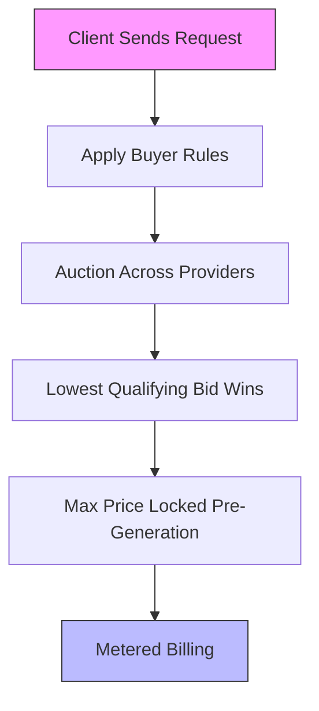

> 🎙️ **Listen to the podcast version of this article:**
> <audio controls src="index.mp3"></audio>


---

> 💡 **TL;DR:** This week marks a turning point for AI infrastructure and reliability. Architect’s *Liquid Inference* introduces a real-time auction marketplace for LLM inference, slashing costs dynamically. NVIDIA’s *PivotOPD* teaches multi-turn AI agents to recover from pivotal mistakes, outperforming 13 baselines. Liquid AI’s *d1-3B* and *d1-omni-600M* redefine efficiency with zero-output-token multimodal decision models. Meanwhile, Google’s *SynthID* expands as a universal watermark detector, unifying verification across major providers—OpenAI, NVIDIA, Kakao, and Google—amid growing regulatory pressure.

| **Metric / Innovation Area**               | **Insight / Takeaway**                                                                                     |
|-------------------------------------------|----------------------------------------------------------------------------------------------------------|
| **Liquid Inference (Architect)**          | Real-time auction for LLM inference; buyers pay the lowest qualifying bid; max price locked pre-generation. |
| **PivotOPD (NVIDIA)**                     | Recovers from 72.7% of pivotal mistakes vs. 20.3% for standard OPD; best average on 3 agent benchmarks.   |
| **d1-3B (Liquid AI)**                     | 48.57 Decision Index score (best under 10B); 8ms latency per question on RTX 4090.                        |
| **d1-omni-600M (Liquid AI)**              | Handles text+image or text+audio; 587M parameters; 95.8% on Civil Comments benchmark.                     |
| **SynthID (Google)**                      | Detects watermarks from OpenAI, NVIDIA, Kakao, and Google; addresses regulatory demands for AI labeling.   |

---

### LLM Inference Marketplaces: Architect’s Liquid Inference and the Real-Time Auction Revolution

The cost and latency of LLM inference remain persistent pain points for developers, particularly as models grow larger and demand spikes unpredictably. Enter **Architect’s Liquid Inference**, a first-of-its-kind *real-time auction marketplace* for LLM inference that treats compute like a financial instrument—dynamic, competitive, and transparent. Built by the team behind the AX perpetual futures exchange, Liquid Inference leverages Architect’s expertise in two-sided price discovery to create a spot market for GPU cycles.

#### How the Live Bidding System Works
At its core, Liquid Inference is an *exchange-style router*. Providers post offers to serve specific models, and each incoming request triggers an auction across all quoting providers for that model. The buyer’s constraints—such as cost caps, latency limits, or data retention policies—filter eligible offers, and the lowest-priced qualifying bid wins. The max price is locked *before* the first token is generated, ensuring no surprises in billing. This mechanism mirrors financial order books, where transparency and competition drive efficiency.



For developers, integration is seamless: swap a base URL, keep existing code, and let providers compete on price. The system supports OpenAI and Anthropic API standards, making it compatible with tools like Claude Code, Cursor, and OpenCode. Early adopters benefit from $20 in free inference credits, and a referral program offers 20% of referred fees as additional credits. Providers, meanwhile, can onboard in minutes, update quotes dynamically, and receive payouts via Stripe with itemized records.

#### Why It Matters
Liquid Inference’s auction model introduces *price elasticity* to LLM inference, a stark contrast to static pricing tiers. For providers with spare GPU capacity, it’s an opportunity to monetize idle resources. For buyers, it’s a way to optimize costs without sacrificing performance. The live order books and cleared transaction data—uncommon in LLM APIs—offer unprecedented transparency, empowering users to make informed decisions.

However, questions remain: How will latency vary across providers? What are the platform fees? And can this model scale without compromising reliability? As Architect expands its provider network (currently undisclosed), these answers will shape its adoption.

---

### Advancing Multi-Turn AI Agents: NVIDIA’s PivotOPD and the Art of Recovery

Multi-turn AI agents are only as good as their ability to *recover from mistakes*. Yet, most training methods—like standard on-policy distillation (OPD)—struggle to address *pivotal mistakes*: early actions that derail an entire task. NVIDIA’s **PivotOPD** (On-Policy Distillation with Pivotal Recovery) changes this by explicitly teaching agents to *avoid* and *recover* from these critical errors.

#### The Problem: Pivotal Mistakes in Agent Rollouts
Research shows that **59% of failed agent rollouts** contain at least one pivotal mistake, often occurring early (median turn 8–12 in a 30-turn task). Correcting these mistakes in replays can boost success rates from 8% to 59%, but standard OPD barely improves failure rates after a pivotal turn (from 51% to 49%). The issue? Correct actions at pivotal turns often have *<1% probability* in the student’s policy, making them nearly impossible to sample during training.

#### How PivotOPD Works
PivotOPD augments group-based reinforcement learning (RL) with three key components:
1. **Pivot Detection**: A larger teacher model analyzes each rollout in hindsight, identifying turns where the student’s action diverges from the optimal (*gold*) action. On ALFWorld, these detected pivots align with the oracle’s pivots in **77.8% of failed rollouts**.
2. **Preventive Distillation (Reverse KL)**: A frozen copy of the student, hinted with the gold action, re-scores the student’s responses to steer it away from mistakes.
3. **Recovery Distillation (Forward KL)**: After a pivot, the teacher provides recovery actions for up to *K* turns. The student trains on these recovery responses, lifting the probability of rarely sampled actions.

The method adds *zero inference overhead*—training changes only—making it deployable wherever the base model runs. On NVIDIA H100 nodes, the overhead over GRPO (Group Relative Policy Optimization) is **12.4% at K=1** and **94.2% at K=2** (due to environment replay costs).

#### Benchmark Dominance
PivotOPD outperforms **13 baselines** across three agent benchmarks—ALFWorld, WebShop, and Search-based QA—using Qwen3-1.7B and Qwen3-8B students. Key results:
- **Recovery Rate**: 72.7% of replayed pivotal mistakes (vs. 20.3% for standard OPD, 8.3% for base model).
- **ALFWorld (1.7B)**: 73.7% average (5.5 points above SDAR).
- **WebShop (1.7B)**: 76.6% success rate (14.1 points above RLSD).
- **SWE-Bench Verified**: 66.0% (vs. 62.8% base, 63.0% standard OPD).

```mermaid
barChart
    title PivotOPD Recovery Performance
    xAxis Recovery Method
    yAxis Success Rate (%)
    bar PivotOPD : 72.7
    bar Standard OPD : 20.3
    bar Preventive-Only : 45.8
    bar Base Model : 8.3
```

#### Why It Matters
PivotOPD demonstrates that *recovery is learnable*—a critical insight for deploying reliable multi-turn agents in real-world applications (e.g., customer support, autonomous systems). Its ability to outperform outcome-only RL methods (which struggle when all rollouts fail) highlights the importance of *hindsight-based teaching*. As NVIDIA prepares to open-source the code, PivotOPD could become a standard tool for training robust agents.

---

### Multimodal Decision Models: Liquid AI’s d1-3B and d1-omni-600M

Generative LLMs excel at open-ended tasks, but for *real-time decision-making*, their token-by-token output is often overkill. **Liquid AI’s d1 models** flip the script: they *read* text, images, or audio and *return calibrated, typed answers in a single forward pass*—with **zero output tokens**. This design targets latency-sensitive applications like moderation, routing, and edge AI.

#### What Is a Decision Model?
Unlike generative models, decision models map inputs directly to a probability distribution over predefined answers. Liquid AI defines three question types:
- **NouL (Yes/No)**: Returns *P(yes)*.
- **Choice**: Selects one label from named options (full probability distribution).
- **Score**: Assigns a probability-weighted position on an ordered rubric (2–10 levels).

For example, a single `d1-3B` call can:
- Answer a yes/no refund request.
- Classify the owning team for a support ticket.
- Rate urgency on a 1–10 scale.
All with *output_tokens: 0*.

#### Architecture and Performance
- **d1-3B**: 3.12B parameters, built from *LFM2.5-VL-3B* (decoder-only VL model) + averaged weights from *LFM2.5-2.6B*. Uses a 400M SigLIP2 NaFlex vision encoder and 32,768-token context. **Decision Index v0.2.1 score: 48.57** (best under 10B, edging Decider 35B-A3B’s 47.11).
- **d1-omni-600M**: 587M parameters, built from *LFM2.5-Encoder-350M* (bidirectional encoder) with a 94M vision encoder and 112M FastConformer audio encoder. Handles *text+image* or *text+audio* (not both simultaneously).

#### Benchmark Highlights
| Model               | Decision Index | Avg. Text Benchmarks | Avg. Image Benchmarks | Latency (RTX 4090) |
|---------------------|-----------------|----------------------|-----------------------|--------------------|
| **d1-3B**           | 48.57           | 82.9                 | 74.1                  | 8ms per question   |
| **d1-omni-600M**    | 15.95           | 78.4                 | N/A                   | N/A                |
| Decider 4B          | 40.70           | 81.1                 | N/A                   | 5.2ms (3-question)  |

On **Jetson AGX Thor**, `d1-3B` processes a 384px image in **35ms**, making it ideal for edge deployment. Liquid AI’s *Open d1 Arcade* demonstrates real-time applications like content moderation and gesture control.

#### Why It Matters
Decision models like `d1-3B` and `d1-omni-600M` bridge the gap between *generative flexibility* and *operational efficiency*. Their zero-output-token design eliminates parsing overhead, while their calibrated probabilities enable reliable routing and scoring. With **LFM Open License v1.0** (free for commercial use under $10M revenue), these models are poised to accelerate adoption in:
- **Edge AI**: Real-time visual inspection (e.g., manufacturing, security).
- **Voice Assistants**: Intent classification from speech + text.
- **Agent Guardrails**: Safe, typed decisions for autonomous systems.

Code to run `d1-3B` locally:
```python
from transformers import AutoModelForDecision, AutoProcessor

model = AutoModelForDecision.from_pretrained("liquidai/d1-3B", trust_remote_code=True)
processor = AutoProcessor.from_pretrained("liquidai/d1-3B")

# Define state and questions
state = "A user requests a refund for a damaged product."
questions = [
    {"type": "noul", "question": "Is the refund approved?"},
    {"type": "choice", "question": "Which team handles this?", "options": ["Support", "Finance", "Logistics"]}
]

# Single forward pass
output = model.system_one(state, questions)
# output.tokens == 0
```

---

### AI Content Verification: Google SynthID as the Universal Watermark Checker

As AI-generated content proliferates, *verification* has become a cornerstone of trust. **Google’s SynthID** now supports watermark detection from **OpenAI, NVIDIA, Kakao, and Google**, positioning itself as a universal tool for identifying AI-generated media. This expansion aligns with regulatory pushes for *machine-readable AI labels*, but it also raises questions about reliability and independence.

#### How SynthID Works
SynthID embeds *imperceptible watermarks* into AI-generated images, audio, and text. The detector analyzes content for these watermarks, providing a confidence score. Crucially, **an undetected watermark does not prove authenticity**—it could mean the content is human-made *or* that the watermark was removed/altered.

#### Implications for Trust and Regulation
- **Unified Verification**: SynthID’s cross-provider support simplifies verification for platforms and regulators. For example, a social media site could use SynthID to flag content from multiple AI sources.
- **Limitations**: Watermarks can be stripped (e.g., via compression, cropping, or adversarial attacks). Google’s role as both a watermark provider *and* detector invites scrutiny over potential conflicts of interest.
- **Regulatory Tailwinds**: The EU AI Act and similar laws may soon require disclosure of AI-generated content. Tools like SynthID could become mandatory for compliance.

#### The Bigger Picture
While SynthID is a step toward transparency, it’s not a silver bullet. Independent auditing, robust watermarking techniques, and *multi-modal verification* (e.g., combining watermarks with provenance metadata) will be essential. As Google notes, *"an undetected watermark does not prove authenticity"*—a reminder that verification is a layered challenge.

---

*This article synthesizes breakthroughs that redefine how we *deploy* (Liquid Inference), *train* (PivotOPD), *decide* (d1 models), and *verify* (SynthID) AI systems. Each innovation addresses a critical bottleneck—cost, reliability, latency, or trust—paving the way for a more scalable and responsible AI ecosystem.*

Written with [Argos](https://github.com/Neilstid/argos)
