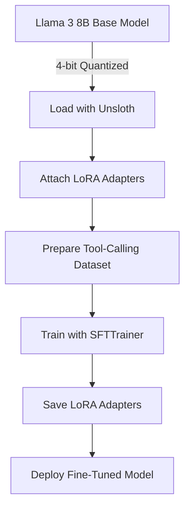
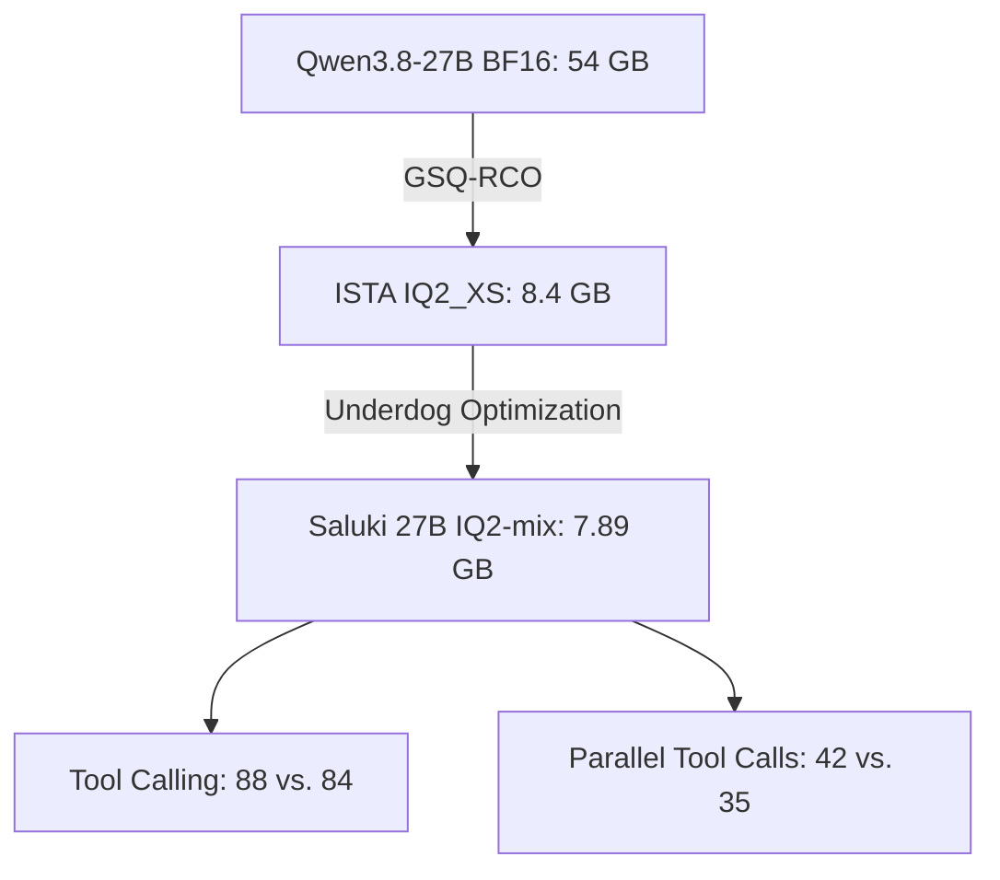
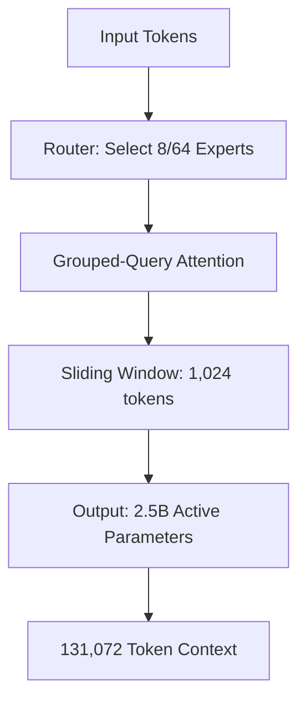
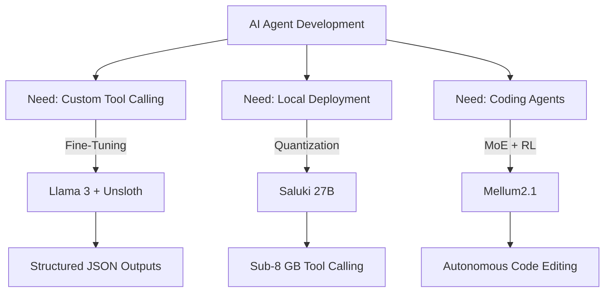

> 🎙️ **Listen to the podcast version of this article:**
> <audio controls src="index.mp3"></audio>


---

> 💡 **TL;DR:** This article dives into three groundbreaking advancements in AI tool calling and coding agents: (1) Fine-tuning Llama 3 with Unsloth for reliable structured JSON outputs, (2) Saluki 27B, a 2-bit quantized Qwen3.8-27B model that outperforms its 54GB counterpart in tool calling, and (3) JetBrains’ Mellum2.1, a 12B Mixture-of-Experts model that leverages reinforcement learning to achieve a 47.0 SWE-bench Verified score. These innovations highlight the rapid evolution of efficient, specialized, and high-performance AI systems.

| Metric / Innovation Area | Insight / Takeaway |
|--------------------------|--------------------|
| **Fine-Tuning Llama 3** | Unsloth + QLoRA enables fine-tuning Llama 3 8B for custom tool calling in under 10 minutes on a free Colab T4 GPU, producing reliable structured JSON outputs. |
| **Saluki 27B** | A 7.89 GB, 2-bit GGUF of Qwen3.8-27B that beats the 54 GB original in tool calling (88 vs. 84 on Underdog Bench) but trades off math/reasoning performance. |
| **Mellum2.1** | 12B MoE model with 2.5B active parameters; RL training in real repositories boosts SWE-bench Verified from 2.0 to 47.0. |
| **Quantization Impact** | 2-bit quantization retains 96% average performance across 9 benchmarks but drops math/reasoning by 12-18 points. |
| **Deployment Efficiency** | Saluki 27B runs on stock llama.cpp; Mellum2.1 GGUF builds start at 7.0 GB for local deployment. |

---

### 1. Fine-Tuning Llama 3 for Custom Tool Calling with Unsloth


#### The Challenge: Reliable Structured JSON Outputs
Llama 3 is a formidable generalist, but its broad capabilities can be a double-edged sword when specialization is required. For developers building AI agents that interact with APIs, the model must **reliably** output structured JSON payloads matching a specific schema. Prompt engineering can coax the model into compliance, but it’s not foolproof—under complex queries or long conversations, the model may drift, adding prose, swapping quote styles, or omitting required fields. A single malformed response can break an entire agentic pipeline.

Fine-tuning addresses this by modifying the model’s behavior at the **weight level**. As highlighted in *The Machine Learning Practitioner’s Guide to Fine-Tuning Language Models*, fine-tuning is justified when deep specialization is needed: custom tones, strict output formatting, or entirely new capabilities. Tool calling checks all three boxes.

#### The Solution: Unsloth + QLoRA
The workflow leverages **Unsloth** and **QLoRA (Quantized Low-Rank Adaptation)** to fine-tune Llama 3 8B efficiently. QLoRA freezes the base model’s weights and injects small, trainable matrices into the attention layers, updating roughly **1% of parameters** while keeping memory usage low enough for a free Google Colab T4 GPU. This approach achieves results comparable to full fine-tuning at a fraction of the compute cost.

Here’s the high-level architecture:



#### Step-by-Step Implementation
1. **Environment Setup**: Install Unsloth and dependencies in a Colab notebook with a T4 GPU:
   ```bash
   !pip install "unsloth[colab-new] @ git+https://github.com/unslothai/unsloth.git"
   !pip install --no-deps xformers trl peft accelerate bitsandbytes
   ```

2. **Load Model and Tokenizer**: Use Unsloth’s pre-quantized Llama 3 8B:
   ```python
   from unsloth import FastLanguageModel
   import torch
   
   model, tokenizer = FastLanguageModel.from_pretrained(
       model_name="unsloth/llama-3-8b-Instruct-bnb-4bit",
       max_seq_length=1024,
       dtype=None,
       load_in_4bit=True,
   )
   ```

3. **Attach LoRA Adapters**: Configure QLoRA with a rank of 8 (low risk of overfitting for small datasets):
   ```python
   model = FastLanguageModel.get_peft_model(
       model,
       r=8,
       target_modules=["q_proj", "k_proj", "v_proj", "o_proj", "gate_proj", "up_proj", "down_proj"],
       lora_alpha=16,
       lora_dropout=0,
       bias="none",
       use_gradient_checkpointing="unsloth",
       random_state=42,
   )
   ```

4. **Build the Dataset**: Each example includes a **system prompt** (defining tools and schemas), a **user query**, and the **exact JSON output**:
   ```python
   tool_calling_data = [
       {
           "system": "You have access to these tools: get_weather(location: str) -> dict fetch_stock_price(ticker: str) -> dict Respond ONLY with a valid JSON tool call. No other text.",
           "user": "What is the weather like in Tokyo right now?",
           "output": '{"name": "get_weather", "arguments": {"location": "Tokyo"}}'
       },
       # Additional examples...
   ]
   ```
   Format the data using Llama 3’s chat template:
   ```python
   from datasets import Dataset
   
   def format_example(item):
       messages = [
           {"role": "system", "content": item["system"]},
           {"role": "user", "content": item["user"]},
           {"role": "assistant", "content": item["output"]},
       ]
       return {"text": tokenizer.apply_chat_template(messages, tokenize=False, add_generation_prompt=False)}
   
   dataset = Dataset.from_list([format_example(ex) for ex in tool_calling_data])
   ```

5. **Train and Test**: Use `SFTTrainer` with hyperparameters optimized for a Colab T4:
   ```python
   from trl import SFTTrainer
   from transformers import TrainingArguments
   
   trainer = SFTTrainer(
       model=model,
       tokenizer=tokenizer,
       train_dataset=dataset,
       dataset_text_field="text",
       max_seq_length=1024,
       args=TrainingArguments(
           per_device_train_batch_size=2,
           gradient_accumulation_steps=4,
           learning_rate=2e-4,
           max_steps=60,
           warmup_steps=5,
           lr_scheduler_type="linear",
           optim="adamw_8bit",
           weight_decay=0.01,
           output_dir="tool_caller_output",
           report_to="none",
       ),
   )
   trainer.train()
   ```
   Test the fine-tuned model with an unseen query:
   ```python
   FastLanguageModel.for_inference(model)
   messages = [
       {"role": "system", "content": "You have access to these tools:\nget_weather(location: str) -> dict\nfetch_stock_price(ticker: str) -> dict\nRespond ONLY with a valid JSON tool call. No other text."},
       {"role": "user", "content": "What's the stock price of Tesla?"},
   ]
   inputs = tokenizer.apply_chat_template(messages, tokenize=True, add_generation_prompt=True, return_tensors="pt").to("cuda")
   output = model.generate(inputs, max_new_tokens=64, temperature=0.1, do_sample=True)
   response = tokenizer.decode(output[0][inputs.shape[1]:], skip_special_tokens=True)
   print(response)  # Expected: {"name": "fetch_stock_price", "arguments": {"ticker": "TSLA"}}
   ```

6. **Save and Deploy**: The LoRA adapters (a few MB) can be saved and reloaded later:
   ```python
   model.save_pretrained("llama3_tool_caller")
   tokenizer.save_pretrained("llama3_tool_caller")
   ```

#### Why It Matters
This approach democratizes **custom tool-calling agents**. By fine-tuning Llama 3 with QLoRA, developers can create specialized models that **guarantee** structured JSON outputs for API interactions—without requiring expensive GPUs or extensive datasets. The workflow is reproducible, efficient, and scalable, making it ideal for integrating into agentic frameworks like **LangChain** or **LlamaIndex**.

---

### 2. The Underdog Saluki 27B: A 2-Bit Qwen3.8-27B That Beats the Original at Tool Calling


#### The Breakthrough: 2-Bit Quantization Without Sacrificing Tool Calling
**Saluki 27B**, developed by **Underdog (Conway Research)**, is a **2-bit GGUF** quantization of **Qwen3.8-27B** that fits into **7.89 GB**—a stark contrast to the original model’s **54 GB** BF16 footprint. Despite its compact size, Saluki 27B **outperforms the full model in tool calling**, achieving **88 vs. 84** on the Underdog Bench (120 tasks from BFCL v4) and **42 vs. 35** in parallel tool calls. This makes it a game-changer for **local, resource-constrained deployments**.

#### How It Works: A Three-Layer Stack
Saluki 27B’s efficiency stems from a **multi-stage quantization process**:

1. **Base Model**: Qwen3.8-27B, a dense 27B model with **64 layers**, mixing **Gated DeltaNet linear attention** with gated attention, and supporting **262,144 tokens** natively.
2. **ISTA-DASLab’s GSQ-RCO**: **GSQ (Grained Scalar Quantization)** learns accurate low-bit scalar grids per tensor, while **RCO (Resource-Constrained Optimization)** assigns quantization types under a fixed budget. ISTA’s smallest file, **IQ2_XS**, is **8.4 GB** at **2.50 bits per weight**.
3. **Underdog’s Final Pass**: Shrinks the file to **7.89 GB** (tagged as **IQ2-mix**) and **prioritizes tool-calling retention**. The exact recipe remains undisclosed, but the results speak for themselves.



#### Benchmark Performance: Wins and Trade-offs
Saluki 27B achieves **96% average retention** across **9 benchmarks** compared to the full Qwen3.8-27B. However, the trade-offs are notable:

| Benchmark               | Saluki 27B | Qwen3.8-27B (Full) | Retention |
|-------------------------|------------|---------------------|-----------|
| **Underdog Bench**      | 88         | 84                  | **104.8%**|
| **Parallel Tool Calls** | 42         | 35                  | **120%**  |
| **SWE-bench Verified**  | 30         | 33                  | 90.9%     |
| **IFEval**               | 93.5       | 91.5                | 102.2%    |
| **AIME 2025**           | 79.2       | 96.7                | **81.9%** |
| **AIME 2026**           | 80.0       | 94.6                | **84.6%** |

**Key Insights**:
- **Tool Calling**: Saluki 27B **excels**, surpassing the full model in both single and parallel tool-call tasks.
- **Math/Reasoning**: **Drops significantly** (e.g., AIME 2025: **79.2 vs. 96.7**), likely due to the aggressive quantization.
- **General Performance**: **96% retention** on average, making it a **viable alternative** for most tasks except high-stakes reasoning.

#### Comparison with Other Compact Qwen3.8-27B Builds
| Feature                     | Saluki 27B               | Qwen3.8-27B (BF16) | ISTA GSQ-RCO IQ2_XS | PrismML Bonsai 2 27B |
|-----------------------------|--------------------------|--------------------|----------------------|----------------------|
| **Size**                   | 7.89 GB                  | 54 GB              | 8.4 GB               | 5.95 GB              |
| **Bits per Weight**        | ~2-bit mix               | 16                 | 2.50                 | 1.75                 |
| **Underdog Bench (120)**   | **88**                   | 84                 | Not disclosed        | 70                   |
| **Parallel Tool Calls**    | **42**                   | 35                 | Not disclosed        | Not disclosed        |
| **Runtime**                | Stock llama.cpp          | Transformers/vLLM  | Stock llama.cpp      | PrismML fork          |
| **License**                | Apache 2.0               | Apache 2.0         | Apache 2.0           | Apache 2.0           |

**Why Saluki Stands Out**:
- **Stock llama.cpp Compatibility**: Unlike Bonsai 2 (which requires a PrismML fork), Saluki runs on **unmodified llama.cpp**, making it **plug-and-play** for most users.
- **Tool-Calling Focus**: Underdog’s optimization **prioritizes agentic capabilities**, making it ideal for **local AI assistants**.
- **Vision Add-On**: Optional **629 MB or 928 MB** vision modules extend functionality to multimodal tasks.

#### Implications for Deployment
Saluki 27B proves that **2-bit quantization** can retain **near-full performance** for **tool calling** while drastically reducing resource requirements. This opens doors for:
- **Edge Devices**: Deploying 27B-class models on **low-memory GPUs** or even **CPUs** (with llama.cpp).
- **Cost-Effective Agents**: Running **multiple specialized agents** in parallel without breaking the bank.
- **Democratized AI**: Enabling **smaller teams** to leverage large models without cloud dependencies.

However, the **math/reasoning trade-off** means Saluki 27B is **not a drop-in replacement** for all use cases. Developers must weigh **tool-calling prowess** against **reasoning limitations** based on their application’s needs.

---

### 3. JetBrains Mellum2.1: A 12B Mixture-of-Experts Open Model for Coding Agents


#### The Leap: From 2.0 to 47.0 on SWE-bench Verified
JetBrains’ **Mellum2.1** is a **12B Mixture-of-Experts (MoE)** model with **2.5B active parameters**, designed for **coding agents** and **fast sub-agents**. The standout achievement? **Reinforcement Learning (RL) in real repositories** catapulted its **SWE-bench Verified** score from **2.0 to 47.0**—a **2,250% improvement** that underscores the power of **environment-aware training**.

#### Architecture: Efficiency Meets Performance
Mellum2.1 retains the same architecture as its predecessor, **Mellum2 Thinking**, but with **enhanced post-training**:
- **28 layers**, **64 experts**, with a **router activating 8 experts per token**.
- **Grouped-Query Attention (GQA)**: 32 query heads, 4 KV heads.
- **Sliding Window**: 3 of every 4 layers use a **1,024-token sliding window** for efficiency.
- **Context Length**: **131,072 tokens** (sufficient for most coding tasks).
- **Vocabulary**: **98,304 tokens** (bfloat16 weights).



#### Training: RL in the Wild
The **key innovation** in Mellum2.1 is its **RL-heavy post-training regime**:
1. **Diverse RL Tasks**: Math, competitive programming, science, **tool use**, and **software engineering**.
2. **Real Repository Training**: The model operates in **actual codebases** with a **shell and file-editing tools**, learning to **explore, edit, and validate** changes.
3. **Reward Signal**: **Tests passing** = positive reinforcement. This **grounds the model in real-world feedback**.
4. **Scale**: **Millions of sandboxes** across **thousands of environments**, ensuring robustness.

#### Benchmark Dominance (and Limitations)
Mellum2.1 was evaluated against **Mellum2**, **Qwen3.5-9B**, and **Gemma 4 E4B** using a **shared pipeline in thinking mode**. Results:

| Benchmark               | Mellum2.1 | Mellum2 | Qwen3.5-9B | Gemma 4 E4B |
|-------------------------|------------|---------|------------|-------------|
| **LiveCodeBench v6**    | **82.0**   | 69.4    | 75.4       | 69.4        |
| **SWE-bench Verified**  | **47.0**   | 2.0     | **50.0**   | 23.0        |
| **SWE-bench Pro**       | **28.0**   | 0.0     | **38.0**   | 3.4         |
| **Terminal-Bench 2.1**  | 17.4       | 0.6     | **21.7**   | 3.4         |
| **BFCL v4**             | **62.3**   | 49.6    | 58.5       | 52.5        |
| **GPQA Diamond**        | 64.6       | 51.0    | **77.8**   | 53.1        |
| **AIME 2025/26**        | 83.3       | 60.1    | **86.7**   | 45.0        |
| **HarmBench** (Lower = Better) | **8.5** | 21.5    | Not disclosed | Not disclosed |

**Key Takeaways**:
- **Coding Strengths**: Mellum2.1 **leads in LiveCodeBench v6 (82.0)** and **BFCL v4 (62.3)**, showcasing its **code-generation and reasoning** prowess.
- **Agentic Improvements**: **SWE-bench Verified (47.0)** and **Terminal-Bench 2.1 (17.4)** demonstrate **dramatic gains** from RL in real environments.
- **Limitations**: Still **trails Qwen3.5-9B** in **SWE-bench Pro (28.0 vs. 38.0)** and **GPQA Diamond (64.6 vs. 77.8)**, indicating room for growth in **hard agentic tasks** and **knowledge-intensive reasoning**.
- **Safety**: **HarmBench score drops from 21.5 to 8.5**, reflecting **improved alignment**.

#### Speed and Deployment
Despite its **12B total parameters**, Mellum2.1’s **2.5B active parameters** make it **highly efficient**:
- **Throughput**: On an **NVIDIA H200**, it serves **~2x the tokens** of Qwen3.5-9B under heavy load.
- **Single-Request Speed**: **1.6x faster** than Qwen3.5-9B due to **multi-token prediction (MTP)**.
- **Local Deployment**: GGUF builds start at **7.0 GB** (MXFP4_MOE), making it **self-hostable** on consumer GPUs:
  | Quantization | Size      | Top-Token Match |
  |--------------|-----------|-----------------|
  | BF16         | 24.3 GB   | Reference       |
  | Q8_0         | 12.9 GB   | 96.1%           |
  | Q6_K         | 10.9 GB   | 93.9%           |
  | **Q4_K_M**   | **8.1 GB** | **88.0%**       |
  | MXFP4_MOE    | **7.0 GB** | **85.6%**       |

**Recommended Setup**:
```bash
# Serve with vLLM (reasoning parser for Qwen3-style output)
vllm serve Mellum2.1-12B-A2.5B-Thinking --reasoning-parser qwen3

# Enable tool calling
vllm serve Mellum2.1-12B-A2.5B-Thinking --enable-auto-tool-choice --tool-call-parser hermes
```

#### Why Mellum2.1 Matters
Mellum2.1 **proves that MoE models can be both powerful and practical** for coding agents. By focusing on **RL in real environments**, JetBrains has created a model that **understands codebases, edits files, and validates changes**—critical for **autonomous software engineering**. The **7.0 GB GGUF** variant makes it accessible for **local development**, while its **speed and throughput** advantages position it as a **strong alternative to dense models** like Qwen3.5-9B.

---

### The Big Picture: Where Do These Innovations Fit?

The three advancements covered here represent **complementary paths** in the evolution of AI agents:

1. **Fine-Tuning for Specialization** (Llama 3 + Unsloth):
   - **Use Case**: Custom tool-calling agents for **niche APIs** or **proprietary systems**.
   - **Strengths**: **Guaranteed JSON formatting**, low cost, and **rapid iteration**.
   - **Limitations**: Requires **domain-specific datasets** and **fine-tuning expertise**.

2. **Quantization for Efficiency** (Saluki 27B):
   - **Use Case**: **Local, low-resource deployments** where tool calling is prioritized over reasoning.
   - **Strengths**: **7.89 GB footprint**, **stock llama.cpp support**, and **superior tool-calling**.
   - **Limitations**: **Math/reasoning trade-offs** and **quantization artifacts**.

3. **MoE for Scalable Coding Agents** (Mellum2.1):
   - **Use Case**: **Autonomous coding agents** that explore, edit, and validate code.
   - **Strengths**: **47.0 SWE-bench Verified**, **131K context**, and **7.0 GB GGUF**.
   - **Limitations**: **Trails in hard reasoning tasks** (e.g., GPQA Diamond).



#### Future Outlook
- **Hybrid Approaches**: Combining **fine-tuning** (for custom tools) with **quantization** (for efficiency) could yield **highly specialized, lightweight agents**.
- **MoE + Quantization**: Future work may explore **quantizing MoE models** like Mellum2.1 to **sub-7 GB** while retaining performance.
- **Benchmark Standardization**: The AI community needs **consistent evaluation frameworks** to compare models fairly (e.g., Saluki’s Underdog Bench vs. Mellum2.1’s shared pipeline).
- **Agentic Ecosystems**: Tools like **LangChain**, **LlamaIndex**, and **Google’s Gemini Agent** will increasingly integrate these models into **end-to-end workflows**.

---

### Conclusion
The AI landscape is evolving at a **blistering pace**, with innovations in **fine-tuning**, **quantization**, and **Mixture-of-Experts** architectures pushing the boundaries of what’s possible. **Llama 3 + Unsloth** empowers developers to create **custom tool-calling agents** with minimal resources. **Saluki 27B** proves that **2-bit quantization** can preserve—and even enhance—**tool-calling capabilities** while slashing memory usage. **Mellum2.1** demonstrates how **RL in real environments** can transform a model into a **proficient coding agent**.

These advancements are not just **technical feats**; they are **enablers** for the next generation of AI applications—**autonomous, efficient, and accessible**. Whether you’re building a **local AI assistant**, a **coding sub-agent**, or a **custom API integrator**, the tools and models discussed here provide a **roadmap** for the future of AI-driven automation.

Written with [Argos](https://github.com/Neilstid/argos)
