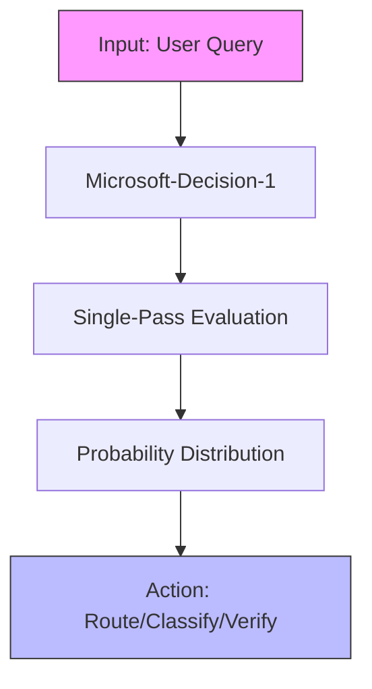
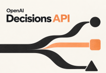
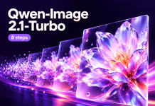
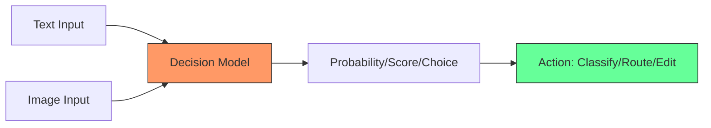

> 🎙️ **Listen to the podcast version of this article:**
> <audio controls src="index.mp3"></audio>


---

> 💡 **TL;DR:** This week marks a pivotal shift in AI: decision models like Microsoft-Decision-1 and Nace AI’s Drex 1.5 are redefining precision with calibrated probabilities for routing, classification, and agent control, while OpenAI’s Decisions API and Qwen-Image-2.1-Turbo are accelerating generative vision and typed outputs. These innovations prioritize speed, cost-efficiency, and actionable insights over traditional text generation, signaling a new era of AI utility.

| **Metric / Innovation Area**               | **Insight / Takeaway**                                                                                     |
|------------------------------------------|---------------------------------------------------------------------------------------------------------|
| **Decision Model Accuracy**              | Microsoft-Decision-1 leads with 83.5% accuracy across 36 benchmarks; Drex 1.5 scores 58.08 on Decision Index 0.3.1. |
| **Latency**                              | Microsoft-Decision-1: 85ms p50; Drex 1.5: 0.65s (8K–32K tokens), 2.0s (32K–128K tokens).                  |
| **Cost Efficiency**                      | Microsoft-Decision-1: $0.042/M input tokens; OpenAI Decisions API: $0.10/M input tokens (output free).   |
| **Generative Vision Speed**              | Qwen-Image-2.1-Turbo reduces denoising steps from 40 to 8, enabling 5x faster 2K image generation/editing.   |
| **Open-Source Accessibility**            | Drex 1.5 offers open weights (8.95B params) under RAIL-M; Qwen-Image-2.1-Turbo uses a research license.      |
| **Multimodal Capabilities**              | OpenAI Decisions API supports text + images; Qwen-Image-2.1-Turbo handles multi-reference editing.       |

---

### Introduction: Today's AI Breakthroughs in Decision Models and Generative Vision

The AI landscape is undergoing a tectonic shift. While generative models have long dominated headlines with their ability to produce human-like text, images, and code, a new class of **decision models** is emerging—optimized not for creativity, but for **precision, speed, and actionable outputs**. Simultaneously, advancements in **generative vision** are making image synthesis and editing faster and more accessible than ever. 

This week’s breakthroughs—Microsoft’s **Microsoft-Decision-1**, Nace AI’s **Drex 1.5**, OpenAI’s **Decisions API**, and Alibaba’s **Qwen-Image-2.1-Turbo**—exemplify this dual evolution. Decision models are now scoring options with calibrated probabilities in milliseconds, while vision models are slashing inference steps without sacrificing quality. Together, they’re paving the way for AI systems that are **faster, cheaper, and more reliable** for real-world applications.


---

### Microsoft-Decision-1: A Qwen3.5-9B Decision-Scoring Model for Routing, Classification, and Agent Control

#### **The Rise of Decision Models: Why Text Isn’t Always the Answer**
Traditional LLMs excel at generating prose, but their outputs often require parsing, validation, and error handling—steps that introduce latency and complexity. Microsoft’s **Microsoft-Decision-1** flips this paradigm by **eliminating text generation entirely**. Instead, it returns **calibrated probabilities for predefined options**, making it ideal for tasks like routing, classification, verification, and agent control. Think of it as a **high-precision judge** rather than a creative writer.


#### **How It Works: Post-Trained for Single-Pass Scoring**
Built on Alibaba’s **Qwen3.5-9B**, Microsoft-Decision-1 is post-trained to evaluate inputs against fixed answer sets. Given a prompt like:
```json
{
  "question": "Is this email spam?",
  "options": ["yes", "no", "cannot tell"]
}
```
The model returns a probability distribution (e.g., `{"yes": 0.85, "no": 0.10, "cannot tell": 0.05}`) in **one forward pass**. This design avoids the overhead of sampling tokens, reducing latency to a median of **85ms**—**4.5x faster than Quyet-1.0-Large** and **35x faster than GPT-6 Sol** (3.01s).

**Key Features:**
- **Supported Formats:** Yes/no, multiple-choice, rating, classification, rubric grading, and abstention (e.g., "cannot tell").
- **Context Window:** 32,768 tokens.
- **Output:** JSON with per-option probabilities.

#### **Performance and Benchmarks: Leading the Pack**
Microsoft evaluated Decision-1 against 9 systems across **36 benchmarks** (147,137 questions), achieving:
- **83.5% average accuracy** (vs. Quyet-1.0-Large’s 81.9%).
- **92.2 calibration score** (second to Quyet’s 93.1).
- **Robustness:** Only **1.3% decision flips** under perturbations (e.g., paraphrasing, option shuffling).

**Cost:** $0.042 per million input tokens (output tokens are free).

**Limitations:**
- Closed weights (API-only via Microsoft Foundry/OpenRouter).
- Text-only (no images/audio/video).
- No explanations or rationales.

#### **Real-World Impact**
- **Xbox Research:** Sorted 10,000+ feedback items **14x faster and 200x cheaper** than GPT-6 Sol.
- **Copilot Quality Control:** Competitive with GPT-5.6 Luna at **100x speed**. 
- **Microsoft Discovery:** **46x more consistent** than LLM scoring at **3x speed**.



**Why It Matters:** Decision-1 proves that **specialized models can outperform generalists** in constrained, high-stakes scenarios. Its speed and cost efficiency make it a game-changer for **automated workflows** where reliability is paramount.


---

### Nace AI Drex 1.5: Open-Source 9B Decision Model That Scores Options in a Single Forward Pass

#### **Democratizing Decision Models**
While Microsoft-Decision-1 is proprietary, **Nace AI’s Drex 1.5** offers an **open-source alternative** with comparable performance. Drex 1.5 is a **9B parameter model** that, like Decision-1, **scores options without generating text**. It’s designed for agents and backend workflows, returning probabilities for **choice, yes/no, or ordinal score** questions.


#### **Architecture: Hybrid Attention and Pointer Head**
Drex 1.5’s backbone is **MiMo-V2.6-Distill-Qwen-9B**, a distilled Qwen 3.5 9B model with:
- **32 layers** featuring **hybrid attention** (3 linear-attention layers per full-attention layer).
- A **separate pointer head** that scores options from the backbone’s hidden states.

**Efficiency:** Each question requires **one pass over the state + the question**, with the state encoded once and reused across questions (via `llama.cpp`).

#### **Benchmark Performance: Tied with Closed Models**
On the **Decision Index 0.3.1** (37 benchmarks, chance-corrected):
- **Drex 1.5: 58.08** (tied with Jev 1.13.0’s 57.96).
- **Strengths:** Tools (75.0), long documents (93.4% accuracy at 32K–128K tokens).
- **Weaknesses:** Knowledge/Reasoning (44.6), GPQA Diamond (45.4% vs. Jev’s 78.6%).

**JevBench (231 items):** 86.2% (vs. Jev’s 87.0%).

#### **Deployment: Flexibility for Developers**
Drex 1.5 can be run:
1. **Python (Kev runtime):** `inference.py` and `serve.py` on CUDA GPUs.
2. **llama.cpp:** Nace’s fork with GGUF (bf16 or Q8_0) on CUDA, Metal, or CPU.
3. **Ollama:** Nace’s fork adds a `decision` capability.
4. **Hosted:** OpenRouter ($0.04/M input tokens, free output) or Nace’s Console API.

**Hardware:**
- **bf16:** 18 GB (1x 24 GB A10G GPU).
- **Q8_0 GGUF:** 9.5 GB (runs on Apple M5 Pro).

#### **Limitations and Licensing**
- **Weak on knowledge-heavy tasks** (e.g., MMLU-Pro: 58.7% vs. Jev’s 82.7%).
- **RAIL-M license:** Restricts commercial use; check terms before deployment.
- **Requires Nace’s forks** for Ollama/llama.cpp (not mainline).

**Why It Matters:** Drex 1.5 **proves that open-source decision models can rival proprietary ones** in performance and efficiency. Its **low hardware requirements** and **flexible deployment** make it accessible for startups and researchers.


---

### OpenAI Decisions API Public Beta: 10× Faster Typed Answers and New Pricing

#### **Typed Outputs at Scale**
OpenAI’s **Decisions API** (public beta) is a **purpose-built endpoint** for returning **probabilities, choices, or scores**—not text. It’s optimized for scenarios where **structured, actionable outputs** are critical, such as:
- **Moderation:** Does this image contain harmful content?
- **Classification:** Which category does this support ticket belong to?
- **Scoring:** Rate the severity of this issue (0–3).



#### **How It Works: Three Question Types**
The API supports three question types via `POST /v1/decisions`:
1. **Predicate:** Returns a probability (0–1) for a condition (e.g., "Is this product defective?").
2. **Choice:** Selects one value from user-supplied options + per-option probabilities.
3. **Score:** Rates input against ordered levels (e.g., severity: 0=Low, 1=Medium, 2=High).

**Example Request:**
```json
{
  "model": "gpt-6-luna",
  "input": "The product has a visible crack.",
  "questions": [
    {
      "name": "defective",
      "type": "predicate",
      "instructions": "Does the input describe a defective product?"
    }
  ]
}
```
**Example Response:**
```json
{
  "answers": {
    "defective": {"probability": 0.98}
  }
}
```

#### **Performance and Pricing**
- **Speed:** ~10x faster than the Responses API (DevDay demo: **150ms vs. 1.6s** for Luna).
- **Cost:** $0.10 per 1M input tokens (output tokens free).
- **Context Window:** 1,050,000 tokens (2x rate for >272K tokens).
- **Compliance:** Zero Data Retention (ZDR), HIPAA (eligible), US/EU residency.

#### **Comparison with TypeSafe Jev**
| Feature               | OpenAI Decisions API       | TypeSafe Jev 1.13          |
|-----------------------|----------------------------|----------------------------|
| **Input Price**       | $0.10/M tokens             | $0.042/M tokens            |
| **Speed**             | ~10x faster than Responses | 70–500ms end-to-end         |
| **Image Support**     | Yes                        | No                         |
| **Max Options**       | Not disclosed              | 255                        |
| **Compliance**        | ZDR, HIPAA                 | Not disclosed              |

**Why It Matters:** OpenAI’s Decisions API **bridges the gap between raw LLM outputs and actionable data**, offering a **scalable, compliant, and high-speed** solution for enterprise workflows. Its **image support** and **structured outputs** set it apart from competitors like Jev.


---

### Qwen-Image-2.1-Turbo: 8-Step 7B Image Generation and Editing, Speed Boost for Developers

#### **The Need for Speed in Generative Vision**
Generative image models have traditionally required **dozens of denoising steps** to achieve high quality. Alibaba’s **Qwen-Image-2.1-Turbo** slashes this to **8 steps**—a **5x reduction**—while maintaining the same **7B architecture** and **2K resolution** as its base model.



#### **Architecture: DiT with Prefix KV Caching**
- **Backbone:** Single-stream **DiT (Diffusion Transformer)** with 32 layers and 7B parameters.
- **Attention:** Block-causal (text: token-level; images: chunk-level bidirectional).
- **Text Encoder:** Qwen3-VL 8B.
- **VAE:** 64-channel RGBA autoencoder (16x spatial compression, **native transparency**).
- **Scheduler:** Flow Matching with Euler discrete scheduling.

**Key Innovation:** **Prefix KV caching** reuses text/reference-image context across denoising steps, drastically reducing compute overhead.

#### **Capabilities: Generation and Editing**
- **Text-to-Image:** 2048×2048 (square) to 2752×1536 (16:9).
- **Editing:** Multi-reference composition, local edits (circles, masks, painted annotations).
- **Transparency:** Native RGBA output.
- **References:** Up to 10 images for composition.

**Example Code:**
```python
import torch
from diffusers import QwenImage21Pipeline

pipe = QwenImage21Pipeline.from_pretrained(
    "Qwen/Qwen-Image-2.1-Turbo", dtype=torch.bfloat16
).to("cuda")

image = pipe(
    prompt="A ceramic teapot on a wooden table, soft window light",
    width=2048, height=2048, use_kv_cache=True
).images[0]
```

#### **Performance and Cost**
- **Base Model Benchmark:** Qwen-Image-2.1 scores **60.28 on Qwen-Image-Bench** (top open-weight score).
- **Turbo API Cost:** **CNY 0.1/image** (vs. Pro’s CNY 0.25/image).
- **Throughput:** 120 RPM (vs. Pro’s 20 RPM).

**Hardware:**
- **Base Model:** 11 GB (GGUF) or 24 GB (INT8/FP8).
- **Turbo:** No official VRAM minimum (likely similar).

#### **Comparison with Competitors**
| Feature               | Qwen-Image-2.1-Turbo | Z-Image-Turbo       | FLUX.2 klein 9B     |
|-----------------------|----------------------|---------------------|---------------------|
| **Generator Size**    | 7B                   | 6B                  | 9B                  |
| **Default Steps**     | 8                    | 8 NFEs              | 4                   |
| **Editing**           | Yes (multi-ref)      | No (separate model) | Yes (multi-ref)     |
| **Transparency**      | Yes (RGBA)           | Not disclosed       | Not disclosed       |
| **API Cost**          | CNY 0.1/image        | Not disclosed       | BFL API              |

**Why It Matters:** Qwen-Image-2.1-Turbo **democratizes high-speed, high-resolution image generation**, making it feasible for **real-time applications** like design tools, gaming, and marketing. Its **open weights** (research license) and **low API cost** further lower barriers to entry.


---

### Cross-Topic Takeaways: How Decision-Scoring and Efficient Vision Models Are Shaping the Next Generation of AI Applications

#### **1. The Rise of Specialized Models**
The success of **Microsoft-Decision-1, Drex 1.5, and OpenAI’s Decisions API** underscores a trend: **general-purpose LLMs are being supplemented (or replaced) by specialized models** for specific tasks. These models prioritize:
- **Speed:** Single-pass scoring vs. token-by-token generation.
- **Precision:** Calibrated probabilities vs. unstructured text.
- **Cost:** Lower compute requirements (e.g., Drex 1.5 runs on a single GPU).

**Implications:**
- **Agents:** Decision models enable **faster, more reliable agent workflows** (e.g., routing, tool selection).
- **Automation:** Reduced latency and cost make **real-time decision-making** feasible (e.g., fraud detection, moderation).
- **Hybrid Systems:** Combine decision models (for classification) with generative models (for creativity).

#### **2. Efficiency as a Competitive Advantage**
Both **decision models** and **Qwen-Image-2.1-Turbo** highlight the importance of **computational efficiency**:
- **Decision Models:** Achieve **sub-100ms latencies** with minimal compute.
- **Vision Models:** **5x fewer denoising steps** without quality loss.

**Why It Matters:** Efficiency **unlocks new use cases** (e.g., edge deployment, high-volume APIs) and **reduces costs**, making AI accessible to smaller players.

#### **3. Open vs. Closed: A Balancing Act**
- **Open-Source Wins:** Drex 1.5 and Qwen-Image-2.1-Turbo offer **transparency, customization, and lower costs**.
- **Closed-Source Wins:** Microsoft-Decision-1 and OpenAI’s Decisions API provide **enterprise-grade reliability, compliance, and support**.

**Trend:** Expect **more open-source decision models** (e.g., fine-tuned Drex variants) and **hybrid approaches** (e.g., open weights + hosted APIs).

#### **4. Multimodality: The Next Frontier**
OpenAI’s Decisions API and Qwen-Image-2.1-Turbo both support **text + images**, signaling a shift toward **multimodal decision-making**. Future models will likely:
- **Score images** (e.g., "Does this X-ray show a fracture?").
- **Combine modalities** (e.g., "Is this product description + image compliant with guidelines?").




---

### Outlook & Reader Engagement: Upcoming Trends, Potential Use-Cases, and How You Can Experiment

#### **Upcoming Trends**
1. **Decision Models Everywhere:**
   - **Customer Support:** Auto-route tickets with Drex 1.5.
   - **E-Commerce:** Real-time product categorization with Microsoft-Decision-1.
   - **Healthcare:** Prioritize patient cases with OpenAI’s Decisions API (HIPAA-compliant).

2. **Turbocharged Vision:**
   - **Advertising:** Generate A/B test variants in seconds with Qwen-Image-2.1-Turbo.
   - **Gaming:** Dynamic asset generation for procedural worlds.
   - **Design:** Collaborative tools with real-time editing (e.g., "Make the logo more vibrant").

3. **Hybrid Pipelines:**
   - **Example:** Use a decision model to **select the best image prompt**, then generate it with Qwen-Image-2.1-Turbo.
   - **Example:** Combine **OpenAI’s Decisions API** (for moderation) with a **generative model** (for content creation).

#### **How to Experiment Today**
| Model/Tool               | How to Try It                                                                                     |
|--------------------------|---------------------------------------------------------------------------------------------------|
| **Microsoft-Decision-1** | [Microsoft Foundry](https://foundry.microsoft.com) or [OpenRouter](https://openrouter.ai)       |
| **Drex 1.5**             | [Hugging Face](https://huggingface.co/nace-ai/drex-1.5) or [OpenRouter](https://openrouter.ai)   |
| **OpenAI Decisions API**| [OpenAI API Docs](https://platform.openai.com/docs/api-reference/decisions)                     |
| **Qwen-Image-2.1-Turbo**| [Hugging Face](https://huggingface.co/Qwen/Qwen-Image-2.1-Turbo) or [ModelScope](https://modelscope.cn) |

**Code Snippet for Drex 1.5 (Python):**
```python
from drex import DrexClient

client = DrexClient(api_key="YOUR_KEY")
response = client.decide(
    state="The user reported a bug in the login page.",
    questions=[
        {
            "name": "priority",
            "type": "choice",
            "options": ["low", "medium", "high"],
            "instructions": "Classify the priority of this issue."
        }
    ]
)
print(response.answers)
```

**Code Snippet for Qwen-Image-2.1-Turbo:**
```python
from diffusers import QwenImage21Pipeline
import torch

pipe = QwenImage21Pipeline.from_pretrained(
    "Qwen/Qwen-Image-2.1-Turbo",
    torch_dtype=torch.bfloat16
).to("cuda")

image = pipe(
    prompt="A futuristic cityscape at night",
    num_inference_steps=8,  # Turbo mode
    use_kv_cache=True
).images[0]
image.save("cityscape.png")
```

#### **Potential Challenges**
- **Decision Models:**
  - **Bias:** Calibration may vary across domains (e.g., Drex 1.5’s weak knowledge scores).
  - **Explainability:** Lack of rationales may limit adoption in high-stakes fields (e.g., law, healthcare).
- **Vision Models:**
  - **Quality vs. Speed:** Fewer denoising steps may introduce artifacts in complex scenes.
  - **Licensing:** Research licenses (e.g., Qwen-Image-2.1-Turbo) restrict commercial use.

#### **Final Thoughts**
The AI landscape is **fragmenting into specialized tools**—each optimized for a niche. Decision models are **redefining precision and speed**, while vision models are **prioritizing efficiency without compromise**. The next wave of AI applications will likely **combine these strengths**, creating systems that are **fast, reliable, and multimodal**.

**Call to Action:**
- **For Developers:** Experiment with Drex 1.5 or Qwen-Image-2.1-Turbo to see how they fit into your workflows.
- **For Enterprises:** Evaluate Microsoft-Decision-1 or OpenAI’s Decisions API for **scalable, compliant decision-making**.
- **For Researchers:** Explore hybrid architectures (e.g., decision models + generative models) for novel use cases.

The future of AI isn’t just about **bigger models**—it’s about **smarter, faster, and more specialized** ones. And that future is here.

Written with [Argos](https://github.com/Neilstid/argos)
