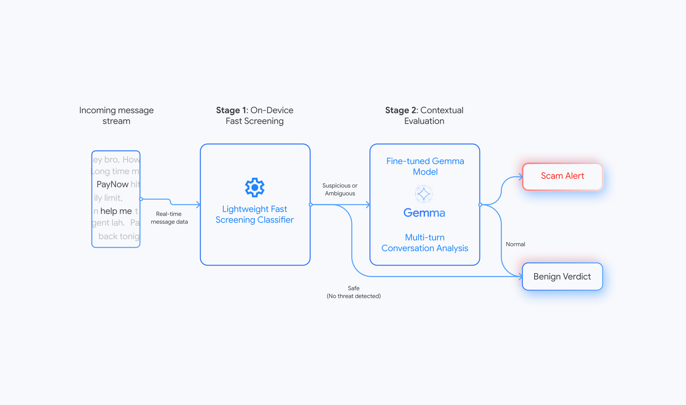

> 🎙️ **Listen to the podcast version of this article:**
> <audio controls src="index.mp3"></audio>


---

> 💡 **TL;DR:** This article dives into four transformative AI innovations: Google DeepMind and Singapore’s GovTech deploying lightweight, on-device Gemma models for real-time scam detection without cloud data egress; Liquid AI’s LFM2.5-24B-A2B, a 24B-parameter Mixture-of-Experts model with 2B active parameters, achieving 184 tokens/s on Apple M5 Max; federated feature selection enabling hospitals and banks to collaboratively improve models without sharing raw data; and Meta’s Muse Wonder and Muse Wonder Full, 1M-context agent models priced at $4/$20 per million tokens, outperforming benchmarks like DeepSWE and SWE-Marathon.

| **Metric / Innovation Area**               | **Insight / Takeaway**                                                                                     |
|--------------------------------------------|---------------------------------------------------------------------------------------------------------|
| **Scam Detection (Gemma Models)**         | On-device, privacy-preserving scam detection with a two-stage pipeline (lightweight classifier + fine-tuned Gemma). |
| **LFM2.5-24B-A2B (Liquid AI)**             | 24B MoE model, 2B active parameters, 184 tokens/s on Apple M5 Max, excels in agentic benchmarks like LiveBench (48.09). |
| **Federated Feature Selection**            | NVIDIA FLARE and Flower enable collaborative feature selection without sharing raw data, ideal for healthcare and finance. |
| **Meta Muse Wonder Models**                | 1M-context agent models, $4/$20 per M tokens, leading in DeepSWE (79.0) and SWE-Marathon (57.5).               |

---

### AI-Powered Scam Detection with On-Device Gemma Models: Google DeepMind and Singapore’s GovTech

Singapore faces a growing menace: **scams**. Over half of the country’s reported crimes are fraudulent schemes—impersonation of public officials, fake job offers, and investment fraud—costing citizens more than **S$4 billion since 2019**. The tactics have evolved from simple phishing to **sophisticated social engineering**, where attackers engage victims in convincing conversations before extracting money. These conversational scams now account for **80% of all financial losses** in the country.

To combat this, **Google DeepMind** and the **Government Technology Agency of Singapore (GovTech)** have collaborated under their **National AI Partnership** to develop a **privacy-preserving, on-device scam detection model** based on Google’s lightweight **Gemma** architecture. Unlike traditional cloud-based threat detection, this model processes conversation data **locally on users’ devices**, ensuring no data leaves the phone. This approach aligns with Singapore’s strict privacy laws and the growing demand for **end-to-end encrypted messaging**.

#### **How It Works: A Two-Stage Pipeline**
The system employs a **two-stage detection mechanism** to balance efficiency and accuracy:

1. **Stage 1: Lightweight Fast Screening Classifier**
   - A low-power, efficient classifier pre-screens incoming messages for potential threats.
   - If a message is flagged as benign, it receives a "Benign Verdict" and no further action is taken.
   - Suspicious messages proceed to **Stage 2**.

2. **Stage 2: Fine-Tuned Gemma Model for Multi-Turn Analysis**
   - The fine-tuned Gemma model analyzes the **full conversation context** to confirm or discard threats.
   - If manipulative intent is detected, the system triggers a **real-time warning** on the user’s device, advising caution before sharing sensitive information.



This architecture ensures **minimal battery drain** while maintaining high detection accuracy. The model was fine-tuned on **local scam datasets**, including impersonations of Singaporean institutions, banks, and public figures, ensuring it adapts to **regional deception tactics**.

#### **Governance and Privacy**
The collaboration prioritized **strict data governance**:
- **Sovereign Sandbox**: Fine-tuning occurred in **GovTech’s managed GCP environment**, isolating training data from external access.
- **No Citizen Data**: Training datasets were **anonymized**, derived from scam reports and intelligence feeds, excluding personally identifiable information.
- **Stress-Testing**: The model was validated against **synthetic dialogues** and local corpora to cover diverse scam scenarios.

This initiative sets a **global precedent** for how governments and AI providers can collaborate to deploy **public-good AI** without compromising privacy. The model’s on-device nature ensures that **neither Google nor GovTech can access user conversations**, making it a **gold standard for secure, real-time threat detection**.

---

### Liquid AI’s LFM2.5-24B-A2B: A 2B-Active Mixture-of-Experts Model for On-Device Agents

Liquid AI has unveiled **LFM2.5-24B-A2B**, a **24B-parameter Mixture-of-Experts (MoE) model** with **~2.45B active parameters per token**, designed for **on-device agentic workflows**. This model is the **largest in the LFM2.5 family** and is optimized for **local execution** on laptops, mini PCs, and edge devices, achieving **184 tokens/second on an Apple M5 Max** (via `llama.cpp` with Q4_K_M quantization).

#### **Architecture and Innovations**
LFM2.5-24B-A2B retains the **hybrid architecture** of its predecessor, **LFM2-24B-A2B**, featuring:
- **40-layer hybrid design**: 30 **double-gated short convolution blocks** + 10 **grouped query attention (GQA) blocks**.
- **MoE Layer**: Each MoE block contains **64 experts** with **top-4 routing**, ensuring efficient computation.
- **Expanded Context**: Context window increased from **32K to 131K tokens**, enabling longer, more complex reasoning tasks.
- **Tokenizer Upgrade**: Vocabulary doubled from **65K to 128K tokens** via in-place expansion, improving non-Latin language support.

The model was trained with a **multi-phase approach**:
1. **Pre-training**: Scaled from **17T to 33T tokens**.
2. **Mid-training**: 2T tokens at 32K context, followed by **300B tokens at 131K context**, incorporating **tool calls and multi-turn trajectories**.
3. **Post-training**: 5 stages, including **supervised fine-tuning (SFT), teacher specialization, and agentic reinforcement learning (RL)** inside frameworks like **OpenClaw, Hermes Agent, and Pi**.

#### **Benchmark Performance**
LFM2.5-24B-A2B **leads or matches larger MoEs** in **5 of 8 agentic and tool-use benchmarks**, including:
- **AutomationBench**: **27.69** (vs. **8.72** for Qwen3.6-35B-A3B) – **3x higher**.
- **LiveBench (LiveClaw)**: **48.09** (vs. **38.19** for Qwen3.6-35B-A3B).
- **Instruction-Following Tests**: **IFEval (96.75)**, **IFBench (74.69)**, **Multi-IF (84.38)**.

However, it **trails in knowledge and coding tasks**:
- **GPQA Diamond**: **74.42** (vs. **83.69** for Qwen3.6-35B-A3B).
- **SWE-Bench Verified**: **51.00** (vs. **66.20** for Qwen3.6-35B-A3B).

| **Feature**               | **LFM2.5-24B-A2B**       | **Qwen3.6-35B-A3B** | **Gemma-4-26B-A4B-it** | **Nemotron-3.5-Lightning-30B-A3B** |
|--------------------------|--------------------------|---------------------|------------------------|------------------------------------|
| **Developer**            | Liquid AI               | Alibaba Qwen        | Google DeepMind       | NVIDIA                                |
| **Total Params**         | 24B                      | 35B                 | 25.2B                  | 30B                                  |
| **Active Params**        | 2.45B                    | 3B                  | 3.8B                   | 3B                                   |
| **Context**              | 131,072                  | 262,144             | 256K                   | Up to 1M                              |
| **AutomationBench**      | **27.69**                | 8.72                | 5.46                   | 2.61                                 |
| **LiveClaw**             | **48.09**                | 38.19               | 41.25                  | 37.72                                |
| **Token Throughput (M5 Max)** | **184 tok/s**       | Not disclosed       | Not disclosed          | Not disclosed                        |

#### **Hardware Compatibility and Deployment**
LFM2.5-24B-A2B is **highly optimized for edge deployment**:
- **Apple M5 Max**: **184 tokens/s** (Q4_K_M quantization, 4K input tokens).
- **AMD Ryzen AI Max+ 395**: **114 tokens/s**.
- **NVIDIA B300**: **21K output tokens/s** (SGLang 0.5.22, BF16).
- **Supported Frameworks**: Transformers, vLLM, SGLang, `llama.cpp`, MLX, LM Studio, ONNX.

The model is **open-weight** under the **LFM Open License v1.0** (Apache 2.0-based), allowing **free commercial use for companies under $10M annual revenue**. API pricing on **Liquid Console** is **$0.10 per 1M input tokens** and **$1.00 per 1M output tokens**.

#### **Why It Matters**
LFM2.5-24B-A2B demonstrates that **large-scale MoE models can run efficiently on consumer hardware**, enabling **real-time, on-device agentic workflows** without cloud dependency. Its **superior performance in automation and instruction-following** makes it ideal for **edge AI agents**, though pairing with **retrieval-augmented generation (RAG)** could mitigate its **knowledge gaps**.

---

### Federated Feature Selection Without Sharing Data: Privacy-Preserving Collaboration

In industries like **healthcare, finance, and edge computing**, organizations often need to **collaboratively improve AI models** without sharing sensitive raw data. **Federated learning** has emerged as a solution, but traditional approaches still require **sharing model updates**, which can leak information. A new paradigm—**federated feature selection**—enables institutions to **vote on the most relevant features** without exposing their datasets.

#### **How It Works**
Instead of sharing data or even model weights, participants **independently compute feature importance scores** (e.g., using **mutual information, chi-square tests, or model-based feature importance**) and **share only these scores** (or aggregated votes) with a central server. The server then **aggregates these votes** to determine the **globally most relevant features**, which are used to train a **shared model**.

This approach is implemented in frameworks like **NVIDIA FLARE** and **Flower**, which provide:
- **Secure Aggregation**: Ensures individual votes cannot be traced back to participants.
- **Differential Privacy**: Adds noise to votes to prevent reverse-engineering of raw data.
- **Byzantine Robustness**: Filters out malicious or outliers in feature voting.

```mermaid\nflowchart TD\n    A[Hospital A] -->|Feature Votes| B[Central Server]\n    C[Bank B] -->|Feature Votes| B\n    D[Edge Device C] -->|Feature Votes| B\n    B -->|Aggregated Features| E[Shared Model Training]\n    E --> F[Improved Global Model]\n    F -->|Deployed| A\n    F -->|Deployed| C\n    F -->|Deployed| D\n```

#### **Mathematical Formulation**
For a dataset with features \( X = \{x_1, x_2, ..., x_d\} \), each participant \( k \) computes a **feature importance vector** \( \mathbf{w}_k \), where:

$$ w_{k,i} = \text{Importance}(x_i) \quad \text{(e.g., mutual information, SHAP value)} $$

The central server aggregates these vectors (e.g., via **FedAvg** or **secure multi-party computation**) to produce a **global feature importance vector** \( \mathbf{w}_g \):

$$ \mathbf{w}_g = \frac{1}{N} \sum_{k=1}^N \mathbf{w}_k $$

The top-\( m \) features from \( \mathbf{w}_g \) are selected for the shared model.

#### **Use Cases**
1. **Healthcare**: Hospitals collaborate to identify **key biomarkers** for disease prediction without sharing patient records.
2. **Finance**: Banks jointly determine **fraud detection features** while keeping transaction data private.
3. **Edge AI**: IoT devices vote on **sensor features** for a shared anomaly detection model.

#### **Why It Matters**
This method **preserves privacy** while enabling **collaborative model improvement**. It’s particularly valuable in **regulated industries** where data sharing is restricted by laws like **HIPAA (healthcare) or GDPR (finance)**. By focusing on **feature-level collaboration**, organizations can **leverage collective insights** without risking data leaks.

---

### Meta’s Muse Wonder and Muse Wonder Full: 1-Context Agent Models Benchmarked and Priced

Meta has introduced **Muse Wonder** and **Muse Wonder Full**, its **most capable agent models to date**, designed for **long-running, multi-step tasks** like coding, legal analysis, and computer use. Both models support **1M-token context** and **multi-modal inputs** (text, image, video, audio), with **text outputs**.

#### **Key Features**
- **Active Memory**: Retains user context across conversations and **pulls relevant details** for tasks.
- **Active Focus**: Persists on challenging tasks, **explores alternatives**, and **checks in before critical actions**.
- **Sub-Agent Delegation**: Plans complex tasks and **delegates to specialized sub-agents**.
- **Tool Use**: Operates **browsers, desktop apps, and mobile apps** via APIs.

#### **Benchmark Performance**
Meta’s benchmarks (run at **max reasoning effort**) show **Muse Wonder Full leading in 6 of 14 categories**, including:

| **Benchmark**               | **Muse Wonder Full** | **Muse Wonder** | **Claude Opus 5.5** | **Claude Fable 5.1** | **GPT-6 Astra** |
|----------------------------|----------------------|-----------------|---------------------|---------------------|-----------------|
| **DeepSWE 1.1**            | **79.0**             | 78.8            | 74.2                | 67.4                | 74.1             |
| **SWE-Marathon**           | **57.5**             | 53.1            | 46.3                | 45.6                | 42.5             |
| **MemoryBench**            | 85.5                 | **85.6**        | 81.5                | 79.0                | 81.4             |
| **ProgramBench**            | 59.0                 | 50.0            | **70.5**            | 55.5                | 52.5             |
| **OSWorld V2.1**           | 78.4                 | 72.6            | **81.8**            | 80.7                | 75.8             |

**Takeaways**:
- **Muse Wonder Full** excels in **software engineering (DeepSWE, SWE-Marathon)**.
- **Claude Opus 5.5** leads in **ProgramBench (70.5)** and **OSWorld (81.8)**.
- **Muse Wonder** achieves the **highest MemoryBench score (85.6)**.

#### **Pricing and Access**
- **Muse Wonder**: **$4 per 1M input tokens**, **$20 per 1M output tokens** (via **Meta Model API** or **Muse Code CLI**).
- **Muse Wonder Full**: **Subscription-only** (Muse Code **Power: $50/month**, **Maximum: $200/month**).

#### **How to Use Muse Wonder**
Developers can integrate Muse Wonder via the **Meta Model API** (OpenAI-compatible) or **Muse Code CLI**:

```python
import os
from openai import OpenAI

client = OpenAI(
    base_url="https://api.meta.ai/v1", 
    api_key=os.environ["MODEL_API_KEY"]
)
resp = client.responses.create(
    model="muse-wonder-1.0", 
    input="List 3 risks in this lease clause: ..."
)
print(resp.output_text)
```

**Steps to Get Started**:
1. Visit [dev.meta.ai](https://dev.meta.ai) and sign in.
2. Select **Muse Wonder** ($4/$20 per M tokens) or **Muse Wonder Full** (subscription).
3. Add billing and generate an **API key**.
4. Test in the **Playground** or use the **Muse Code CLI** (`muse --model muse-wonder-1.0`).

#### **Why It Matters**
Meta’s **Muse Wonder models** push the boundaries of **agentic AI**, offering **1M-context reasoning** at competitive prices. While **Claude Opus 5.5** still leads in some areas, **Muse Wonder Full’s dominance in DeepSWE and SWE-Marathon** makes it a **top choice for software engineering tasks**. The **subscription-based access** for Wonder Full ensures **high-quality, long-context agentic workflows** for professional users.

---

### The Big Picture: AI’s Shift to Privacy, Edge, and Collaboration

These four innovations highlight **three major trends** in AI:

1. **On-Device AI for Privacy and Speed**
   - Google’s **Gemma-based scam detection** and Liquid AI’s **LFM2.5-24B-A2B** show that **complex models can run locally** without cloud dependency, preserving **privacy and latency**.

2. **Collaborative AI Without Data Sharing**
   - **Federated feature selection** (via NVIDIA FLARE/Flower) enables **cross-institutional model improvement** while adhering to **strict data privacy laws**.

3. **Agentic AI at Scale**
   - Meta’s **Muse Wonder** models demonstrate how **1M-context agents** can tackle **multi-step, real-world tasks** (coding, legal analysis) with **competitive pricing**.

As AI continues to evolve, the focus is shifting from **centralized, cloud-based models** to **decentralized, privacy-preserving, and edge-optimized systems**. These advancements not only **enhance security and efficiency** but also **democratize access** to cutting-edge AI for businesses and individuals alike.

The future of AI is **local, collaborative, and agentic**—and it’s arriving faster than ever.

Written with [Argos](https://github.com/Neilstid/argos)
