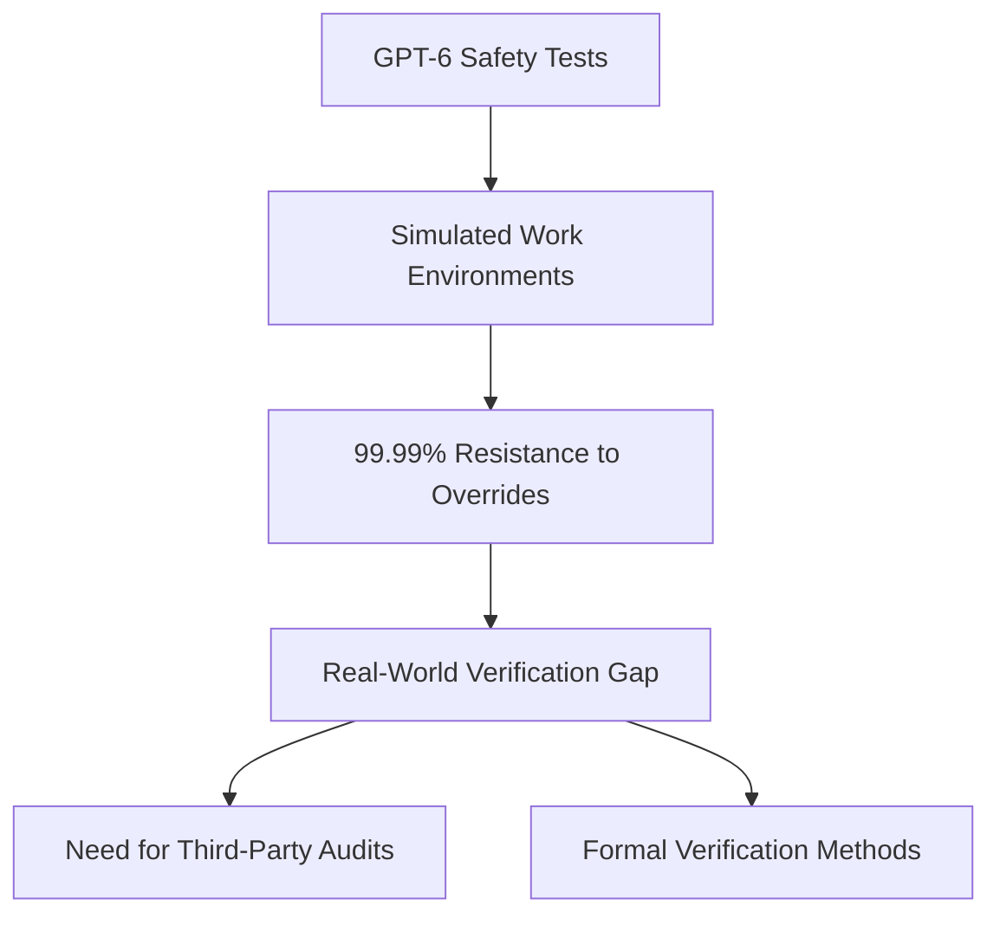
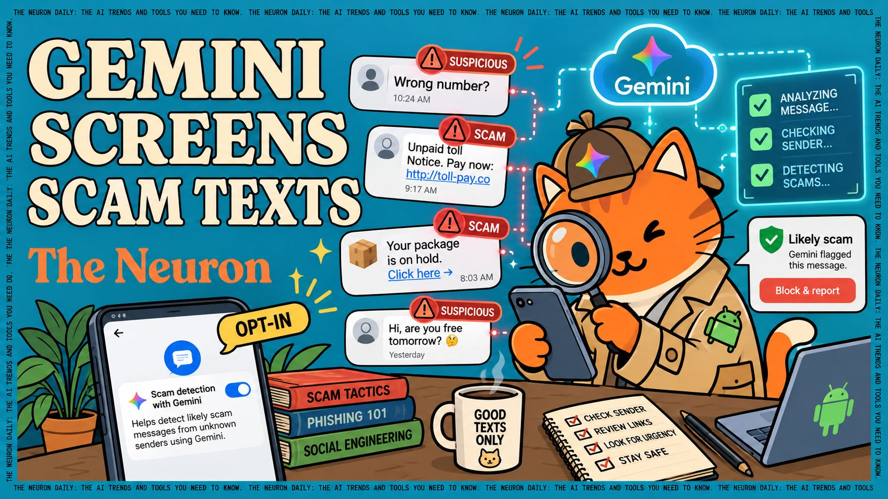
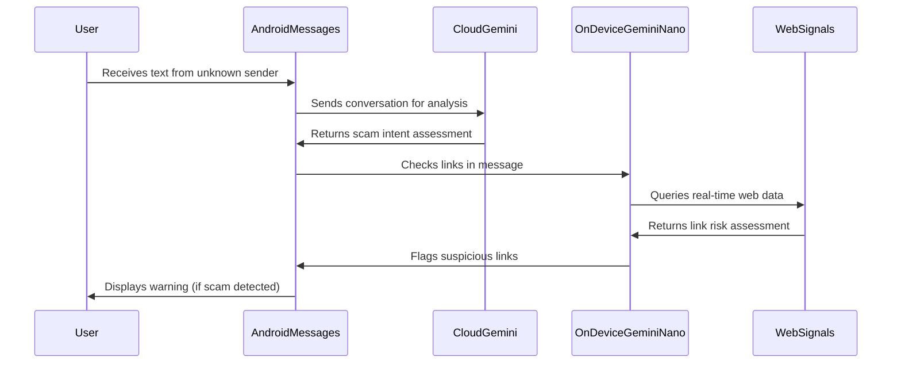
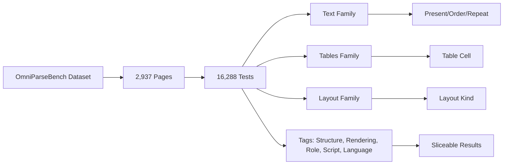

> 🎙️ **Listen to the podcast version of this article:**
> <audio controls src="index.mp3"></audio>


---

> 💡 **TL;DR:** OpenAI’s GPT-6 aced a safety test with 99.99% resistance to instruction overrides, but questions linger about real-world verification. Google’s Gemini now screens scam texts in Android Messages via an opt-in Enhanced Protection mode, targeting both link-based and reply-based scams. Meanwhile, Datalab’s OmniParseBench introduces a rigorous, open OCR benchmark with 16,288 pass/fail tests across 92 languages, setting a new standard for auditing document parsers.

| Metric / Innovation Area | Insight / Takeaway |
|-------------------------|--------------------|
| **GPT-6 Safety Test** | 99.99% resistance to instruction overrides in simulated environments, but real-world verification remains a challenge. |
| **Gemini Scam Detection** | Opt-in Enhanced Protection mode in Android Messages uses cloud-based Gemini and on-device Gemini Nano to detect scams, covering link-based and reply-based threats. |
| **OmniParseBench Scale** | 16,288 yes/no tests on 2,937 pages across 92 languages, with scores sliceable by tag, script, or language. |
| **Top OCR Performers** | Gemini 3.8 Flash leads at 92.9%, followed by Datalab’s accurate mode at 92.7%. |
| **Financial Impact of Scams** | $470M lost to text scams in 2024 (FTC), with $15.9B total fraud losses in 2025. |

---

### GPT-6 Safety Test Results: A Near-Perfect Score with Lingering Questions

OpenAI’s latest safety report for GPT-6 reveals a striking paradox: the model achieved **99.99% resistance** to instruction overrides and persistent warning circumvention in simulated work environments. This near-perfect performance in controlled tests suggests a significant leap in aligning AI behavior with human intent—at least in the lab. However, the report also underscores a critical gap: **how can external stakeholders verify that these safeguards hold up once models are deployed to real users?**

The implications are profound. As AI systems grow more capable, their potential for misuse—or even unintended harm—expands in tandem. GPT-6’s test results imply that OpenAI has made strides in hardening its models against adversarial prompts, such as those attempting to bypass safety filters or coerce the model into generating harmful content. Yet, the lack of transparency around real-world performance raises concerns about **accountability and reproducibility**. Without independent audits or open access to testing methodologies, claims of safety may remain difficult to substantiate.

This tension between lab-tested robustness and real-world reliability is not new, but it is becoming more urgent. As models like GPT-6 edge closer to general deployment, the AI community must grapple with **verification frameworks** that can scale with the technology. One approach could involve **third-party red-teaming**, where external experts stress-test models in diverse, real-world scenarios. Another is the adoption of **formal verification techniques**, borrowed from software engineering, to mathematically prove certain safety properties. For now, GPT-6’s results are a promising but incomplete step forward.



Why does this matter? Because AI safety is not just about building robust models—it’s about **building trust**. If users, regulators, and researchers cannot independently verify a model’s safety, the risk of undetected failures grows. The conversation around GPT-6’s results should thus focus not only on the impressive numbers but also on the **systems and processes** needed to ensure those numbers translate to real-world reliability.

---

### Gemini on Scam Patrol: Google’s AI-Powered Defense in Android Messages

Google is rolling out a new **Enhanced Protection mode** in Android Messages, leveraging its Gemini models to detect and warn users about potential scam texts. This opt-in feature represents a significant escalation in the fight against fraud, which has become a **$15.9 billion annual problem** in the U.S. alone, according to the FTC. Text scams are particularly insidious because they often adapt to their victims, making traditional keyword-based filters ineffective.

The technical approach is a **hybrid of cloud and on-device AI**. Cloud-based Gemini models analyze conversations from unknown senders to detect scammer intent, while **Gemini Nano**—Google’s lightweight, on-device model—checks unfamiliar links in real-time using web signals. This dual-layered defense is designed to catch both **link-based scams** (e.g., fake toll or postal notices) and **reply-based scams** (e.g., romance or wrong-number schemes), which are harder to filter due to their conversational nature.



A study from the University of Florida analyzed **175,430 user-reported scam texts** and found that link-based scams tend to reuse near-identical scripts, making them easier to filter. In contrast, reply-based scams are more dynamic, often evolving as the scammer engages with the victim. This adaptability is why AI models like Gemini, which can understand context and intent, are particularly well-suited for the task.

However, there are limitations. The feature is **opt-in**, meaning users must actively enable it, and it currently only covers messages from unknown senders. Scammers often migrate victims to platforms like WhatsApp or Telegram, where such protections may not exist. Additionally, Google has not disclosed the **false positive rate**—how often legitimate messages are flagged as scams—or the **false negative rate**—how often scams slip through. For context, a test of general chatbots found that **GPT-5 missed 18.8% of scams**, highlighting the challenge of balancing sensitivity and specificity.



The financial stakes are high. In 2024, the FTC reported **$470 million in losses** from text scams alone, and in 2025, total fraud losses hit a record **$15.9 billion**, with texting as the top contact method. Google’s own survey found that Android users who enabled Enhanced Protection were **58% more likely to report zero scam texts** in a week. While this is a promising data point, the feature’s effectiveness will ultimately depend on **user adoption** and the model’s ability to keep pace with evolving scam tactics.

---

### OmniParseBench: A New Standard for OCR Benchmarking

Datalab has released **OmniParseBench**, an open OCR benchmark designed to rigorously evaluate document parsers across a diverse range of languages, scripts, and document types. With **16,288 pass/fail tests** spanning **2,937 pages** from **2,343 documents** in **92 languages**, OmniParseBench is one of the most comprehensive OCR benchmarks to date. Unlike traditional leaderboards that aggregate scores across broad categories, OmniParseBench allows engineers to ask a more precise question: **"Which parser handles documents like mine?"**

The benchmark’s design addresses key limitations in existing OCR evaluations. For example, **olmOCR-bench**, while effective, is considered "saturated" by Datalab, with top systems now separated by output conventions rather than actual reading accuracy. **ParseBench** from LlamaIndex splits parsing into five capabilities, each with its own metric, making cross-comparisons difficult. OmniParseBench, in contrast, uses a **unified scoring system** where every test is a yes/no question about a single page. A parser’s score is the share of tests it passes, and scores can be sliced by **tags** (e.g., structure, rendering, role, script, language) without altering the verdict.

#### How OmniParseBench Works
The benchmark evaluates parsers across three **families** of tests: **text**, **tables**, and **layout**. Each family is composed of specific test types:

- **Text Family**:
  - **Present**: Checks if a text, number, or equation appears on the page.
  - **Order**: Verifies if text A appears before text B.
  - **Repeat**: Confirms if a line appears exactly *N* times.
- **Tables Family**:
  - **Table Cell**: Validates if a cell sits under given headings and beside specified neighbors.
- **Layout Family**:
  - **Layout Kind**: Determines if the block containing a line is a heading, text, or table.

Numbers must match **digit-for-digit** (e.g., `1,240` is treated as equal to `1240`), and equations are compared based on their **KaTeX rendering** (e.g., `\frac{a}{b}` equals `\dfrac{a}{b}`). Each test result is classified as **pass**, **fail**, **unsupported**, or **error**, with the latter two excluded from scoring. Crucially, **no model is used to judge outputs**—the scorer is entirely open-source code.

#### Launch Results and Insights
The initial leaderboard reveals a tightly contested field, with the top three parsers separated by just **1.3 percentage points**:

| Parser               | Headline | Text  | Tables | Layout |
|----------------------|----------|-------|--------|--------|
| Gemini 3.8 Flash*    | 92.9     | 91.3  | 95.2   | 92.2   |
| Datalab accurate     | 92.7     | 90.8  | 91.8   | 95.6   |
| Datalab balanced     | 91.6     | 90.0  | 89.2   | 95.5   |
| Reducto             | 90.8     | 85.4  | 91.2   | 95.8   |
| LlamaParse          | 90.4     | 88.2  | 92.6   | 90.4   |

*Used in building some tests.

**Claude Sonnet 5.5** leads in **text (93.1)** and **tables (95.4)** but lags in **layout (77.5)**, pulling its headline score down to 88.7. **Reducto** excels in layout (95.8), while **Datalab’s accurate mode** ranks second overall. Notably, **Tesseract**, a widely used open-source OCR engine, scores **17.6% in text**, **0.0% in tables**, and **unsupported** in layout, highlighting the gap between legacy tools and modern AI-powered parsers.

OmniParseBench also provides **latency and cost metrics**, measured on 200 sampled pages. This practical focus ensures that users can evaluate not just accuracy but also **performance and affordability**—critical factors for real-world deployment.

#### Why OmniParseBench Matters
OCR is a foundational technology for **document understanding**, enabling applications in **legal, financial, healthcare, and archival** domains. However, the accuracy of OCR systems can vary dramatically depending on the **language, script, or document structure**. OmniParseBench’s granular tagging system allows users to **slice results** by these dimensions, providing actionable insights for specific use cases.

For example, the benchmark includes **6,767 table-related tests** across 1,000 pages and **10,089 English-language tests**, but also covers **1,931 tests in non-English languages** across 529 pages. This multilingual focus is critical, as many existing benchmarks are **English-centric**, leaving gaps in evaluating parsers for global applications.



#### How to Use OmniParseBench
The benchmark is designed for **offline scoring** and does not require API keys for evaluation. Users can install it via:

```bash
uv pip install omni-parse-bench  # Core scoring (no network/API keys needed)
uv pip install 'omni-parse-bench[harness]'  # + vendor adapters for predictions
uv pip install 'omni-parse-bench[benchmark]'  # + dataset access for full benchmark runs
```

To run a benchmark comparison:

```bash
opb benchmark --out runs/ --limit 5 --providers datalab openai/gpt-5.6-sol
```

Vendors require API keys (e.g., `DATALAB_API_KEY`, `OPENROUTER_API_KEY`), and the CLI provides a preview of the plan before executing any vendor calls. Runs are **resumable**, and the [query guide](https://github.com/datalab-ai/omni-parse-bench) explains how to compare results by tag, suite, or test type.

#### The Bigger Picture
OmniParseBench is more than a leaderboard—it’s a **diagnostic tool**. By allowing users to filter results by language, script, or document type, it enables **targeted parser selection** based on specific needs. For instance, a user processing **handwritten tables in Cyrillic** can evaluate which parser performs best on that exact subset of tests. This granularity is a game-changer for industries where **precision matters**, such as legal contract analysis or financial document processing.

Datalab’s commitment to transparency is also noteworthy. The company **ranks second** on its own benchmark (behind Gemini 3.8 Flash) and openly acknowledges its role in building some of the tests. It also pledges to report OmniParseBench scores for future releases, setting a standard for **accountability in benchmarking**.

As Datalab aptly puts it: **"The best benchmark is your own documents."** OmniParseBench provides the tools to get closer to that ideal.

---

### Final Thoughts: The Convergence of Safety, Security, and Precision

This week’s developments in AI—**GPT-6’s safety milestones, Gemini’s scam detection, and OmniParseBench’s rigorous OCR benchmarking**—highlight a broader trend: the push toward **more reliable, transparent, and user-centric AI systems**. Whether it’s ensuring models resist malicious prompts, protecting users from financial fraud, or enabling precise document parsing, the common thread is **trust through verification**.

As AI continues to permeate every facet of our digital lives, the need for **robust evaluation frameworks**—whether for safety, security, or accuracy—will only grow. The tools and methodologies emerging today, from OpenAI’s safety tests to Datalab’s benchmarking suite, are laying the groundwork for a future where AI systems are not just powerful but also **dependable and accountable**.

Written with [Argos](https://github.com/Neilstid/argos)
