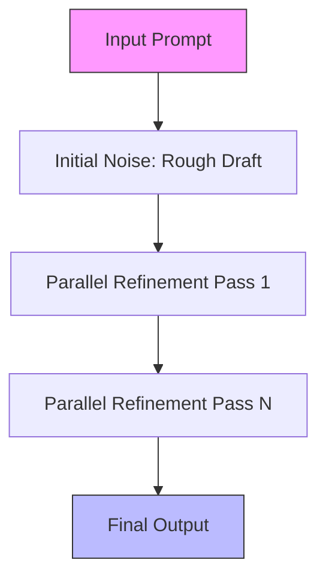
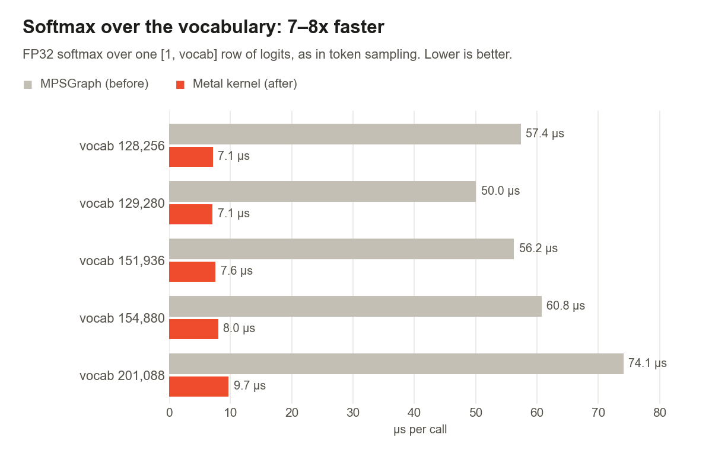
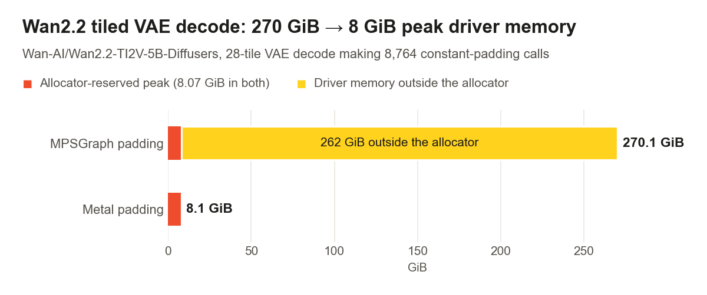

> 🎙️ **Listen to the podcast version of this article:**
> <audio controls src="index.mp3"></audio>


---

> 💡 **TL;DR:** Inception’s Mercury 3 diffusion LLM redefines speed with 1,068 tokens per second and a 1M-token context, outpacing GPT-6 Luna and Claude Haiku 5.5 on 8 of 12 benchmarks. Google’s Gemini 4 Argon introduces a million-token output window, catering to long-context applications. Meanwhile, PyTorch 2.15’s MPS backend brings FP8 tensor support, 5–6.5× speedups for MoE models, and an 8× faster softmax to Apple silicon, slashing video decoding memory from 270 GiB to 8 GiB.

| Metric / Innovation Area | Insight / Takeaway |
|---|---|
| **Mercury 3 Speed** | 1,068 tokens/sec (vs. ~130 for GPT-6 Luna, ~240 for Haiku 5.5) |
| **Mercury 3 Context** | 1M-token window, competitive with GPT-6 Luna (1.05M) and Haiku 5.5 (1M) |
| **Benchmark Leadership** | Leads 8/12 tests (e.g., SWE-Bench Atlas: 51.08 vs. 33.33/32.26) |
| **Gemini 4 Argon Output** | Million-token output window, ideal for long-form generation |
| **PyTorch 2.15 MPS FP8** | Halves memory usage for tensors (1 byte/value vs. 2 for BF16) |
| **MoE Speedup (PyTorch 2.15)** | 5–6.5× faster decoding (e.g., Qwen3.6-35B-A3B: 9.4 → 61.3 tokens/sec) |
| **Softmax Acceleration** | 8× faster (FP32 softmax: 57 µs → 7 µs for 128K vocab) |
| **Video Decoding Memory** | Wan2.2 VAE: 270 GiB → 8 GiB peak driver memory |

---

### Inception’s Mercury 3: The Diffusion LLM That Outruns Autoregressive Rivals

The race for faster, more efficient large language models (LLMs) has taken a dramatic turn with Inception’s **Mercury 3**, a diffusion-based LLM that generates text in parallel rather than token-by-token. This architectural shift—inspired by diffusion models in computer vision—enables Mercury 3 to achieve a blistering **1,068 tokens per second** on NVIDIA GPUs, a 40× scale-up from its predecessor, Mercury 1. The model also boasts a **1M-token context window**, putting it on par with frontier models like GPT-6 Luna and Claude Haiku 5.5.

#### How Diffusion LLMs Work
Unlike traditional autoregressive models, which generate text sequentially (each token waiting for the previous one), diffusion LLMs start with a "rough draft" of the entire output and refine it in parallel across multiple passes. This approach reduces sequential dependencies, unlocking unprecedented speed. The trade-off? Proving that diffusion scales with model size and complexity. Inception’s results suggest it does: Mercury 3’s average quality across benchmarks improved **3×** over Mercury 1, while maintaining speeds above 1,000 tokens/sec.



#### Benchmark Dominance (and a Few Blind Spots)
Inception’s self-reported benchmarks pit Mercury 3 against GPT-6 Luna and Claude Haiku 5.5 across 12 tasks. The results are striking:
- **SWE-Bench Atlas**: Mercury 3 scores **51.08**, crushing Luna (33.33) and Haiku (32.26) by ~18 points.
- **IFBench (Instruction Following)**: **76.84** (vs. 61.82 for Luna, 54.65 for Haiku).
- **GPQA Diamond**: **89.23** (vs. 86.36 and 84.51).

However, Haiku 5.5 retains the edge in **DeepSWE v1** (51.62 vs. 46.31) and **MRCR v2** (78.40 vs. 75.50), highlighting that long-context retrieval and complex coding tasks remain challenging for Mercury 3. GPT-6 Luna also narrowly leads in **AA-Omniscience-Public** (46.94 vs. 46.44) and **AA-LCR v1.1** (78.30 vs. 77.67).

#### Why It Matters
For developers building **agents, voice bots, and search tools**, Mercury 3’s speed-first design is a game-changer. Early adopters report sub-second latency:
- **Octen AI**: 0.9s median generation time for smart-glasses search (2.2s end-to-end).
- **RevisionDojo**: Hints and marked answers returned in ~1s.
- **TinyFish**: 50% completion rate on 50 live Mind2Web navigation tasks (outperforming GPT-6.1-Sol, per Inception).

Mercury 3 is available via Inception’s API, OpenRouter, Baseten, and Vercel, with **OpenAI-compatible endpoints** and a `reasoning_effort` parameter. Pricing starts at **$0.10/$0.35 per 1M input/output tokens** (50% off list price during launch).

**Key Takeaway**: Diffusion LLMs are no longer a theoretical curiosity—they’re a practical alternative to autoregressive models, especially where speed and parallelism are critical.

---

### Google Gemini 4 Argon: The Million-Token Output Window for Long-Context Masters

While Mercury 3 excels in speed, **Google’s Gemini 4 Argon** targets a different frontier: **long-form generation**. With a **million-token output window**, Argon is designed for applications where context length and coherence over extended interactions are paramount—think **legal document analysis, multi-turn coding sessions, or creative writing with deep narrative continuity**.

#### Who Benefits Most?
Gemini 4 Argon’s strengths align with use cases that demand:
1. **Extended Reasoning Chains**: Tasks requiring the model to maintain context across hundreds of thousands of tokens (e.g., debugging large codebases or synthesizing research papers).
2. **Multi-Modal Long-Form Generation**: Combining text and images in outputs that span thousands of tokens without losing coherence.
3. **Batch Processing**: Generating or analyzing large volumes of text in a single pass (e.g., summarizing lengthy reports or generating comprehensive documentation).

#### Benchmark Highlights
While specific benchmark numbers for Argon are sparse, Google’s focus on **output length** and **context retention** suggests it will outperform in:
- **Long-Context Q&A**: Answering questions about documents exceeding 100K tokens.
- **Code Generation**: Producing or refining large codebases with consistent style and logic.
- **Creative Writing**: Maintaining character arcs, themes, and stylistic consistency over long narratives.

**Pricing and Availability**: Details remain under wraps, but expect Argon to be positioned as a premium offering for enterprise and high-end developer use cases.

**Why It Matters**: As models like Argon push the boundaries of context length, we’re inching closer to **AGI-like coherence** in specialized domains. The million-token window isn’t just a spec—it’s a paradigm shift for applications where context is king.

---

### PyTorch 2.15’s MPS Backend: A Quantum Leap for Apple Silicon

Apple’s M-series chips have long been the underdog in the AI hardware race, but **PyTorch 2.15’s MPS backend** changes the game. Developed in collaboration with Hugging Face, this update delivers **dramatic performance improvements** for Mac users, making Apple silicon a first-class citizen for AI workloads.

#### FP8 Tensor Support: Halving Memory Usage
PyTorch 2.15 introduces **`torch.float8_e4m3fn`** tensors on MPS, storing values in **1 byte per element** (vs. 2 bytes for BF16). This halves memory usage for compatible operations, enabled via **scaled matrix multiplication** (`F.scaled_mm`). Here’s how it works in practice:

```python
import torch
import torch.nn.functional as F

def quantize_fp8(x):
    limit = torch.finfo(torch.float8_e4m3fn).max
    scale = x.abs().amax().clamp_min(1e-12) / limit
    return (x / scale).to(torch.float8_e4m3fn), scale

x = torch.randn(1, 1024, device="mps", dtype=torch.float32)
weight = torch.randn(1024, 1024, device="mps", dtype=torch.float32)
x_fp8, x_scale = quantize_fp8(x)
w_fp8, w_scale = quantize_fp8(weight)
y = F.scaled_mm(
    x_fp8,
    w_fp8.t(),
    scale_a=x_scale,
    scale_recipe_a=F.ScalingType.TensorWise,
    scale_b=w_scale,
    scale_recipe_b=F.ScalingType.TensorWise,
    output_dtype=torch.bfloat16,
)
```

#### Mixture-of-Experts (MoE) Speedups: 5–6.5× Faster Decoding
MoE models like **Qwen3.6-35B-A3B** see massive gains on Apple silicon:
- **M3 Ultra with `torch.compile`**: Decoding speed jumps from **9.4 to 61.3 tokens/sec** (6.5× improvement).
- **LFM2.5-8B-A1B**: **23.6 → 123.6 tokens/sec** (5.2×).

The secret? A **native grouped matmul kernel** that avoids CPU-GPU syncs and optimizes top-k routing. Here’s the workflow:

```mermaid
sequenceDiagram
    participant CPU
    participant GPU
    CPU->>GPU: Input Tokens (Grouped)
    GPU->>GPU: Grouped Matmul (Native Metal Kernel)
    GPU->>GPU: Top-K Routing (On-GPU)
    GPU->>CPU: Output Tokens
    Note: No CPU-GPU syncs during decoding
```

#### Softmax and Linear Algebra: 8× Faster
- **Softmax**: FP32 softmax over a 128K vocabulary row drops from **57 µs to 7 µs** (8× speedup).
  
- **Linear Layers**: Single-row matrix-vector multiplications (critical for decoding) see a **1.23× geometric-mean speedup** across 96 layer shapes.
- **Linear Algebra**: Complex LU solves, triangular solves, and QR decomposition now run natively on GPU, with **blocked updates for QR** and **dedicated kernels for small matrices** (e.g., 4×4 to 64×64).

#### Video Decoding: From 270 GiB to 8 GiB
One of the most dramatic improvements comes from **constant padding optimizations**. The Wan2.2 tiled VAE decode, which previously pushed driver memory to **270 GiB**, now peaks at **~8 GiB**—a **33× reduction**. This unlocks **local video generation** on Macs without running out of memory.



#### What’s Next for PyTorch 2.16?
The roadmap includes:
- **Fully Metal-based attention**: Scaled dot-product attention will drop MPSGraph entirely, with **dedicated vector kernels for decoding** and Metal Performance Primitives for prefill.
- **More MPSGraph-to-Metal migrations**: Batch norm, MSE loss (up to 12× faster), and `bincount` (4M integers in 0.5ms vs. 6.8s).
- **Smaller install size**: Bundled shaders shrink `libtorch_cpu.dylib` by **25%** (384 MiB → 287 MiB).

**Why It Matters**: PyTorch 2.15 turns Apple silicon into a **viable alternative to CUDA** for many workloads. For developers on Macs, this means:
- Faster local LLM inference (especially for MoE models).
- Lower memory usage for video and image tasks.
- Native support for more operations, reducing the need for workarounds.

---

### The Big Picture: Where We’re Headed

These three advancements—**Mercury 3’s diffusion speed, Gemini 4 Argon’s long-context prowess, and PyTorch 2.15’s MPS optimizations**—paint a clear picture of the AI landscape’s evolution:

1. **Speed vs. Context**: Mercury 3 and Argon represent two sides of the same coin. Mercury 3 prioritizes **throughput** (tokens/sec), while Argon focuses on **context length** (tokens/output). The ideal model may eventually combine both.
2. **Hardware Democratization**: PyTorch 2.15’s MPS backend proves that **Apple silicon can compete** with NVIDIA GPUs for many tasks, lowering the barrier to entry for AI development.
3. **Architectural Innovation**: Diffusion LLMs like Mercury 3 challenge the dominance of autoregressive models, while MoE architectures (accelerated by PyTorch 2.15) offer a path to **scalable, efficient inference**.

**Final Thought**: The next generation of AI models won’t just be bigger—they’ll be **faster, more context-aware, and more accessible** than ever before. Whether you’re a developer building agents, a researcher pushing the boundaries of long-form generation, or a Mac user running models locally, these breakthroughs are worth watching closely.

Written with [Argos](https://github.com/Neilstid/argos)
