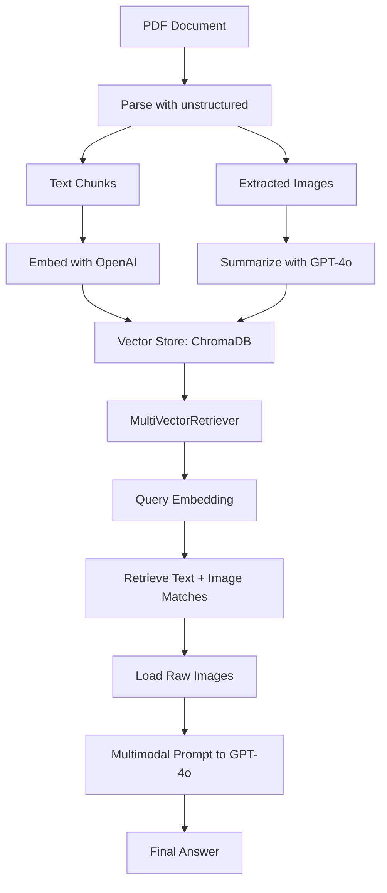

> 🎙️ **Listen to the podcast version of this article:**
> <audio controls src="index.mp3"></audio>


---

> 💡 **TL;DR:** This article dives into three pivotal advancements in AI: a hands-on tutorial for building a multi-modal RAG pipeline that unifies text and image retrieval, an analysis of spatial reasoning limitations in current vision-language models, and Google’s open-sourcing of TorchTPU—a native PyTorch backend for Cloud TPUs that delivers up to 52% MFU in LLM training and seamless integration with frameworks like vLLM and Hugging Face.

| **Metric / Innovation Area**               | **Insight / Takeaway**                                                                                     |
|-------------------------------------------|----------------------------------------------------------------------------------------------------------|
| **Multi-Modal RAG Pipeline**              | Combines `unstructured`, LangChain, and GPT-4o to parse, summarize, and retrieve text + images from PDFs. |
| **Spatial Reasoning Gaps**                | Grid-puzzle tasks reveal VLMs struggle with spatial logic, highlighting a key area for improvement.       |
| **TorchTPU Performance**                  | 52% MFU on Qwen 3 8B, near-linear scaling to 8,192 TPUs, and 3.80x speedup with `torch.compile`.             |
| **TorchTPU Integration**                  | Native PyTorch device (`tpu`), replaces PyTorch/XLA, supports vLLM, SGLang, and Hugging Face Transformers. |

---

### Building a Multi-Modal RAG Pipeline for Images and Documents in Python

The rise of **Retrieval-Augmented Generation (RAG)** has transformed how AI systems interact with unstructured data. Yet, traditional RAG pipelines often hit a wall when faced with **multi-modal documents**—PDFs packed with charts, diagrams, or tables where critical insights reside in visual elements, not just text. Standard text-based chunking destroys formatting, omits images, and leaves models answering questions from an incomplete picture.

Enter the **multi-modal RAG pipeline**, a solution that treats images as first-class retrievable objects alongside text. This tutorial walks through a Python implementation using **LangChain**, the `unstructured` library, and **GPT-4o** to parse, summarize, store, and query documents with both textual and visual content. The pipeline’s architecture is designed for business use cases, running on standard hardware while leveraging API-driven components for scalability.


#### **Architecture Overview**
The pipeline consists of four key stages:
1. **Parse**: Use `unstructured.partition.pdf()` to decompose a PDF into text chunks, tables, and embedded images.
2. **Summarize**: Generate searchable text summaries for images using GPT-4o’s vision capabilities.
3. **Store**: Index both text and image summaries in a **multi-vector retrieval system** (ChromaDB) while linking raw content in a document store.
4. **Retrieve & Query**: Embed a user’s query, retrieve matching text/image summaries, and pass raw images + text to GPT-4o for a grounded answer.

Below is a **Mermaid diagram** illustrating the workflow:



#### **Step-by-Step Implementation**
**1. Parsing the Document**
The `unstructured` library classifies each PDF element by type (paragraph, table, image) and extracts them separately. Here’s how to parse a PDF and separate text from images:

```python
from unstructured.partition.pdf import partition_pdf

raw_elements = partition_pdf(
    filename="report.pdf",
    extract_image_block_types=["Image"],
    extract_image_block_output_dir="./extracted_images",
    infer_table_structure=True,
    chunking_strategy="by_title",
    max_characters=4000,
)

text_elements = []
image_paths = []
for el in raw_elements:
    if "CompositeElement" in str(type(el)):
        text_elements.append(str(el))
    elif "Image" in str(type(el)):
        image_paths.append(el.metadata.image_path)
print(f"Extracted {len(text_elements)} text chunks, {len(image_paths)} images")
```

**2. Generating Image Summaries**
Since vector databases can’t index raw images, each image is passed to **GPT-4o** to generate a dense, searchable description:

```python
import base64
from openai import OpenAI

client = OpenAI()

def summarize_image(image_path):
    with open(image_path, "rb") as f:
        image_data = base64.b64encode(f.read()).decode("utf-8")
    response = client.chat.completions.create(
        model="gpt-4o",
        messages=[{
            "role": "user",
            "content": [
                {"type": "image_url", "image_url": {"url": f"data:image/png;base64,{image_data}"}},
                {"type": "text", "text": "Describe this image in detail for use in a search system."}
            ]
        }]
    )
    return response.choices[0].message.content

image_summaries = [summarize_image(p) for p in image_paths]
```

**3. Multi-Vector Storage**
A `MultiVectorRetriever` (from LangChain) maintains two stores:
- **Vector Store**: Holds embeddings of text chunks and image summaries (using `text-embedding-3-small`).
- **Document Store**: Stores raw content (text or image paths) linked via unique IDs.

```python
import uuid
from langchain_openai import OpenAIEmbeddings
from langchain_chroma import Chroma
from langchain.storage import InMemoryStore
from langchain.retrievers.multi_vector import MultiVectorRetriever
from langchain_core.documents import Document

embeddings = OpenAIEmbeddings(model="text-embedding-3-small")
vectorstore = Chroma(embedding_function=embeddings)
docstore = InMemoryStore()
retriever = MultiVectorRetriever(vectorstore=vectorstore, docstore=docstore)

text_ids = [str(uuid.uuid4()) for _ in text_elements]
image_ids = [str(uuid.uuid4()) for _ in image_summaries]

# Populate vector store with embeddings
retriever.vectorstore.add_documents(
    [Document(page_content=t, metadata={"doc_id": i}) for t, i in zip(text_elements + image_summaries, text_ids + image_ids)]
)

# Populate document store with raw content
raw_docs = (
    [Document(page_content=t, metadata={"type": "text"}) for t in text_elements] +
    [Document(page_content=p, metadata={"type": "image"}) for p in image_paths]
)
retriever.docstore.mset(list(zip(text_ids + image_ids, raw_docs)))
```

**4. Querying with Multimodal Retrieval**
At query time, the retriever fetches matching text and image summaries. Raw images are loaded, base64-encoded, and passed to GPT-4o alongside text for a **grounded answer**:

```python
def query_pipeline(question):
    docs = retriever.invoke(question)
    text_content, image_content = [], []
    for doc in docs:
        if doc.metadata.get("type") == "image":
            with open(doc.page_content, "rb") as f:
                img_b64 = base64.b64encode(f.read()).decode("utf-8")
                image_content.append({"type": "image_url", "image_url": {"url": f"data:image/png;base64,{img_b64}"}})
        else:
            text_content.append({"type": "text", "text": doc.page_content})
    
    response = client.chat.completions.create(
        model="gpt-4o",
        messages=[{"role": "user", "content": text_content + image_content + [{"type": "text", "text": question}]}]
    )
    return response.choices[0].message.content

answer = query_pipeline("What does the revenue chart show for Q3?")
print(answer)
```

#### **Why It Matters**
This pipeline addresses a critical gap in traditional RAG: **documents where visuals convey essential information**. Financial reports, research papers, and product manuals often rely on charts, diagrams, or tables to communicate key insights. By treating images as retrievable objects, this approach ensures models have access to the *full* context of a document, not just its text.

**Future Outlook**: Extensions could include:
- **Re-ranking** to improve retrieval precision.
- **Persistent vector stores** (e.g., ChromaDB on disk) for production.
- **Vision-language models** like ColPali that embed entire document pages as images, skipping the parsing step.

---

### Spatial Reasoning in AI Models, Taken Apart

While **vision-language models (VLMs)** have made strides in tasks like image captioning and visual question answering, their ability to handle **spatial reasoning**—understanding relationships like *left of*, *above*, or *between*—remains a weak spot. Recent research using **grid-puzzle tasks** (where objects are arranged in a grid and must be manipulated based on spatial logic) has exposed these limitations, revealing that even state-of-the-art models struggle where humans excel effortlessly.

#### **The Grid-Puzzle Challenge**
Grid puzzles are deceptively simple for humans but notoriously difficult for AI. For example:
- *Task*: "Move the red square to the left of the blue circle."
- *Human Performance*: Near-perfect accuracy.
- *VLM Performance*: Often fails to interpret directional relationships or misaligns objects.

These tasks highlight a **fundamental gap** in how VLMs process spatial information. Unlike humans, who inherently understand spatial hierarchies, VLMs often treat visual scenes as **flat collections of objects** without robust relational reasoning.

#### **Why Spatial Reasoning Matters**
Spatial reasoning is critical for applications like:
- **Robotics**: Navigating environments or manipulating objects.
- **Autonomous Vehicles**: Understanding traffic scenes (e.g., "the pedestrian is to the left of the car").
- **Augmented Reality**: Placing virtual objects in real-world contexts.
- **Medical Imaging**: Interpreting scans where anatomical relationships are key.

#### **Current Limitations and Paths Forward**
Research identifies several **bottlenecks** in VLM spatial reasoning:
1. **Lack of Explicit Spatial Representations**: Most VLMs rely on **implicit** spatial understanding from pre-training data, which may not generalize to novel arrangements.
2. **Tokenization of Space**: Spatial relationships are often encoded as text (e.g., "left", "right"), but VLMs may not ground these tokens in visual features effectively.
3. **Training Data Bias**: Existing datasets (e.g., VQA, COCO) rarely test fine-grained spatial logic, leading to **underdeveloped capabilities** in this area.

**Potential Solutions**:
- **Spatial-Aware Architectures**: Incorporate **graph neural networks (GNNs)** or **transformers with spatial attention** to explicitly model relationships.
  - Example: Use a **spatial transformer layer** where the attention score between two objects is weighted by their relative positions:
    $$\text{Attention}(Q, K, V) = \text{softmax}\left(\frac{QK^T + \text{SpatialBias}}{\sqrt{d_k}}\right)V$$
- **Synthetic Data**: Generate grid-puzzle datasets with **programmatic control** over spatial relationships to train models more effectively.
- **Multi-Task Learning**: Combine spatial reasoning tasks with standard VLM objectives to encourage **emergent spatial capabilities**.

#### **The Road Ahead**
Improving spatial reasoning in VLMs requires a **multi-disciplinary approach**, blending insights from **cognitive science** (how humans process space) with **AI architecture design**. As models grow larger, their ability to **implicitly** learn spatial logic may improve, but explicit architectural innovations will likely be necessary to close the gap entirely.

---

### Google Open-Sources TorchTPU: A Native PyTorch Backend for Cloud TPUs

Google’s recent open-sourcing of **TorchTPU** marks a significant milestone in the democratization of **TPU (Tensor Processing Unit) acceleration** for PyTorch users. Developed in collaboration with Meta, TorchTPU is a **native PyTorch backend** that replaces the older **PyTorch/XLA** stack, offering **eager-first execution**, seamless integration with PyTorch 2.0, and **compilation via `torch.compile`** for production-grade performance.


#### **What is TorchTPU?**
TorchTPU is a **PyTorch device backend** that enables PyTorch models to run natively on Google Cloud TPUs. Key features include:
- **Native PyTorch Integration**: TPUs are now a first-class PyTorch device, accessible via `torch.device("tpu")`.
- **Eager by Default**: Unlike PyTorch/XLA (which used lazy tensor graphs), TorchTPU runs in **eager mode** by default, with three variants:
  - **Strict**: Asynchronous operator dispatch (default).
  - **Debug**: Synchronous execution with tensor bounds checking.
  - **DeferAndFuse**: Fuses eager operators to reduce HBM (High Bandwidth Memory) traffic, offering **50%+ speedups** over Strict mode.
- **Compilation Path**: For peak performance, `torch.compile(backend="tpu")` captures the computation graph via **TorchDynamo**, lowers it to **StableHLO**, and emits TPU machine code via **OpenXLA**. Compiled executables are cached across processes for efficiency.

#### **Performance Highlights**
TorchTPU delivers **impressive benchmarks** (self-reported by Google):
- **Training Scale**: Achieved **52% Model FLOPs Utilization (MFU)** on **Qwen 3 8B** using **TorchTitan** (a training stack built on TorchTPU), with **near-linear scaling** up to **8,192 Ironwood (TPU7x) chips**.
- **Fine-Tuning Speedup**: In a TorchTitan fine-tuning case, step time dropped from **11.49s (out-of-box eager)** to **2.78s (fully tuned)**, with:
  - **DeferAndFuse**: 1.15x speedup.
  - **Full `torch.compile`**: 3.80x speedup.
- **Serving Throughput**: **Zenteiq** grew daily token output from **1.47B to 5.97B tokens per 1,000 TPU v6e chips** using `llm-d` routing on GKE (Google Kubernetes Engine).

#### **Integration with the PyTorch Ecosystem**
TorchTPU is designed to **seamlessly integrate** with existing PyTorch workflows and libraries:

| **Integration**               | **Details**                                                                                     |
|-------------------------------|-------------------------------------------------------------------------------------------------|
| **Hugging Face Transformers** | Deploy models to TPU with `device_map="tpu"`. Supports eager and compiled modes.               |
| **vLLM**                      | `vLLM-TorchTPU` built with **Inferact**, retains upstream schedulers/APIs, and includes custom **Pallas kernels**. |
| **SGLang**                    | `SGLang-TorchTPU` built with **RadixArk**, preserves **RadixAttention** prefix reuse.             |
| **Serving Features**          | FP8 KV caches, FP8/MXFP4/NVFP4 checkpoints, speculative decoding (MTP, EAGLE-3).               |
| **TorchTitan**                | Recipes for **Llama 3 (70B/405B)**, **Qwen 3 (8B/32B/235B MoE)**, and **FLUX.1 12B**.              |

#### **Comparison with Alternatives**
TorchTPU stands out in several ways compared to other TPU/accelerator backends:

| **Feature**               | **TorchTPU**                          | **PyTorch/XLA**               | **TorchNeuron (AWS)**       | **JAX on TPU**          |
|---------------------------|---------------------------------------|-------------------------------|-----------------------------|--------------------------|
| **Vendor**                | Google + Meta                         | Google / PyTorch              | AWS                         | Google                   |
| **Hardware**              | Cloud TPU (v5e+)                      | Cloud TPU                     | Trainium 2/3                | Cloud TPU                |
| **PyTorch Device**        | `tpu`                                  | `xla`                         | `neuron`                   | N/A                      |
| **Default Execution**     | Eager (Strict/Debug/DeferAndFuse)      | Lazy tensors                  | Eager + `torch.compile`     | N/A                      |
| **Compile Path**          | TorchDynamo → StableHLO → XLA          | XLA                           | Neuron Compiler            | XLA                      |
| **Distributed APIs**      | DDP, FSDP2, DTensor, SPMD/MPMD         | Pure SPMD                     | FSDP, DTensor, DDP, TP      | N/A                      |
| **Custom Kernels**        | Pallas, Tokamax, Helion                | Not disclosed                 | NKI                         | Pallas                   |
| **Status**                | Open source (Apache 2.0), v0.2.0       | Being replaced by TorchTPU    | Public beta (Neuron 2.33)   | Maintained               |

#### **Getting Started with TorchTPU**
Installation is straightforward for TPU VM users:

```bash
pip install torch_tpu
```

Then, use the TPU device in PyTorch:

```python
import torch

device = torch.device("tpu")
x = torch.randn((4, 4), device=device)
```

For **compilation**, simply wrap your model with `torch.compile`:

```python
model = torch.compile(model, backend="tpu")
```

Full documentation and guides are available at [torchtpu.readthedocs.io](https://torchtpu.readthedocs.io).

#### **Why TorchTPU Matters**
1. **Unified PyTorch Experience**: TPUs are now a **native PyTorch device**, reducing friction for developers familiar with PyTorch’s API.
2. **Performance Gains**: Compilation via `torch.compile` and optimizations like **DeferAndFuse** unlock **production-level throughput** for training and inference.
3. **Ecosystem Compatibility**: Integrations with **Hugging Face**, **vLLM**, and **SGLang** mean existing workflows can migrate to TPUs with minimal changes.
4. **Open Source**: Released under **Apache 2.0**, TorchTPU encourages community contributions and transparency.

**Future Outlook**: As TorchTPU matures, we can expect:
- **Broader model support**: Expansion beyond the **5,000 Hugging Face models** currently tested.
- **Enhanced serving features**: More quantization formats (e.g., INT8) and optimization techniques.
- **Cross-vendor portability**: Lessons from TorchTPU may influence other backends (e.g., TorchNeuron for AWS Trainium).

---

### Final Thoughts: The Convergence of Multi-Modality, Reasoning, and Hardware

The three advancements covered here—**multi-modal RAG pipelines**, **spatial reasoning analysis**, and **TorchTPU**—paint a picture of AI’s rapid evolution toward **more capable, efficient, and generalized systems**.

- **Multi-modal RAG** bridges the gap between text and visual data, enabling models to reason over **complete documents** rather than fragmented text.
- **Spatial reasoning** research underscores the need for **architectural innovations** to match human-like understanding of visual relationships.
- **TorchTPU** democratizes access to **TPU acceleration**, offering PyTorch users a path to **scalable, high-performance training and inference**.

Together, these developments signal a future where AI systems are not only **more powerful** but also **more aligned with human cognition**—understanding context, space, and efficiency in equal measure. For practitioners, the message is clear: **the tools to build next-generation AI are here; the challenge is to wield them wisely**.

Written with [Argos](https://github.com/Neilstid/argos)
