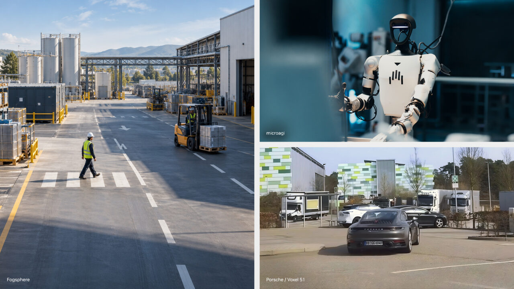
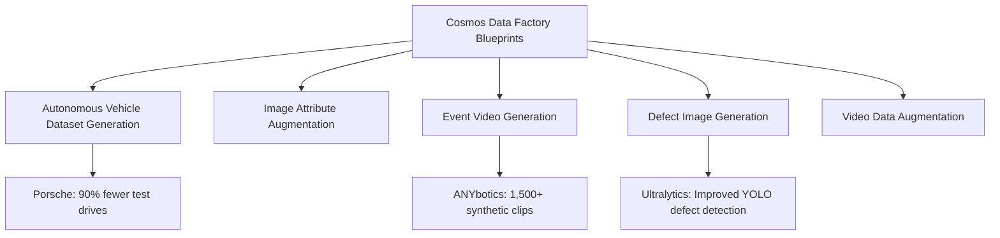
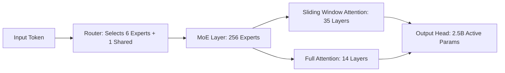
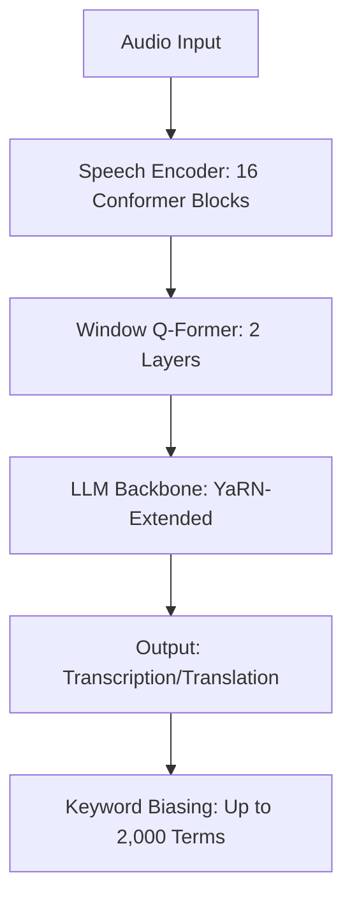
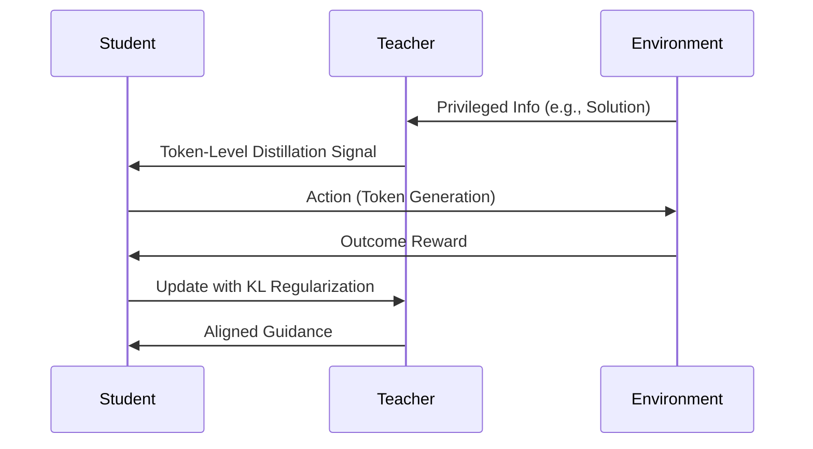

> 🎙️ **Listen to the podcast version of this article:**
> <audio controls src="index.mp3"></audio>


---

> 💡 **TL;DR:** This week marks a watershed moment for AI innovation: NVIDIA Cosmos expands its world model tools for physical AI, Recursive launches Flint—a 40B MoE coding model with 2.5B active parameters—IBM unveils Granite Speech 5.0 for multilingual transcription, and Perplexity/NVIDIA introduce JOLT, a reinforcement learning method that slashes training token requirements by 6.5x. These advancements redefine efficiency, scalability, and real-world applicability in AI.

| **Metric / Innovation Area** | **Insight / Takeaway** |
|-----------------------------|------------------------|
| **NVIDIA Cosmos** | Top 5 rankings on 6 open models leaderboards; 90% reduction in physical test drives for Porsche; 1,500+ synthetic clips generated for ANYbotics. |
| **Recursive Flint** | 40B total / 2.5B active parameters; 74.2% SWE-bench Verified; 125+ tokens/sec on M4 Pro MacBook Pro. |
| **IBM Granite Speech 5.0** | #2 on Open ASR Leaderboard (5.68% avg English WER); 6-language support; 2,000-term keyword biasing. |
| **JOLT Method** | 6.5x fewer training tokens than GRPO for matched MATH accuracy; +9.9 points on AppWorld. |

---



### NVIDIA Cosmos Expands World Model Tools: A Leap for Physical AI

The race to build **world models**—AI systems capable of understanding and simulating the physical world—just accelerated. NVIDIA’s **Cosmos platform** has unveiled a suite of new tools designed to streamline the development of these models, from data curation to deployment. With top-five rankings on **six open models leaderboards**, Cosmos is positioning itself as the go-to ecosystem for developers building the next generation of **physical AI** and **computer vision** applications.

At the heart of this expansion is the **Cosmos Data Factory**, a cloud-native suite of blueprints for generating, augmenting, and curating multimodal, multisensory datasets. These blueprints—available via GitHub, Microsoft Azure, Nebius, and CoreWeave—include specialized workflows for **autonomous vehicle dataset generation**, **defect image synthesis**, and **event video generation**. For example, Porsche is leveraging Cosmos Data Factory to create a **shared AV data flywheel** across Volkswagen Group brands, reducing physical test drives by **up to 90%** and shortening development cycles by **85%**. Meanwhile, ANYbotics generated **1,500+ synthetic video clips** to train industrial-inspection robots to detect liquid spills and other anomalies.



Beyond data, Cosmos now offers **Cosmos Framework**, a modular toolkit for training, fine-tuning, and deploying world models. Developers can adapt open models like **GR00T, Alpamayo, and QWEN** via reinforcement learning or distillation, then deploy them using **NVIDIA’s NIM microservices**—which now deliver **2x faster inference** with no quality loss. A standout example is **MicroAGI**, which post-trained Cosmos 3 on egocentric manipulation videos and distilled a **32B-parameter reasoner into an 8B-parameter Nano model** without sacrificing accuracy. For real-time applications, the **Metropolis Blueprint for Video Search and Summarization (VSS) 3.3** enables teams to monitor **40% more video streams** with the same GPU resources.

Why does this matter? World models are the backbone of **autonomous systems**, from robots to self-driving cars. By providing end-to-end tools—**data synthesis, model training, and deployment optimization**—NVIDIA is democratizing access to cutting-edge physical AI. The implications for **computer vision** and **robotics** are profound: faster iteration, lower costs, and higher accuracy in real-world scenarios.

---

### Recursive Flint: A 40B MoE Coding Model That Runs Locally at 125+ Tokens/sec

Recursive Superintelligence has dropped a bombshell for developers: **Flint**, an open-weight **Mixture-of-Experts (MoE) coding model** with **40B total parameters** but only **2.5B active per token**. This architecture, combined with **Apache 2.0 licensing**, makes Flint a game-changer for **local coding assistants**—delivering **state-of-the-art performance** on benchmarks like **SWE-bench Verified (74.2%)** while running at **125+ tokens per second on an M4 Pro MacBook Pro**.

Flint’s architecture is a marvel of efficiency. It features **49 layers**: 2 dense layers and 47 MoE layers, each with **256 experts**. A router dynamically selects **6 experts per token**, plus 1 always-active shared expert. The model uses a hybrid attention mechanism—**35 layers with a 513-token sliding window** and **14 layers with full attention**—balancing computational cost and context awareness. The **2.5B active parameters** include the output head, with the core body weighing in at ~2.2B parameters.



What’s under the hood? Flint was built using **Recursive’s Eureka Machine**, an automated research system that optimized everything from **architecture design** to **quantization**. Notably, Eureka Machine **quantized the output layer (lm_head) to 4 bits**—a departure from common practice—then used **offline distillation** to recover accuracy. This reduced training steps by **nearly half** compared to quantization-aware training. The result? Flint’s **NVFP4 model** scores within **0.7 points** of its 16-bit counterpart.

Performance-wise, Flint shines on **agentic coding tasks**. It leads among MoE models under 50B on benchmarks like **IFEval (95.1%)** and **SWE-bench Pro v2 (89.7%)**, though it trails dense models like **Qwen 3.8** on **Terminal-Bench 2.1 (54.9% vs. 73.0%)**. Yet, its **local deployment** capabilities are unmatched: **4-bit weights** fit into **~23 GB**, running smoothly on **48 GB Macs or GPUs**. For developers, this means **near-instant feedback** and **offline coding assistance** without sacrificing performance.

**Code Snippet: Running Flint Locally**
```bash
# Install required libraries
pip install -U transformers accelerate

# Load Flint in 4-bit
from transformers import AutoModelForCausalLM, AutoTokenizer
model = AutoModelForCausalLM.from_pretrained("Recursive/Flint-40B", load_in_4bit=True)
tokenizer = AutoTokenizer.from_pretrained("Recursive/Flint-40B")

# Generate code
inputs = tokenizer("Write a Python function to sort a list of dictionaries by a key.", return_tensors="pt")
outputs = model.generate(**inputs, max_new_tokens=200)
print(tokenizer.decode(outputs[0], skip_special_tokens=True))
```

Why does Flint matter? It bridges the gap between **cloud-based coding assistants** and **local development**. For teams prioritizing **data privacy, latency, or cost**, Flint offers a compelling alternative to API-based solutions. And with **125+ tokens/sec** on consumer hardware, it’s fast enough for real-time collaboration.

---


### IBM Granite Speech 5.0 2B: Multilingual Transcription and Translation Redefined

IBM has raised the bar for **open-source speech recognition** with **Granite Speech 5.0 2B**, a **2B-parameter model** that ranks **#2 on the Open ASR Leaderboard** with a **5.68% average English Word Error Rate (WER)**. This **Apache 2.0** model supports **6 languages** and introduces **keyword biasing**, **language ID prompting**, and **enhanced robustness** for noisy environments—making it a powerhouse for **global transcription and translation** applications.

Granite Speech 5.0’s architecture is a three-part system:
1. A **speech encoder** with **16 Conformer blocks**, trained with **CTC (Connectionist Temporal Classification)** and **block attention** over 4-second audio segments.
2. A **2-layer window q-former** that projects and downsamples acoustic embeddings (10x downsampling, so the LLM sees embeddings at **10 Hz**).
3. A **fine-tuned LLM backbone** (an intermediate checkpoint of **granite-4.0-1b-base**), extended to **16k positions** using **YaRN** and fine-tuned with **LoRA adapters**.

Training leveraged **390,000 hours of public audio** plus synthetic data, with a focus on **Japanese ASR, keyword biasing, and translation**. The model was trained over **40 days on 8 H100 GPUs**—a testament to IBM’s commitment to **high-quality, open-weight models**.

**Performance Highlights:**
- **#2 on Open ASR Leaderboard** (5.68% avg English WER), just behind **Qwen3-ASR-1.7B (5.40%)**.
- **0.99% WER on LibriSpeech Clean** and **2.21% on LibriSpeech Other**.
- **Multilingual CommonVoice WER**: 2.60% (Portuguese), 3.50% (Spanish), 10.74% (Japanese).
- **Translation BLEU scores**: 53.6 (Portuguese→English), 40.1 (German→English).
- **Keyword biasing**: F1 score jumps from **67.2 to 90.1** on Earnings-22 with correct keyword lists.



IBM also updated its **Turbo CTC** and **4.1 2B Plus** models:
- **Turbo CTC** (470M parameters) now supports **7 languages** with **native punctuation/capitalization** and achieves **19,870 RTFx** (up from ~12,600).
- **4.1 2B Plus** improves **timestamp accuracy** (shift reduced from 210.86 to 98.54) and **long-form WER** (13.53 → 10.22).

**Deployment Options:**
Granite Speech 5.0 runs on **GPUs (Transformers/vLLM)**, **Apple Silicon (mlx-audio)**, and **local CPU (llama.cpp GGUF)**. IBM recommends **Q8_0 quantization** for GGUF to balance accuracy and size.

Why does this matter? For enterprises and developers, Granite Speech 5.0 offers **production-ready, multilingual transcription** with **customizable keyword biasing**—ideal for **customer service, legal, and healthcare** applications. Its **open-weight Apache 2.0 license** ensures flexibility, while its **leaderboard-topping accuracy** makes it a serious contender against proprietary models.

---

### JOLT: Joint Teacher-Student Reinforcement Learning Cuts Training Costs by 6.5x

Reinforcement Learning (RL) for language models just got a **compute-efficient upgrade**. Perplexity and NVIDIA researchers introduced **JOLT (Joint On-policy Learning and Teaching)**, a **post-training method** that trains **a single model as both teacher and student**, achieving **GRPO-level accuracy on MATH with 6.5x fewer training tokens**.

The core innovation? In traditional RL methods like **GRPO (Group Relative Policy Optimization)**, the **reward signal is sparse**—only one reward per attempt, with no guidance on which tokens contributed to success. **OPSD (On-Policy Self-Distillation)** addresses this by using a **stronger teacher model** to provide token-level feedback, but this introduces a **mismatch**: the teacher’s guidance may not align with the student’s capabilities.

JOLT solves this by **training the teacher and student simultaneously** within the same model:
- **Teacher**: Receives **privileged information** (e.g., verified solutions) and learns from **outcome rewards + KL divergence penalty** (to stay close to the student).
- **Student**: Receives **only the task input** and learns from the **teacher’s token-level distillation signal** on its own attempts.
- **JOLT+**: Adds the **student’s outcome reward** to the student update, further aligning the two roles.

The mathematical intuition behind JOLT is elegant. The teacher’s policy $\pi_{\text{teacher}}$ is regularized to stay close to the student’s policy $\pi_{\text{student}}$ via a **KL divergence term** in the loss function:

$$ \mathcal{L}_{\text{teacher}} = \mathcal{L}_{\text{reward}} + \beta \cdot D_{\text{KL}}(\pi_{\text{teacher}} \|\| \pi_{\text{student}}) $$

This ensures the teacher’s guidance remains **reward-consistent** and **reachable** for the student.

**Benchmark Results:**
JOLT+ outperforms **GRPO, OPSD, and π-Distill** across all tested settings:
- **GSM8K (DeepSeek-V2-Lite)**: +1.5 points over GRPO.
- **MATH (Qwen3-0.6B)**: +4.2 points over GRPO (72.59% vs. 68.36%).
- **LiveCodeBench v6 (Qwen3-8B)**: +3.0 points over GRPO.
- **AppWorld (Qwen3-4B)**: **+9.9 points over GRPO (72.09% vs. 62.20%)**.
- **Terminal-Bench 2.1 (Qwen3-30B-A3B)**: **10.96% pass@1** (vs. 8.25% for GRPO).

**Efficiency Gains:**
On MATH, JOLT achieves **63.44% accuracy** with just **1.30M processed training tokens**, compared to **8.40M for GRPO**—a **6.5x reduction**. For **completion tokens only**, the gap widens to **~13x fewer tokens**. Savings range from **4.3x to 7.4x** across different accuracy targets (55%–65%).



Why does JOLT matter? For teams running **RL post-training**, compute costs are a major bottleneck. JOLT’s **6.5x token efficiency** could **democratize RL fine-tuning**, making it feasible for smaller organizations to compete with industry giants. Moreover, its **single-model approach** simplifies deployment, as there’s no need to maintain separate teacher and student models.

---

### The Big Picture: AI’s Convergence of Efficiency, Scalability, and Real-World Impact

These four innovations—**NVIDIA Cosmos, Recursive Flint, IBM Granite Speech 5.0, and JOLT**—highlight a clear trend in AI: **the convergence of efficiency, scalability, and real-world applicability**.

- **NVIDIA Cosmos** is **accelerating physical AI** by providing end-to-end tools for world models, from synthetic data generation to deployment-optimized inference. Its impact on **autonomous vehicles, robotics, and industrial inspection** is already being felt, with companies like Porsche and ANYbotics reporting **dramatic reductions in development time and cost**.
- **Recursive Flint** proves that **MoE models can be both powerful and practical**. With **2.5B active parameters**, it delivers **SOTA coding performance** while running **locally at 125+ tokens/sec**—a milestone for **offline, privacy-preserving AI assistants**.
- **IBM Granite Speech 5.0** sets a new standard for **open-source speech recognition**, combining **multilingual support, keyword biasing, and leaderboard-topping accuracy**. Its **Apache 2.0 license** ensures it will be a cornerstone for **enterprise and developer applications**.
- **JOLT** redefines **RL efficiency**, offering a **6.5x reduction in training tokens** without sacrificing performance. This could **lower the barrier to entry** for RL fine-tuning, enabling smaller teams to compete in **agentic AI**.

Together, these advancements underscore a pivotal moment in AI: **the shift from experimental prototypes to production-ready, efficient, and scalable solutions**. Whether you’re building **world models, coding assistants, speech systems, or RL agents**, the tools and methods emerging today are making AI **faster, cheaper, and more accessible** than ever before.

Written with [Argos](https://github.com/Neilstid/argos)
