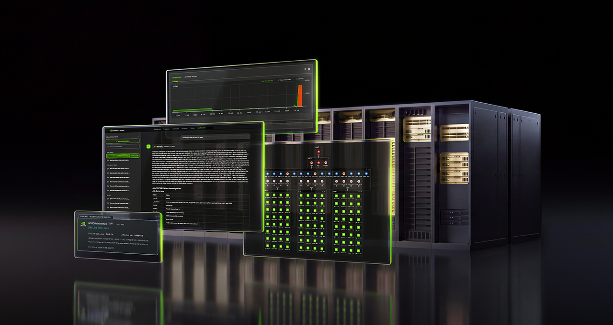
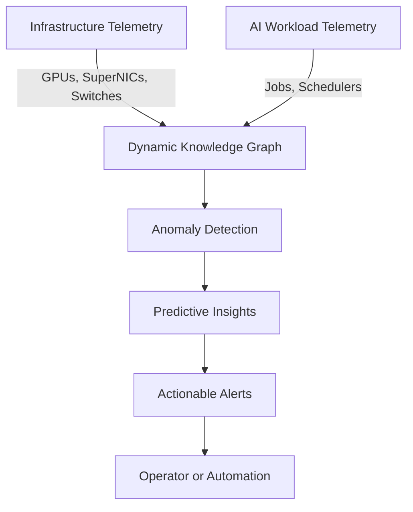
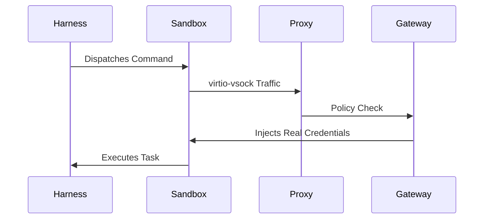
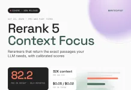
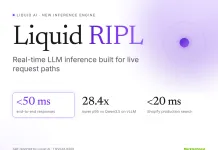

> 🎙️ **Listen to the podcast version of this article:**
> <audio controls src="index.mp3"></audio>

---

> 💡 **TL;DR:** This article explores groundbreaking advancements in AI infrastructure and NLP tools: NVIDIA Minerva introduces end-to-end observability for AI factories, Google Cloud’s Agent Compute Engine offers hardware-isolated microVMs for AI agents, Cohere Rerank 5 delivers passage-level context focus with calibrated scores, and Liquid AI’s RIPL engine achieves sub-50ms inference for real-time applications. These innovations collectively push the boundaries of efficiency, security, and performance in AI operations.

| **Metric / Innovation Area** | **Insight / Takeaway** |
|--------------------------------|--------------------------------|
| **NVIDIA Minerva** | End-to-end observability for AI factories, correlating workload and infrastructure issues with AI-driven insights. |
| **Google Agent Compute Engine** | Hardware-isolated microVMs per AI agent with zero credentials inside, enabling VM-grade isolation with container-like speed. |
| **Cohere Rerank 5** | 32K context window, passage-level extraction (Context Focus), and calibrated relevance scores (ECE ~0.06). |
| **Liquid AI RIPL** | Real-time inference engine delivering 5.6–28.4x lower p95 latency vs. Qwen3.5 on vLLM, enabling sub-50ms responses. |

---

### Introduction: AI Infrastructure and Optimization Trends

The AI landscape is evolving at a breakneck pace, with infrastructure and optimization emerging as critical battlegrounds for scalability, efficiency, and reliability. As AI factories—massive, GPU-powered data centers—become the backbone of modern AI development, the need for observability, security, and performance optimization has never been more pressing. Today, we stand at the precipice of a new era where AI-driven operations (AIOps), microVM isolation, and real-time inference engines are redefining what’s possible.

This article explores four transformative innovations: **NVIDIA Minerva**, a platform designed to bring end-to-end observability to AI factories; **Google Cloud’s Agent Compute Engine**, which introduces hardware-isolated microVMs for AI agents; **Cohere Rerank 5**, a retrieval model with passage-level context focus and calibrated scores; and **Liquid AI’s RIPL**, a real-time inference engine that slashes latency to sub-50ms. Together, these advancements are shaping the future of AI operations, natural language processing (NLP), and real-time applications.

---

### NVIDIA Minerva – End-to-End Observability for AI Factories

#### Platform Overview and Telemetry Integration

AI factories are among the most complex operational environments in the world, with thousands of GPUs working in tandem across high-speed networks to train models and serve AI applications. In such an ecosystem, even a single degraded component—be it an overheating GPU or an underperforming NVMe drive—can throttle the entire system. Enter **NVIDIA Minerva**, an AIOps platform designed to provide **end-to-end observability** by unifying telemetry from infrastructure and AI workloads into a single, actionable view.

Minerva aggregates data from NVIDIA GPUs, networking hardware, storage systems, schedulers, and workloads, constructing a **dynamic knowledge graph** that maps the physical and logical topology of the AI factory. This graph enables operators to trace performance bottlenecks—such as a slow training job—to their root causes, even in environments with hundreds of thousands of GPUs. The platform employs **supervised and unsupervised machine learning** to analyze billions of data points per hour, learning normal behavior patterns, detecting anomalies, and predicting failures before they escalate.

#### AI-Driven Insights for Productivity

Minerva’s true power lies in its ability to **correlate workload and infrastructure issues**, transforming a deluge of alerts into a focused, actionable incident with a likely root cause. This capability allows AIOps teams to transition from **reactive to proactive maintenance**, maximizing GPU uptime and overall factory yield. Key metrics improved by Minerva include:
- **Longer time between interruptions**: By spotting trouble early, jobs run longer without incident.
- **Faster time to repair**: Pinpointing problems accelerates resolution.
- **Greater insight**: Filtering out noise ensures only critical alerts reach operators.

The platform also integrates a **native AI assistant** and supports external agentic AI tools, providing a natural-language interface for investigating cluster health and receiving remediation recommendations. Teams can either manually implement fixes or connect Minerva to automation systems via APIs.

> *"As we scale our AI factories, the key to providing the best service for our customers is maximizing the productivity of our GPUs. NVIDIA Minerva gives our operations team one view across the network, the GPUs, and the jobs running on them, so we focus more on proactive maintenance rather than troubleshooting."* — **Denis Skrinnikoff, CTO of IREN**

Minerva is already being adopted by industry leaders like **IREN, Aolani, Bitdeer AI, IBM, Jio, Lambda, Quake AI, and Tesla**, with hardware partners such as **Dell Technologies, Lenovo, and Supermicro** offering it as part of their AI factory operations portfolios.

---

### Google Cloud Agent Compute Engine – MicroVM per AI Agent

#### Hardware-Isolated MicroVM Concept

In the realm of AI agents, **security and isolation** are paramount. Google Cloud’s **Agent Compute Engine (ACE)** addresses this by providing **one hardware-isolated microVM per AI agent session**, complete with its own guest kernel, root access, and Hyperdisk. This design ensures **VM-grade isolation** with **container-like speed and density**, a combination that’s rare in today’s cloud environments.

Each agent in ACE is split into two components:
1. **The Harness (Brain)**: Runs outside the sandbox and calls the model.
2. **The Sandbox (Hands)**: Executes code, shell commands, and browsers in a **Cloud Hypervisor microVM** with no standard network interface, no default gateway, and no direct VPC access. All traffic is routed through a **virtio-vsock boundary** to a local proxy, then to an external gateway. This architecture assumes an attacker could control everything inside the sandbox—yet finds **no credentials to steal**.

#### Security Benefits and Gemini Integration

ACE’s security model is built on **four distinct identities** for every agent workload:
1. **User Identity**: Authenticates the overall task.
2. **Delegated On-Behalf-Of Identity**: A scoped grant stored centrally, never on the node.
3. **Agent Workload Identity**: A short-lived SPIFFE identity used for sandbox traffic (useless if exfiltrated).
4. **Agent Workforce Identity**: The agent’s own account and resources.

This multi-layered approach ensures that even if an agent is compromised, the blast radius is minimized. **Idle agents** are checkpointed to **zero active resources** and resumed from snapshots, optimizing cost and efficiency. ACE already powers **Gemini agents** and is set to enter customer preview in the coming months.

For those seeking flexibility, Google offers **Agent Substrate**, an open-source, Kubernetes-native counterpart to ACE. Agent Substrate supports **Cloud Hypervisor microVMs or gVisor sandboxes** and delivers impressive metrics:
- **Up to 10x higher compute density** than traditional compute.
- **500 activations per second** with **under 500ms suspend/resume** in a 200,000-agent benchmark.
- **Over 1,000 dormant agents per host**.

| **Feature**               | **Google Agent Compute Engine** | **Google Agent Substrate**       | **AWS AgentCore Runtime** | **Azure Dynamic Sessions** | **E2B**                |
|---------------------------|----------------------------------|----------------------------------|----------------------------|----------------------------|---------------------------|
| **Isolation**             | Cloud Hypervisor microVM        | Cloud Hypervisor microVM/gVisor | Dedicated microVM          | Hyper-V sandbox            | Firecracker microVM       |
| **Idle Handling**         | Checkpoint to zero resources    | Snapshot, free CPU/RAM           | CPU billing skips I/O wait | Destroyed after cooldown   | Pause saves filesystem    |
| **Persistence**           | Hyperdisk per microVM           | Filestore agent volumes          | Filesystem persists        | Ephemeral sessions         | Snapshot on pause          |
| **Open Source**           | No                               | Yes                               | No                         | No                         | Yes                       |

Google is also expanding **agent governance** with integrations across **Agent Runtime, Cloud Run, Agent Sandboxes, GKE, and ACE**, including **Agent Gateway, Agent Registry, and Agent Identity** with OpenTelemetry-based observability.

---

### Cohere Rerank 5 – Passage-Level Context Focus and Calibrated Scores

#### 32K Context Window and Passage Extraction

Retrieval-Augmented Generation (RAG) and agentic systems rely heavily on the quality of retrieved documents. **Cohere Rerank 5** introduces two major innovations to enhance this process:
1. **Context Focus**: Extracts **relevant passages** within each document, returning scored character spans with start/end offsets. This allows developers to send **fewer, better tokens** to the LLM, reducing noise and improving efficiency.
2. **Calibrated Relevance Scores**: Scores are normalized as probabilities (e.g., a score of 0.7 indicates a 70% chance the document is useful), enabling consistent threshold-based filtering across domains.

Both **Pro** and **Fast** tiers of Rerank 5 support:
- A **32K token context window**.
- **100+ languages**.
- Reranking of **semi-structured data** (JSON, tables, YAML).

In tests, **Context Focus** demonstrated remarkable efficiency:
- Removing **50% of retrieved text** retained **96% of answer quality**.
- Removing **75% of retrieved text** retained **87% of answer quality**.
- In a search-agent test, **Context Focus at a 0.1 threshold** reduced tokens by **19%** and improved accuracy from **49% to 57%**.

#### Pro/Fast Tiers, Pricing, and BRIGHT Score

Rerank 5 is available in two tiers:
- **Pro**: Optimized for **reasoning-heavy queries** and long, domain-specific documents. **$0.05 per 1M tokens**.
- **Fast**: Optimized for **low latency and high throughput**. **$0.02 per 1M tokens**.

Benchmark performance (self-reported by Cohere using **RCP-nDCG@10**):
- **Pro** leads on **39 of 46 composite datasets**, scoring:
  - **92.2 on ViDoRe V3**
  - **90.4 on BEIR**
  - **82.2 on BRIGHT** (5.8 points above Voyage AI Rerank 3)
  - **87.3 on nanoMTEB**
- **Fast** outperforms competitors like **Voyage AI Rerank 3 Lite** and **Qwen3-Reranker-8B** across all major benchmarks.

Calibration metrics (Expected Calibration Error, or ECE) further highlight Rerank 5’s precision:
- **Rerank 5 Pro/Fast**: **~0.06 ECE** (human judges and NIST TREC-DL assessors).
- **Voyage AI Rerank 3**: **0.234–0.307 ECE**.
- **Rerank 4 Pro**: **0.309–0.384 ECE**.

| **Feature**               | **Cohere Rerank 5 Pro** | **Cohere Rerank 5 Fast** | **Voyage AI Rerank 3** | **Qwen3-Reranker-8B** |
|---------------------------|--------------------------|---------------------------|-------------------------|-------------------------|
| **Context Window**        | 32K                      | 32K                       | 32K                     | 32K                     |
| **BRIGHT Score**          | 82.2                     | 77.5                      | 76.4                    | 69.8                    |
| **ViDoRe V3 Score**      | 92.2                     | 90.6                      | 90.6                    | 85.1                    |
| **ECE (Lower is Better)** | 0.058                    | 0.058                     | 0.234                   | Not disclosed           |
| **Price per 1M Tokens**   | $0.05                    | $0.02                     | $0.05                   | Self-hosted             |

Rerank 5 is deployable via **Cohere API, Model Vault, Microsoft Foundry, Amazon SageMaker, or private VPC/on-prem**, with integrations for **LangChain, Haystack, Elasticsearch, and Weaviate**.

---

### Liquid AI RIPL – Real-Time Inference Engine for Sub-50ms LFMs

#### Latency Gains vs. Qwen3.5-0.8B

For applications requiring **real-time responses**—such as search ranking, fraud detection, and payment authorization—traditional LLM serving stacks are often too slow, forcing teams to rely on classical models. **Liquid AI’s RIPL (Real-time Inference Pipeline)** aims to eliminate this trade-off by delivering **end-to-end inference in under 50ms**, even under continuous peak load.

RIPL serves **Liquid Foundation Models (LFMs)** ranging from **230M to 2.6B parameters** on enterprise-grade GPUs like **NVIDIA H100, H200, B200, and RTX PRO 6000**. Benchmarks on a single B200 show **staggering latency improvements** over **Qwen3.5 on vLLM**:

| **Workload**               | **Load**       | **LFM2.5 on RIPL (p95)** | **Qwen3.5 on vLLM (p95)** | **Gap**  |
|----------------------------|----------------|----------------------------|----------------------------|----------|
| 1B class, 32→32 tokens     | 1,000 req/s    | 34.6 ms (1.2B)             | 498 ms (0.8B)             | **14.4x** |
| 1B class, 256→128 tokens   | 400 req/s      | 155.8 ms (1.2B)            | 4,431 ms (0.8B)            | **28.4x** |
| 2B class, 32→32 tokens     | 1,000 req/s    | 76.4 ms (2.6B)             | 586.8 ms (2B)              | **7.7x**  |
| 2B class, 256→128 tokens   | 300 req/s      | 449.1 ms (2.6B)            | 2,499 ms (2B)              | **5.6x**  |

RIPL’s architecture optimizes the **entire inference path**, from request arrival to completed response. The **LFM2.5 models** themselves are hybrids, combining **double-gated convolution blocks** and **GQA (Grouped-Query Attention) blocks** for efficiency. For example:
- **LFM2.5-1.2B-Instruct**: 16 layers (10 convolution + 6 GQA).
- **LFM2.5-2.6B**: 30 layers (22 convolution + 8 GQA).

#### Real-Time Application Implications

RIPL’s performance unlocks **real-time use cases** previously reserved for classical models. Liquid AI highlights six production workloads where LFMs on RIPL meet strict latency budgets:
1. **Adtech Query Rewriting**: 32→32 tokens, **50ms budget**, LFM2.5-350M.
2. **Search Intent Classification**: 128→1 token, **20ms budget**.
3. **Search Reranking**: 1K→1 token, **30ms budget**.
4. **Payments Risk Scoring**: 512→16 tokens, **50ms budget**, LFM2.5-1.2B.
5. **Credit Decisioning**: 8K→64 tokens, **150ms budget**.
6. **Image Alt Text**: 512×512 image + 64 tokens→16 tokens, **100ms budget**, LFM2.5-VL-450M.

**Shopify** is already deploying LFMs on RIPL for **latency-sensitive commerce workloads**, achieving **sub-20ms inference** in production search with **50% fewer parameters** and **2–10x faster inference** than alternatives.

---

### Conclusion: Shaping the Future of AI Ops and NLP Tools

The innovations highlighted in this article—**NVIDIA Minerva, Google Cloud’s Agent Compute Engine, Cohere Rerank 5, and Liquid AI’s RIPL**—represent a **paradigm shift** in how we build, deploy, and optimize AI systems. From **end-to-end observability** in AI factories to **hardware-isolated security** for AI agents, from **passage-level context extraction** to **sub-50ms inference**, these tools are pushing the boundaries of what’s achievable in **efficiency, security, and performance**.

As AI continues to permeate every facet of technology and business, the ability to **monitor, secure, and accelerate** AI workloads will be the defining factor in who leads the next wave of innovation. The future of AI ops and NLP is here—and it’s **faster, smarter, and more observable** than ever before.

Written with [Argos](https://github.com/Neilstid/argos)
