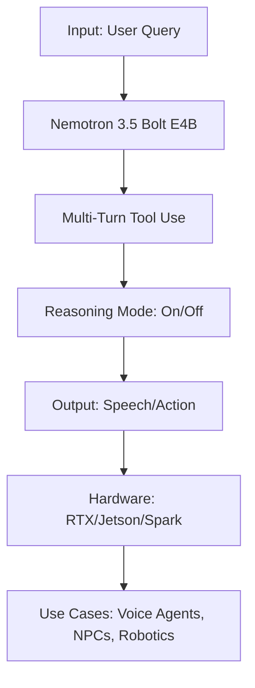
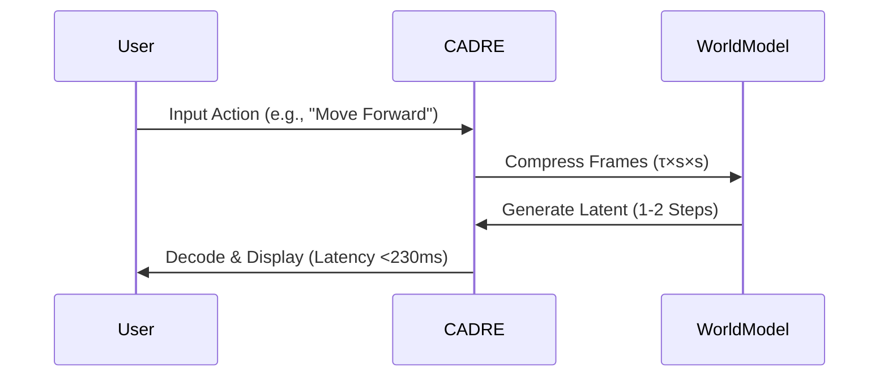
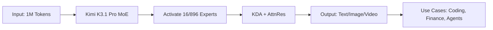

> 🎙️ **Listen to the podcast version of this article:**
> <audio controls src="index.mp3"></audio>

---

> 💡 **TL;DR:** This article dives into three transformative AI breakthroughs: NVIDIA’s **Nemotron 3.5 Bolt E4B 4GB**, a 4GB LLM for local voice agents and robotics; Kyutai’s **CADRE**, a family of video autoencoders reducing world-model latency below 230ms for real-time interactions; and Moonshot AI’s **Kimi K3.1 Pro**, a 2.8T-parameter MoE model with a 1M-token context window, excelling in coding and agentic tasks. Together, they redefine efficiency, speed, and scalability in AI deployment.

| **Metric / Innovation Area** | **Insight / Takeaway** |
|-----------------------------|------------------------|
| **Model Size & Efficiency** | Nemotron 3.5 Bolt E4B: 8B total, 4B effective params; CADRE: 476M params + 86M DINOv3; Kimi K3.1 Pro: 2.8T total, 104B active params (MoE). |
| **Latency & Speed** | CADRE achieves **<230ms latency** at 20 FPS on a single H100; Nemotron Bolt decodes **272.6 tokens/s** on RTX 5070; Kimi K3.1 Pro Highspeed runs **2-3x faster** than base. |
| **Context Window** | Nemotron: 64K; CADRE: 288×512 at 20 FPS; Kimi K3.1 Pro: **1M tokens**, the largest in its class. |
| **Benchmark Leadership** | Nemotron leads **15/21 agent benchmarks** (IHEval: 84.8); CADRE cuts driving FVD to **162.6** (vs. 599.7 for Wan 2.2); Kimi K3.1 Pro scores **65.7%** on Terminal-Bench 4.0. |
| **Deployment** | Nemotron runs on **RTX, Jetson, Spark** (~4GB VRAM); CADRE targets **interactive world models**; Kimi K3.1 Pro requires **multi-node serving** (64+ accelerators). |
| **Open-Source Status** | Nemotron: **OpenMDW-1.1**; CADRE: **MIT code, CC BY-NC 4.0 weights**; Kimi K3.1 Pro: **Open weights expected Nov 2026**. |

---

### **1. NVIDIA’s Nemotron 3.5 Bolt E4B 4GB: A Tiny LLM for Local, Real-Time Agents**

#### **Context: The Rise of On-Device AI**
The AI landscape is shifting toward **edge deployment**, where models run locally on consumer hardware—GPUs, embedded systems, or even smartphones—rather than in cloud data centers. NVIDIA’s **Nemotron 3.5 Bolt E4B 4GB** is a prime example of this trend, designed to power **voice assistants, game NPCs, and robotic interfaces** without relying on remote servers. This reduces latency, enhances privacy, and enables offline functionality, critical for applications like industrial automation or immersive gaming.

#### **Tech Deep Dive: Post-Trained for Efficiency**
Nemotron 3.5 Bolt E4B is **post-trained from Google’s Gemma 4 E4B** using **reinforcement learning (RL) only**—a deliberate choice to avoid the trade-offs of supervised fine-tuning (SFT). According to NVIDIA’s research, SFT improved tool-calling but degraded conversational quality and verbosity in Gemma 4. Instead, the team employed **RLVR (Reinforcement Learning from Verbal Feedback)** and **RLHF (Reinforcement Learning from Human Feedback)** via NVIDIA’s **NeMo-RL** and **NeMo-Gym** frameworks.

Key architectural and training details:
- **Parameters**: 8B total, 4B effective (quantized to **Q4_K_M** with importance-matrix calibration).
- **Context Window**: 64K tokens, sufficient for multi-turn conversations and tool definitions.
- **Training Innovation**: Each batch maintained a **2:1 ratio of non-reasoning to reasoning samples**, with length penalties to prevent overly verbose outputs.
- **Speculative Decoding**: Includes a **DFlash drafter**, boosting token generation speed. On an **RTX 5070**, Bolt achieves **272.6 tokens/s** (1.21x faster than Gemma 4 E4B’s 225.9 tokens/s).

#### **Performance: Benchmark Dominance with Caveats**
NVIDIA’s internal benchmarks (measured in BF16 via NeMo-Gym) show Bolt leading **15 of 21 tests** across reasoning, tool use, and conversational tasks. Standout metrics include:
- **IHEval**: **84.8** (vs. 67.0 for Gemma 4 E4B, 60.6 for Qwen3.5-4B).
- **MultiChallenge**: **53.1** (vs. 42.1 for Gemma 4 E4B).
- **Tau2-Bench**: **55.1** (trailing Qwen3.5-4B’s 75.1).

However, Bolt’s **4GB VRAM target** (actual GGUF file: 6.18GB) is a practical constraint. Performance varies by hardware:
| **Device**               | **VRAM (GB)** | **Time to First Token (ms)** | **Tokens/s** |
|--------------------------|---------------|-----------------------------|--------------|
| RTX 5070 (12GB)          | 3.5           | 548                         | 133.4        |
| RTX Spark (32GB)         | 3.1           | 930                         | 67.0         |
| Jetson AGX Orin (32GB)   | 4.2           | 3,687                       | 24.0         |
| Jetson Orin Nano (8GB)   | 4.2           | 5,785                       | 15.5         |

#### **Real-World Use Cases & Why It Matters**
Nemotron 3.5 Bolt E4B is optimized for **three core workloads**:
1. **Device/Voice Assistants**: Low-latency, multi-turn conversations with tool integration (e.g., smart home controls).
2. **Interactive Game Characters**: NVIDIA’s **ACE (Avatar Cloud Engine)** leverages Bolt for dynamic NPCs with **asynchronous tool calls** (e.g., fetching quest data).
3. **Embedded/Robotic Agents**: Demonstrated on a **Reachy Mini robot** (Jetson Orin Nano 8GB), where **Cosmos 3 Edge** handles vision and Bolt manages speech/tool responses.

The model’s **open weights (OpenMDW-1.1 license)** and compatibility with **Hugging Face, Ollama, LM Studio, and NVIDIA NIM** make it accessible for developers. Its **privacy-preserving, low-latency** design could accelerate adoption in **edge AI**, where cloud dependency is a bottleneck.

---

### **2. Kyutai CADRE: Causal-Diffusion Video Autoencoders for Sub-230ms World Models**

#### **Context: The Latency Problem in World Models**
World models—AI systems that simulate environments for planning or interaction—often suffer from **action lag**, where the time between a user’s input and the system’s response breaks immersion. Traditional autoencoders (e.g., those repurposed from text-to-video models) compress multiple frames into a single latent, introducing delays. **Kyutai’s CADRE** (Causal Diffusion Autoencoders) tackles this by optimizing for **low-latency, high-fidelity video generation**.

#### **Tech Deep Dive: Compression Meets Diffusion**
CADRE is a **family of 7 open autoencoders**, each with:
- **~476M trained parameters** + a frozen **86M DINOv3 ViT-B/16** backbone.
- **Causal diffusion decoder**: 24 transformer blocks, trained via **progressive self-distillation** to decode in **1-2 steps** (no adversarial loss).
- **Compression Formula**: Defined as **τ×s×s**, where:
  - **τ** = frames per latent (temporal compression).
  - **s** = spatial compression factor.
  - Latency = **τ/f + generation + decode time** (where *f* = frame rate).

For example, at **τ=8** and **20 FPS**, temporal compression alone adds **400ms**—exceeding the **230ms human-perceptible lag threshold**. CADRE’s design minimizes this by balancing **τ** and **s** for different scenarios (e.g., moving cameras favor spatial compression).

#### **Performance: Redefining the Latency-Quality Frontier**
Kyutai evaluated CADRE across **4 environments**:
1. **Robot Manipulation** (ABC dataset).
2. **Human Manipulation** (EgoDex).
3. **Driving** (PhysicalAI AV).
4. **Indoor Navigation** (RealEstate10K).

**Key Results (1 H100, BF16, Batch 1)**:
| **Metric**               | **CADRE-2×32×32** | **CADRE-2×16×16** | **Wan 2.2** | **LTX-2** | **Cosmos** |
|--------------------------|-------------------|-------------------|-------------|-----------|------------|
| **Action Latency**       | 185ms             | 216ms             | 317ms       | 492ms     | 605ms      |
| **Max FPS**              | 23.4              | 17.3              | 34.2        | 87.4      | 39.0       |
| **FVD (Driving)**        | 171.3             | **162.6**         | 599.7       | 913.3     | 452.5      |
| **ARR (Robot Manip.)**   | 0.45              | **0.73**          | **0.85**    | 0.25      | 0.78       |

**Insights**:
- **Diffusion > Regression**: At high compression, perceptual regression (e.g., MIRA) blurs outputs, while diffusion samples **sharp videos**.
- **Camera Motion Matters**: Static cameras tolerate temporal compression (**τ=8**), but moving cameras need **fewer frames (τ=2) and coarser spatial tokens (s=32)**.
- **Trade-offs**: CADRE-2×16×16 achieves the **lowest driving FVD (162.6)**, but Wan 2.2 excels in **robot manipulation ARR (0.85)**.

#### **Why It Matters: Real-Time Interactive Worlds**
CADRE’s **<230ms latency** unlocks applications in:
- **Robotics**: Real-time action following (e.g., ARR of **0.73** for CADRE-2×16×16).
- **AR/VR**: Seamless world interactions without motion sickness.
- **Gaming**: Dynamic, responsive environments for NPCs or physics.

The **MIT-licensed code** and **CC BY-NC 4.0 weights** (non-commercial) are available on [GitHub](https://github.com/kyutai-lab/cadre) and [Hugging Face](https://huggingface.co/kyutai). A **live demo** lets users test CADRE’s responsiveness via keyboard inputs.

---
### **3. Moonshot AI’s Kimi K3.1 Pro: A 2.8T-Parameter MoE Giant with 1M-Token Context**

#### **Context: The Scaling Race in LLMs**
As LLMs grow larger, **Mixture-of-Experts (MoE)** architectures have emerged as a cost-effective way to scale performance without proportional increases in compute. **Moonshot AI’s Kimi K3.1 Pro** pushes this further with:
- **2.8T total parameters**, **104B active parameters** (16 of 896 experts activated per token via **Stable LatentMoE**).
- **1M-token context window**, the largest among open-weight models (weights expected **November 2026**).
- **Multi-modal inputs**: Text, images, and video via API.

#### **Tech Deep Dive: MoE + Long-Context Innovations**
Kimi K3.1 Pro builds on **Kimi K3** with:
- **Kimi Delta Attention (KDA)**: Optimizes attention for long sequences.
- **Attention Residuals (AttnRes)**: Improves gradient flow in deep networks.
- **Joint RL Post-Training**: Applied across **hundreds of downstream domains**, with optimizations for:
  - Long-context inference.
  - Sandboxed execution (for agentic tasks).
  - Rollout scheduling.

The **Highspeed variant** runs **2-3x faster** than the base model, though it comes at a higher API cost.

#### **Performance: Coding and Agentic Leadership**
Moonshot’s self-reported benchmarks (using **Claude Code harness** at max reasoning effort) highlight strengths and gaps:

**Strengths**:
- **Terminal-Bench 4.0**: **65.7%** (0.7 points behind **Claude Opus 5.5** at 66.4%).
- **SWE-Marathon**: **51.7%** (ahead of Opus 5.5’s 46.3%).
- **Kimi Code Bench 3.0 (Long-Horizon)**: **61.2%** (up from K3’s 55.95%).
- **Finance**: **64.4%** on **OfficeQA Pro v2** (state-of-the-art).
- **Hallucination Reduction**: Claim-level hallucinations dropped from **23.4% (K3) to 8.3%** on **Kimi Hallu Bench Hard**.

**Gaps**:
- **Terminal-Bench Science 0.1**: **38.1%** (vs. **68.1% for GPT-6 Astra**, **63.3% for Opus 5.5**).
- **3D/CAD**: **92.7%** on **BenchCAD (with tools)** (vs. 96.2% for Opus 5.5).

**Cybersecurity**:
- **xdev-bench-hard**: Unfiltered checkpoint solved **90.5%** at pass@3; shipped model: **81.0%**.
- Moonshot **removed cyber-related data** from mid-training and RL for the open-weight release, acknowledging it trails **frontier proprietary models** on offensive tasks.

#### **Accessibility and Cost**
Kimi K3.1 Pro is available via:
- **API Endpoints**: `kimi-k3.1-pro` and `kimi-k3.1-pro-highspeed` (OpenAI-compatible).
- **Platforms**: [Kimi.ai](https://kimi.ai), Kimi Work, Kimi Code.
- **Pricing**:
  - **Base**: $2.00 input / $10.00 output per **1M tokens**.
  - **Highspeed**: $4.00 input / $20.00 output.
  - **Cache Hits**: $0.20 per 1M tokens.

**Limitations**:
- **No self-hosting yet**: Weights are closed until November 2026.
- **Multi-Node Serving**: Requires **64+ accelerators** (supernodes) with **MXFP4 weights/MXFP8 activations**.
- **Fixed Hyperparameters**: Temperature (1.0), top-p (0.95), and **always-on reasoning mode**.

#### **Why It Matters: The Future of Agentic AI**
Kimi K3.1 Pro’s **1M-token context** and **agentic benchmarks** (e.g., **SWE-Marathon**) position it as a leader for:
- **Autonomous Coding Agents**: Long-horizon task execution (e.g., debugging large codebases).
- **Financial Modeling**: State-of-the-art performance on **OfficeQA Pro v2**.
- **Multimodal Applications**: Unified text/image/video understanding.

However, its **science lag** and **proprietary competition** (e.g., GPT-6 Astra) highlight the challenges of **generalist MoE scaling**.

---
### **The Big Picture: AI’s Convergence on Efficiency, Speed, and Scale**
These three innovations represent **complementary frontiers** in AI:
1. **Nemotron 3.5 Bolt E4B**: **Edge AI** with **sub-4GB VRAM** and **real-time tool use**.
2. **Kyutai CADRE**: **Low-latency world models** for **interactive simulations**.
3. **Kimi K3.1 Pro**: **Massive MoE scaling** for **long-context, agentic tasks**.

Together, they illustrate a **triple helix of progress**:
- **Democratization**: Smaller, efficient models (Nemotron) for local deployment.
- **Real-Time Interaction**: Ultra-low-latency systems (CADRE) for immersive experiences.
- **Frontier Performance**: Giant MoE models (Kimi) pushing the boundaries of **reasoning and context**.

As these technologies mature, we can expect **hybrid systems**—e.g., a **Kimi-powered agent** using **CADRE for real-time vision** and **Nemotron for edge deployment**—to define the next generation of AI applications. The future isn’t just bigger models; it’s **smarter, faster, and everywhere**.

Written with [Argos](https://github.com/Neilstid/argos)
