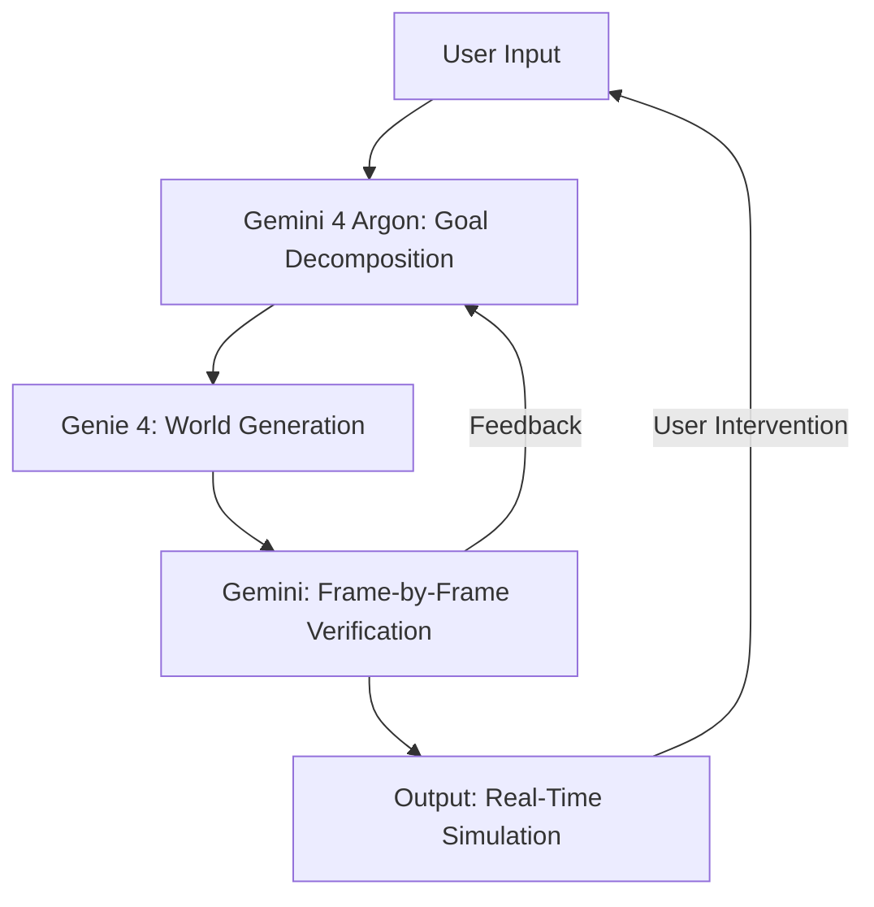

> 🎙️ **Listen to the podcast version of this article:**
> <audio controls src="index.mp3"></audio>


---

> 💡 **TL;DR:** This article dives into three transformative AI innovations: **Genie 4**, Google DeepMind’s real-time world model with native audio and physics-based realism; **FlashMap**, a speculative decoding drafter achieving 6.14× lossless speedup on Qwen3-8B; and **Liquid AI’s LFM3**, a suite of six open-weight 2B-class multimodal models optimized for edge deployment. Together, they push the boundaries of simulation, inference efficiency, and multimodal versatility.

| **Metric / Innovation Area**               | **Insight / Takeaway**                                                                                     |
|--------------------------------------------|---------------------------------------------------------------------------------------------------------|
| **Genie 4 (World Simulation)**             | Real-time multimodal simulation with native audio, physics, and interactive dialogue; 1GB+ context-aware environments. |
| **FlashMap (LLM Decoding)**                | 6.14× lossless speedup on Qwen3-8B via 16-token joint drafting; 0.5B-parameter drafter.                     |
| **LFM3 (Multimodal Models)**               | Six 2B-class models (text, vision, audio, omni, decisions) with tri-hybrid backbone; 256K context in ~1GB at 4-bit. |
| **Deployment**                             | Genie 4: Research preview for trusted testers; FlashMap: vLLM/SGLang plugins; LFM3: Hugging Face, GGUF, ONNX. |
| **Key Differentiator**                     | Genie 4: Hybrid reasoning + pixel-level simulation; FlashMap: Continuous flow maps for joint token drafting; LFM3: Hardware-aware architecture. |

---

### Genie 4: A New Generation of World Simulation

The quest to build **Artificial General Intelligence (AGI)** hinges on systems that can *understand* and *simulate* the world with human-like coherence. Google DeepMind’s **Genie 4** marks a watershed moment in this journey, introducing a **real-time, multimodal world model** that blends photorealistic visuals, dynamic physics, and native audio—including interactive dialogue—into a single, steerable simulation. Unlike its predecessors, Genie 4 doesn’t just render static scenes; it *reacts*, *adapts*, and *evolves* in response to user inputs or environmental changes, all while maintaining temporal consistency.

#### **The Architecture: Hybrid Reasoning Meets Pixel-Level Realism**
Genie 4’s breakthrough lies in its **hybrid architecture**, where **Gemini Omni** anchors the simulation in real-world appearance and behavior, while other **Gemini models** (e.g., **Gemini 3.8 Flash** and **Gemini 4 Argon**) provide the reasoning scaffolding. This duality enables Genie 4 to:
- **Simulate complex physics**: Aerodynamics, collisions, and fluid dynamics are rendered with unprecedented fidelity.
- **Generate native audio**: Ambient sounds (e.g., rustling leaves, crashing waves) and **interactive dialogue** emerge organically from the scene.
- **Support real-time steering**: Users can modify the simulation via natural language (e.g., “change the weather to rainy” or “add a character”) while Gemini dynamically adapts the prompt to the scene’s context.

A key innovation is the **closed-loop interaction** between Genie 4 and Gemini models. As Genie 4 generates a world in real-time, Gemini observes the scene, decomposes goals into sequential steps, and verifies progress frame-by-frame. If the user intervenes or the world shifts, Gemini **replans on the fly**, ensuring causality and coherence. This is visualized below:



#### **Applications and Early Feedback**
Genie 4’s **research preview** is already being tested by creatives, journalists, and engineers, with use cases spanning:
- **Filmmaking**: Rapid pre-visualization with adjustable camera angles, lighting, and dialogue.
- **Historical Reconstruction**: Transforming 2D archival photos into explorable 3D simulations.
- **Game Development**: Prototyping interactive mechanics and visual styles via natural language.
- **Robotics**: Simulating multi-step tasks (e.g., navigation, object manipulation) in virtual environments before real-world deployment.


*Example: A Genie 4 simulation with native audio and dynamic physics. Source: Google DeepMind.*

**Limitations and Responsibility**
While Genie 4 excels in short-term coherence, **long-term consistency** (e.g., object permanence, spatial accuracy) remains a challenge. To mitigate risks, Google has implemented:
- **Safety guardrails** aligned with its broader AI policies.
- **SynthID watermarking** for all generated audio/visual content.
- **Trusted tester feedback loops** to refine the model before broader release.

Genie 4 is currently available to **Google AI Ultra subscribers** via **Project Genie** and early access partners of the **Gemini API**. [Join the waitlist here](https://deepmind.google/).

---

### FlashMap: A Flow Map Drafter for 6.14× Faster LLM Decoding

Large Language Models (LLMs) are powerful but **slow and expensive** to run—especially for real-time applications. **Speculative decoding** has emerged as a leading solution, where a smaller **drafter model** proposes token sequences for the larger **target model** to verify in parallel. **FlashMap**, developed by researchers from **Polymathic AI, Princeton, USC ISI, NYU, and the Flatiron Institute**, takes this a step further by replacing traditional diffusion-based drafters with a **continuous flow map**, achieving **up to 6.14× lossless speedup** on **Qwen3-8B**.

#### **The Problem with Diffusion Drafters**
Existing drafters like **DFlash** or **EAGLE-3** suffer from **factorized approximations**, where each token in a block is predicted independently. This leads to **inconsistent drafts** (e.g., proposing “new diego” instead of “new york” or “san diego”), forcing the target model to reject valid prefixes. FlashMap solves this by **jointly mapping Gaussian noise to entire token blocks** in a single step, ensuring **inter-token dependencies** are preserved.

#### **How FlashMap Works**
1. **Flow Teacher**: A continuous flow over one-hot token blocks, trained via cross-entropy.
2. **Flow Map Student**: Uses **semigroup distillation** to convert the flow into a **2-time denoiser**, jumping from noise to data in **one step**.
3. **Drafter Architecture**: A **6-block diffusion transformer (DiT)** with:
   - Embedding dimension: 2048
   - 16 attention heads
   - Hidden states read from target layers 1, 9, 17, 25, and 33.
   - Frozen embedding matrix and LM head (copied from the target model).

The result? A **0.5B-parameter drafter** that drafts **16 tokens jointly** in one forward pass, with **6.14× speedup on GSM8K** (temperature 0) and **4.36× average speedup** across 9 benchmarks.

| **Feature**               | **FlashMap**               | **DFlash**               | **EAGLE-3**              | **DSpark**               |
|---------------------------|----------------------------|--------------------------|--------------------------|--------------------------|
| **Drafting Style**        | Continuous flow map, 1-2 passes | Block diffusion, 1 pass | Autoregressive, tree     | Semi-autoregressive      |
| **Inter-Token Dependencies** | Yes (joint over block)   | No (per-slot independent)| Yes (sequential)         | Yes (lightweight module) |
| **Drafter Size (Qwen3-8B)** | 500M                      | 1B                       | 302M                     | Not disclosed            |
| **GSM8K Speedup (T=0)**   | **6.14×**                  | 5.77×                    | 3.20×                    | Not tested               |

#### **Deployment and Performance**
FlashMap integrates seamlessly with **vLLM 0.31** and **SGLang 0.5.20**. For example, in vLLM:
```bash
--speculative-config num_speculative_tokens=16
```
Or in SGLang:
```bash
--speculative-algorithm DSPARK --speculative-draft-path /path/to/flashmap
```
**Key Takeaways**:
- **Lossless speedup**: Output remains **identical** to the target model’s.
- **Hardware efficiency**: Runs on the **same GPU** as the target model (tested on NVIDIA H200 NVL).
- **Open-source**: Weights (Apache-2.0) and code (MIT) are available on [Hugging Face](https://huggingface.co/) and [GitHub](https://github.com/).

---
### Liquid AI LFM3: 6 Open-Weight 2B-Class Multimodal Models

Multimodal AI is often **resource-intensive**, requiring massive models (e.g., 7B+ parameters) to handle text, vision, and audio. **Liquid AI’s LFM3** flips this script by introducing **six open-weight 2B-class models** that deliver **frontier performance** while fitting into **~1GB at 4-bit quantization**. Built on a **tri-hybrid backbone**, LFM3 models are optimized for **edge deployment** (phones, laptops, Raspberry Pi) and **agentic tasks**.

#### **The Tri-Hybrid Architecture**
LFM3’s backbone mixes **three operators** across 24 layers:
1. **Gated Short Convolutions (13 layers)**: Efficient local feature extraction.
2. **Sliding-Window Attention (5 layers)**: Captures medium-range dependencies (window size: 256 tokens).
3. **Global Attention (6 layers)**: Models long-range interactions.

This architecture was discovered via **hardware-in-the-loop search**, tuning across **14 device/backend combinations** (e.g., Raspberry Pi 5, Qualcomm Hexagon NPU). Additional optimizations include:
- **Head-wise sigmoid gates** on attention.
- **Partial RoPE** on global layers.
- **Sandwich normalization**.

#### **Model Variants and Performance**
The LFM3 family includes:
| **Model**               | **Parameters** | **Context Window** | **Modality**               | **Key Strengths**                     |
|-------------------------|----------------|--------------------|----------------------------|---------------------------------------|
| LFM3-1.7B               | 1.73B          | 256K               | Text                       | Agents, reasoning                      |
| LFM3-VL-2B             | 1.92B          | 128K               | Vision + Text              | Video input (2 fps), GUI understanding |
| LFM3-Audio-2B          | 1.92B          | 128K               | Audio (18 languages)       | Speech-to-speech, tool calling        |
| LFM3-Omni-2B           | 2.2B           | 128K               | Vision + Audio + Text      | Multimodal dialogue                    |
| d1-2B                  | 2B             | 128K               | Decision                   | Multi-question answering in 1 pass    |
| d1-Omni-2B            | 2B             | 128K               | Decision + Multimodal      | Agentic tasks                          |

**Benchmark Highlights**:
- **LFM3-1.7B** outperforms **Qwen3.5-9B** on:
  - **BFCL V4**: 71.39 vs. 55.12
  - **WebArena-Verified**: 38.42 vs. 21.92
  - **AutomationBench**: 41.29 vs. 15.10
- **LFM3-VL-2B** scores **71.4** across 62 vision benchmarks (vs. 71.7 for Gemma 4 12B).
- **LFM3-Omni-2B** achieves **70.1 on Daily-Omni** (vs. 61.3 for Qwen2.5-Omni-7B).

**Weaknesses**:
- **Knowledge-intensive tasks** (e.g., GPQA Diamond: 63.37 vs. 80.40 for Qwen3.5-9B).
- **Agentic coding** (e.g., SWE-bench Verified: 43.40 vs. 51.20).

#### **Deployment and Licensing**
LFM3 models are available on:
- **Hugging Face** (Apache-2.0 weights for most variants).
- **Liquid AI Playground** and **API**.
- **Formats**: GGUF, MLX, ONNX, FP8, NVFP4.
- **Runtimes**: llama.cpp, vLLM, SGLang, Ollama, Transformers.

**Hardware Efficiency**:
- **llama.cpp (Q4_0, 32K context)**: ~1GB RAM.
- **128K context**: 1.6GB KV cache (vs. 4.3GB for Qwen3.5-4B).
- **Throughput**: On an **NVIDIA B300** with SGLang, LFM3-1.7B generates **3.6B tokens/day** at 1,024 concurrent requests.

**Commercial Use**: Free under **LFM Open License v1.0** (up to **$10M annual revenue**).

---
### Why These Innovations Matter

#### **Genie 4: The Path to AGI via World Models**
World models like Genie 4 are **crucial for AGI** because they:
1. **Bridge the gap between reasoning and perception**: Hybrid architectures (Gemini + Genie) enable **structured planning** (e.g., robotics tasks) while maintaining **sensory richness**.
2. **Democratize simulation**: From filmmaking to robotics, Genie 4 lowers the barrier to **rapid prototyping** of complex, interactive environments.
3. **Raise ethical questions**: As simulations become indistinguishable from reality, **watermarking (SynthID)** and **safety guardrails** will be essential.

#### **FlashMap: The Key to Real-Time, Affordable AI**
Speculative decoding is **the most promising path** to making LLMs **10× faster and cheaper**. FlashMap’s advancements:
- **Joint token drafting** eliminates the **independence assumption** of prior methods.
- **1-step flow maps** reduce latency without sacrificing accuracy.
- **Open-source ecosystem** (vLLM, SGLang) ensures broad adoption.

**Future Outlook**: Expect **sub-100ms latency** for 8B-parameter models on consumer GPUs, unlocking **real-time chatbots, gaming NPCs, and edge AI**.

#### **LFM3: The Edge AI Revolution**
Liquid AI’s LFM3 proves that **small models can punch above their weight** when:
- **Architecture is hardware-aware**: Tri-hybrid backbones optimize for **memory and compute efficiency**.
- **Training is task-specific**: Agentic RL and distillation from larger teachers boost **decision-making** and **multimodal** performance.
- **Deployment is flexible**: From **Raspberry Pi to cloud**, LFM3 models adapt to **any environment**.

**Implications**:
- **On-device AI**: Privacy-preserving, low-latency applications (e.g., **voice assistants, AR/VR**).
- **Agentic workflows**: Lightweight models for **automation, coding, and robotics**.
- **Democratization**: Developers can fine-tune and deploy **without massive infrastructure**.

---
### The Big Picture: Where AI Is Heading
These three innovations—**Genie 4, FlashMap, and LFM3**—represent **three pillars** of the next AI era:
1. **Simulation**: World models that **understand and generate reality**.
2. **Efficiency**: Decoding methods that **eliminate latency bottlenecks**.
3. **Accessibility**: Multimodal models that **run anywhere**.

As these technologies converge, we’re inching closer to **AGI that is fast, affordable, and embedded in the fabric of daily life**—from hyper-realistic virtual worlds to **instantaneous, on-device AI assistants**. The future isn’t just intelligent; it’s **immersive, efficient, and ubiquitous**.

Written with [Argos](https://github.com/Neilstid/argos)
