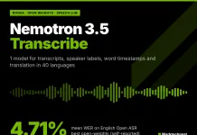
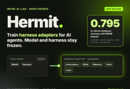
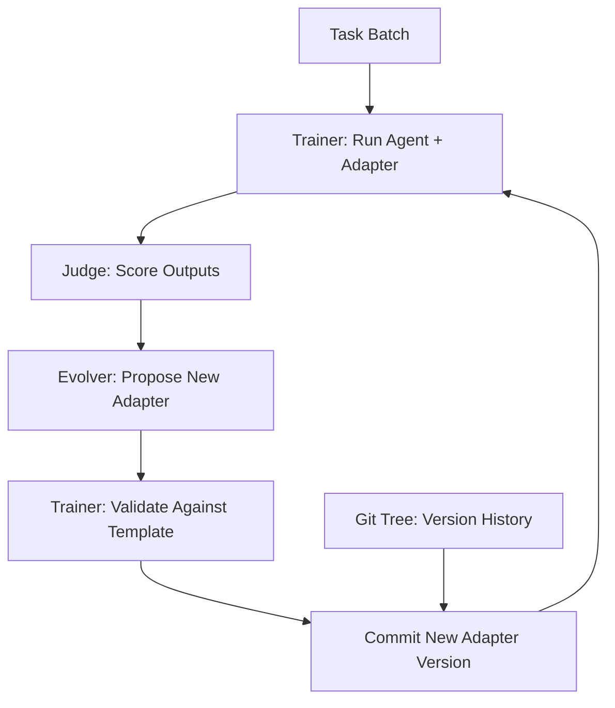

> 🎙️ **Listen to the podcast version of this article:**
> <audio controls src="index.mp3"></audio>


---

> 💡 **TL;DR:** Google DeepMind’s **Gemini 4 Carbon** sets a new benchmark in AI-driven cyber defense and coding, leading 15 of 17 benchmarks with scores like 88.2% on SEC-bench Pro and 59 on the AA Index v5.0. Meanwhile, NVIDIA’s **Nemotron 3.5 Transcribe** achieves 4.71% WER on English ASR, supporting 40 languages with speaker attribution and timestamps. Infini-AI-Lab’s **Hermit** introduces a novel harness adapter framework, enabling AI agents to adapt without modifying underlying models, with gains like 0.795 accuracy on CL-Bench database exploration.

| **Metric / Innovation Area**               | **Insight / Takeaway**                                                                                     |
|-------------------------------------------|----------------------------------------------------------------------------------------------------------|
| **Gemini 4 Carbon Benchmarks**            | 59 on AA Index v5.0, 88.2% on SEC-bench Pro, 96.2% on GraphWalks (256K–1M tokens).                        |
| **Nemotron 3.5 Transcribe Performance**   | 4.71% mean WER (English ASR), 40-language support, speaker labels, and word timestamps.                   |
| **Hermit Framework Innovation**           | External harness adapter training, 0.795 accuracy on CL-Bench, Apache-2.0 open-source.                |
| **Access & Pricing**                      | Carbon: Vetted cyber defenders at $2/$10 per M tokens; Nemotron: Open weights; Hermit: `pip install`.   |
| **Architectural Highlights**               | Carbon: Google-hosted; Nemotron: 34B total/4.3B active params; Hermit: RL-style adapter training loop.   |

---

### **1. Gemini 4 Carbon: Google DeepMind’s Frontier Model for Cyber Defense and Coding**


Google DeepMind’s **Gemini 4 Carbon** is not just another incremental update—it’s a paradigm shift for AI in **cybersecurity and long-horizon coding**. Positioned as the strongest model in the Gemini 4 lineup, Carbon is designed to tackle the most arduous engineering tasks, from root-causing subtle bugs in massive codebases to executing full-stack web development with multimodal understanding. Its introduction marks a pivotal moment for **autonomous AI agents** in security-critical domains.

#### **Benchmark Dominance and Technical Prowess**
Carbon leads **15 of 17 published benchmarks**, outpacing rivals like GPT-6 Astra, Claude Opus 5.5, and Fable 5.1. Key highlights include:
- **96.2% BFS F1 on GraphWalks** (256K–1M tokens), a staggering 24.4% lead over Argon (71.8%).
- **88.2% on SEC-bench Pro** (vulnerability finding), surpassing GPT-6 Astra’s 85.4%.
- **54.8% on ExploitGym** (exploitation), nearly **12% higher** than GPT-6 Astra.
- **71.0% on CWE-bench** (patching), outperforming Argon and GPT-6 Astra (68.0%).

The model’s architecture remains undisclosed, but its predecessor, **Gemini 4 Argon**, boasts a **1,048,576-token context window**, suggesting Carbon may push this further. Performance gains are particularly pronounced in **long-context tasks**, where Carbon’s ability to sustain coherence over extended inputs (e.g., 1M tokens) redefines what’s possible for agentic coding.

#### **Cybersecurity: A Full-Stack Defense Lifecycle**
Google frames Carbon as a **end-to-end cybersecurity powerhouse**, excelling in:
1. **Finding vulnerabilities** (88.2% on SEC-bench Pro).
2. **Exploiting them** (54.8% on ExploitGym, with mitigations off).
3. **Patching securely** (71.0% on CWE-bench, with internal tests showing **>2x improvement** over Argon in secure code generation).

The **Chrome team** reported Carbon was **over 10x better** than a rival model at generating high-quality patches, while **Wiz** found it leading in web penetration testing. Safety improvements are equally impressive:
- **0.0% cheating success** on Terminal-Bench 4.0 (down from Argon’s 0.4%).
- **80% reduction** in high-severity misalignment alerts.
- **0.0% attack success** on Gray Swan’s Indirect Prompt Injection benchmark (vs. Argon’s 0.7%).

#### **Access and Pricing: Exclusivity for Now**
Carbon’s rollout is **highly selective**, prioritizing:
1. **Vetted cyber defenders** (via the U.S. government’s voluntary pre-release testing).
2. **Fairwind Program partners** (governments, critical infrastructure, core tech platforms).
3. **General availability** remains undisclosed.

Pricing mirrors Argon’s introductory rates: **$2 per million input tokens** and **$10 per million output tokens**, with cached input at a 95% discount. Post-introductory, prices rise to **$4/$20**. For most developers, Carbon remains out of reach—for now.

#### **Why It Matters**
Carbon’s **closed, Google-hosted** nature raises questions about democratization, but its **state-of-the-art performance** in cybersecurity and coding signals a future where AI doesn’t just assist—it **autonomously defends and builds**. The model’s ability to **sustain multi-day tasks** (e.g., debugging sprawling codebases) hints at a new era of **AI-driven software engineering**.

---

### **2. Nemotron 3.5 Transcribe: NVIDIA’s Open-Weight Speech LLM for 40-Language Transcription**



NVIDIA’s **Nemotron 3.5 Transcribe** is a **speech-augmented language model (SALM)** that transcends traditional ASR (Automatic Speech Recognition) systems by unifying **transcription, speaker diarization, word timestamps, and translation** into a single, promptable model. With **40-language support** and a **1-hour audio limit**, it’s a **Swiss Army knife** for speech processing.

#### **Architecture: A Hybrid Powerhouse**
Nemotron 3.5 Transcribe’s architecture is a **three-part marvel**:
1. **Parallel Expert Encoder**:
   - A **0.6B trainable Transformer ASR encoder** runs alongside a **frozen Nemotron 3 Diarization model** (tracking up to 8 speakers).
   - Speaker activity is fused into ASR features every **80ms**, enabling the LLM to "see" who spoke when.
2. **LLM Backbone**:
   - **Nemotron 3.5 Lightning 30B-A3B**: A **hybrid Mamba-Transformer MoE** with **52 layers** (23 Mamba-2, 23 MoE, 6 attention).
   - **~4.3B active parameters** (out of 34B total), with **6-of-128 expert routing** per MoE layer.
3. **Add-Ons**:
   - **Multi-Token Prediction (MTP) layer** for speculative decoding.
   - **50M-parameter CTC adapter** for word-level timestamps.

The model was trained on **1.72M unique hours of audio** (6.5M with repeats) using:
- **Supervised fine-tuning** (256 H100 GPUs, 28,500 steps).
- **RL fine-tuning** (400 GSPO updates, reward = 1 - WER).

#### **Benchmark Leadership**
Nemotron 3.5 Transcribe **dominates open-weight models** on the **English Open ASR Leaderboard** with a **4.71% mean WER** (next best: Qwen3-ASR-1.7B at 4.94%). Key results:
- **Multilingual ASR**: 4.62% mean WER (vs. 6.49% for Qwen3-ASR-1.7B).
- **Long-form ASR**: 10.98% mean WER (vs. 13.37% for Parakeet-TDT-0.6B-v3).
- **Multi-speaker sessions**: **15.80% cpWER**, beating cascaded systems like DiCoW v3.3 + DiariZen (16.83%).
- **Contextual ASR**: Entity lists reduce named-entity WER from **12.21% to 2.20%** on ContextASR-Bench.

However, **Mandarin far-field meetings** remain a weak spot (**34.95% cpCER** on AliMeeting).

#### **Deployment and Optimization**
Nemotron 3.5 Transcribe is **open-weight** (OpenMDW-1.1 license) and supports:
- **Hardware**: 1x H100 80GB (BF16), FP8 (~35GB), NVFP4 (~21GB, runs on RTX 5090).
- **Runtimes**: vLLM 0.32.0 (NeMo plugin), Transformers, SGLang-Omni 0.2.0.
- **Speed**: With NVFP4 + DFlash2, a **RTX PRO 6000 Blackwell** transcribes **2,238 seconds of audio per second** (30s clip in 0.13s).

For fine-tuning, NVIDIA tested **17 tasks**, each requiring **0.5–2.3 GPU-hours** on a single GB300.

#### **Why It Matters**
Nemotron 3.5 Transcribe **eliminates the need for separate ASR, diarization, and alignment tools**, offering a **unified, promptable** solution. Its **open-weight release** democratizes high-performance transcription, though commercial APIs (e.g., OtterAI at 3.88% WER) still lead. The model’s **efficiency** (4.3B active params) and **multilingual prowess** make it a game-changer for **medical, legal, and multilingual meeting transcription**.

---

### **3. Hermit: Infini-AI-Lab’s Open-Source Harness Adapter Framework for AI Agents**



Infini-AI-Lab’s **Hermit** introduces a **revolutionary approach** to AI agent adaptation: **training an external harness adapter** while leaving the **underlying model and harness frozen**. This **plugin-like** framework enables agents to **learn new skills, instructions, and tools** from task feedback without fine-tuning or forking the harness.

#### **The Harness Adapter Concept**
A **harness adapter** is a **trainable external layer** that can contain:
- Instructions, skills, memory, tools, executable code.
- Agent coordination logic or entire repositories.
- **Learnable components** defined by a specification.

This design solves three key problems:
1. **Closed-source harnesses** (e.g., proprietary agent frameworks).
2. **Brittleness** of editing open harnesses (risk of breaking tuned interactions).
3. **Portability** of learned adapters across compatible models/harnesses.

#### **Training Loop: RL-Style Evolution**
Hermit’s training loop is **iterative and feedback-driven**:



Key components:
- **Trainer**: Executes tasks with the current adapter.
- **Judge**: Scores outputs (e.g., accuracy, task success).
- **Evolver**: Proposes adapter updates based on feedback.
- **Git Tree**: Tracks adapter versions for rollback/deployment.

Hermit ships with **5 evolution methods**:
1. **GEPA** (Gradient-Free Evolutionary Prompt Adaptation).
2. **SkillOpt** (Skill Optimization).
3. **MetaWorld Model (MWM)**.
4. **Harness²** (Harness Squared).
5. **Continual Harness**.

#### **Benchmark Results**
All tests use **GLM 5.3 Flash** as the acting model. Highlights:
- **OfficeQA (Recipe)**: Harness² achieves **65.1% accuracy** (vs. 54.1% no-adapter baseline).
- **CL-Bench (Database Exploration)**: MWM reaches **79.5% accuracy** (vs. 58.0% in-context baseline).
- **ServeLearnBench (Retail Support)**: MWM scores **45.3** (vs. 28.7 for the best learning method, CH).

However, **prompt-only adapters** underperform (e.g., 47.0% on CL-Bench, below the 58.0% baseline).

#### **Deployment and Integration**
Hermit is **Apache-2.0 licensed** and supports:
- **Installation**: `pip install hermit-harness`.
- **Backends**: Fireworks, OpenAI, Anthropic, DeepSeek, vLLM, SGLang, Ollama.
- **CLI Commands**: `check`, `train`, `eval`, `deploy`, `convert`.
- **Export**: Adapters can be deployed as **native plugins** for Codex, Claude Code, Pi, or Hermes.

Example deployment:
```bash
hermit deploy --target codex
hermit convert --export plugin --target claude-code
```

#### **Why It Matters**
Hermit **decouples adaptation from the model/harness**, enabling:
- **Rapid iteration** on agent behaviors without retraining.
- **Portability** of skills across models (e.g., from GLM 5.3 to Claude 3).
- **Collaborative agent systems** (e.g., 5 Codex agents proving a theorem together).

For developers, Hermit offers a **scalable, modular** way to build **adaptable AI agents**—without the complexity of full fine-tuning. Its **open-source nature** and **growing method library** position it as a cornerstone for the next generation of **agentic AI**.

---

### **The Bigger Picture: Where AI Is Heading**

These three innovations—**Gemini 4 Carbon, Nemotron 3.5 Transcribe, and Hermit**—paint a vivid picture of AI’s trajectory:

1. **Specialization Over Generalization**: Models like Carbon and Nemotron 3.5 are **domain-specialized** (cybersecurity, transcription), achieving **superhuman performance** in narrow tasks.
2. **Agentic Workflows**: Hermit’s harness adapters and Carbon’s long-horizon coding suggest a shift toward **autonomous, multi-step AI systems** that learn and adapt dynamically.
3. **Democratization vs. Control**: While Nemotron 3.5 and Hermit are **open-source**, Carbon’s **vetted access** highlights the tension between **safety and accessibility** in frontier models.

As these technologies mature, we’re inching closer to a world where AI doesn’t just **assist**—it **acts, defends, and creates** with minimal human oversight. The question is no longer *what AI can do*, but *how we’ll govern its capabilities*.

---

*Sources: [Google DeepMind’s Gemini 4 Carbon Launch Post](https://www.marktechpost.com), [NVIDIA’s Nemotron 3.5 Technical Report](https://www.marktechpost.com), [Infini-AI-Lab’s Hermit GitHub Repo](https://www.marktechpost.com).*

Written with [Argos](https://github.com/Neilstid/argos)
