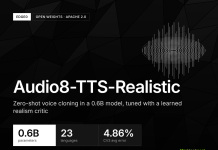
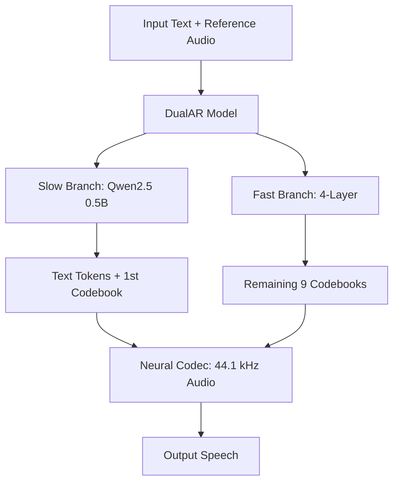
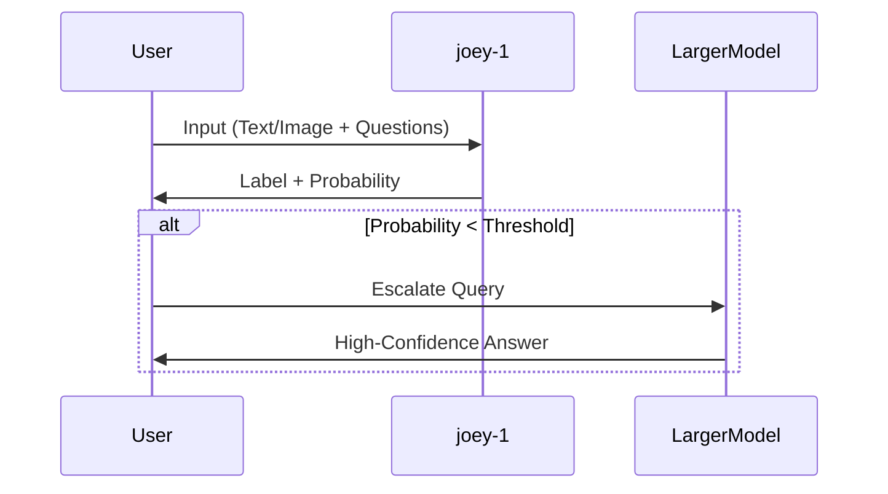
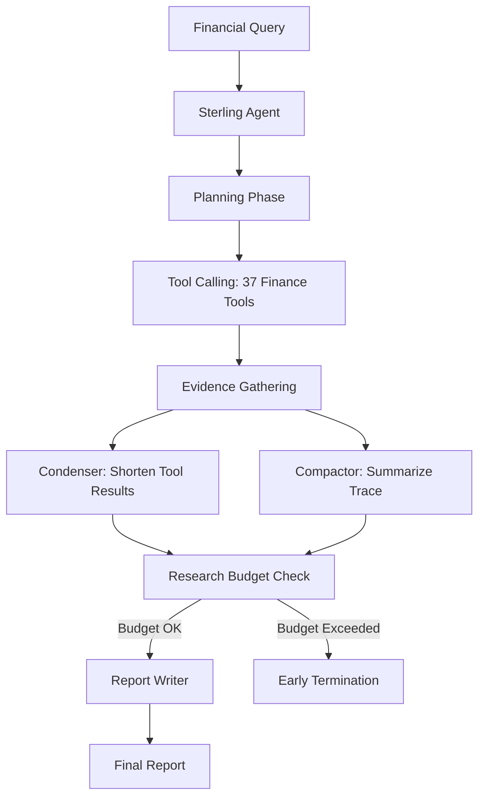

> 🎙️ **Listen to the podcast version of this article:**
> <audio controls src="index.mp3"></audio>

---

> 💡 **TL;DR:** This week, three AI breakthroughs redefine efficiency and specialization: Edge0’s **Audio8-TTS-Realistic** delivers 0.6B-parameter, 23-language voice cloning with open weights; Baseten’s **joey-1** offers 2B-parameter decision-making at 20 ms latency and $0.01 per million tokens; and Samaya’s **Sterling** outperforms Claude 5.1 on financial research at 1/11th the cost. Together, they showcase how domain-specific fine-tuning, calibrated probabilities, and multilingual TTS are pushing the boundaries of practical AI deployment.

| Metric / Innovation Area | Insight / Takeaway |
|-------------------------|-------------------|
| **Model Size** | Audio8-TTS-Realistic: 0.6B; joey-1: 2B; Sterling: 3B active (30B total MoE) |
| **Cost Efficiency** | joey-1: $0.01/1M tokens; Sterling: $0.61/question (vs. $6.89 for Claude 5.1) |
| **Latency** | joey-1: 20 ms P50; Audio8-TTS-Realistic: 21.5 fps (slow branch) |
| **Languages Supported** | Audio8-TTS-Realistic: 23; Sterling: English (finance domain) |
| **Benchmark Leadership** | Sterling: 58.9% on FrontierFinance; joey-1: 63.30 on Jev Decision Index (top under 4B) |
| **Open Weights** | Audio8-TTS-Realistic: Apache 2.0; joey-1: MIT; Sterling: Not public |

---

### Introduction: The New Wave of Specialized AI

The AI landscape is evolving beyond general-purpose giants into a constellation of specialized, high-efficiency models. This week, three releases exemplify this shift: **Edge0’s Audio8-TTS-Realistic** for multilingual voice cloning, **Baseten’s joey-1** for lightning-fast decision-making, and **Samaya AI’s Sterling** for finance research. Each addresses a niche with surgical precision, proving that smaller, tailored models can outperform larger counterparts in cost, speed, and domain-specific accuracy.

These innovations share a common thread: **co-training models with their harnesses or environments** to achieve breakthroughs in usability. Whether it’s voice cloning, probabilistic decisions, or financial analysis, the focus is on **practical deployment**—low latency, minimal cost, and open accessibility. Let’s explore how each model achieves this and why it matters.

---

### Edge0’s Audio8-TTS-Realistic: Open-Weight Voice Cloning for 23 Languages

#### Context: The Quest for Realism in TTS
Text-to-speech (TTS) systems have long struggled with the "uncanny valley" of synthetic speech—where outputs sound almost human but miss subtle rhythms, pauses, or emotional nuances. Traditional metrics like **Word Error Rate (WER)** and **Speaker Similarity (SIM)** often fail to capture these nuances, leading to models that score well quantitatively but still sound robotic. Edge0’s **Audio8-TTS-Realistic** tackles this by introducing a **learned realism critic** in its training pipeline, a novel approach to bridging the gap between technical metrics and human perception.

#### Technical Deep Dive
Audio8-TTS-Realistic is a **0.6B-parameter** model (excluding the codec) that supports **zero-shot voice cloning** across **23 languages**, including low-resource languages like Thai, Vietnamese, and Finnish. Its architecture is a **dual-autoregressive (DualAR) design**, inspired by Fish Audio S2 Pro:

- **Slow Branch**: Built on **Qwen2.5 0.5B**, this 24-layer, 896-width transformer predicts text tokens and the first audio codebook at **21.5 frames per second**. It handles the sequential, high-level reasoning of speech generation.
- **Fast Branch**: A shallow 4-layer network predicts the remaining **9 codebooks in parallel**, reducing sequential compute overhead.

The training pipeline is a **three-stage process**:
1. **Multilingual Supervised Fine-Tuning (SFT)**: Aligns the model with diverse linguistic patterns.
2. **GRPO with Combined Reward**: Optimizes for **70% WER and 30% SIM** to balance accuracy and speaker likeness.
3. **GRPO with Learned Realism Critic**: A **3M-parameter critic** (built on a frozen WavLM-large encoder) scores outputs against human recordings. The critic is trained on a "quality ladder" of 6 open-source TTS systems, with human recordings at the top. An **identity-erasure loss** prevents the critic from rewarding model-specific fingerprints, ensuring fairness.

The final stage improved aggregate metrics for **13 lower-resource languages**, reducing error rates from **22.53% to 20.77%** and increasing SIM from **0.637 to 0.679**.

#### Performance and Benchmarks
Audio8-TTS-Realistic excels on **CV3 (9 languages)** with a **4.86% average error**, outperforming:
- **Qwen3-TTS-1.7B**: 7.73%
- **VoxCPM2**: 5.35%
- **CosyVoice3-1.5B**: 6.89%

However, it trails **Higgs TTS 3** (4B parameters) on both CV3 (**4.41%**) and MiniMax (**2.74%**). Notably, **Thai WER remains high at 48.57%**, highlighting the challenges of low-resource languages.

#### Why It Matters
- **Open Weights**: Released under **Apache 2.0**, enabling fine-tuning and deployment without licensing barriers.
- **Multilingual Support**: 23 languages make it one of the most versatile open TTS models.
- **Realism Focus**: The learned critic addresses the "uncanny valley" problem, a first in open TTS systems.
- **Efficiency**: Runs on **1.1–1.2 GiB peak memory** on an **Apple M2 CPU (INT4 ONNX)**, making it accessible for edge devices.

**Deployment**: Available via Hugging Face, with a CLI, batching, and fine-tuning scripts. An **SGLang Omni adapter** enables paged attention and dynamic batching for GPU serving.

---

### Baseten’s joey-1: Calibrated Decision-Making at 20 ms Latency

#### Context: The Need for Speed in Decision Models
Decision-making models are the unsung heroes of AI systems—handling routing, classification, and guardrail checks with minimal latency. Traditional LLMs, however, are overkill for these tasks: they generate text outputs that must be parsed, adding overhead and complexity. **joey-1** flips this script by returning **calibrated probabilities** directly, eliminating the need for post-processing.

#### Technical Deep Dive
joey-1 is a **2B-parameter** model post-trained from **Qwen3.5-2B**, optimized for **high-volume, low-latency decisions**. Key features:
- **Output Format**: Returns a **label + probability** (not text) for three question types:
  - **Choice**: Pick one named option (e.g., "Which team owns this ticket?").
  - **Yes/No**: Probability of "yes."
  - **Score**: Ordered levels (e.g., urgency: low, medium, high).
- **Architecture**: Uses a **block-bidirectional mask** for full-attention layers. The vision encoder remains frozen, and all questions are answered from a **shared-prefix prefill**, minimizing computational overhead for additional queries.
- **Training**: Fine-tuned on **6.21M decision examples** with a **cross-entropy + Brier calibration term**. The dataset mix:
  - 58.3% core decision skills
  - 16.1% safety
  - 16.1% judging and expert domains
  - 9.5% public data

The model was trained for **1 epoch (43,390 steps)** on **2 nodes of 8 H100 GPUs** with a peak learning rate of **1e-5** in BF16.

#### Performance and Benchmarks
joey-1 achieves:
- **20 ms P50 latency** for an average **2,000-token request** (2.5x faster than its 9B sibling, **elephant-1** at 49 ms).
- **$0.01 per 1M input tokens** (vs. $0.035 for elephant-1 and $0.10 for mammoth-1).
- **63.30 on the Jev Decision Index 0.4 public split**, ranking **#37 of 230 models** and **#1 under 4B parameters**.

| Model | Parameters | Jev Decision Index 0.4 | Latency (P50) | Cost per 1M Tokens |
|-------|------------|------------------------|----------------|---------------------|
| joey-1 | 2B | 63.30 | 20 ms | $0.01 |
| elephant-1 | 9B | 72.24 | 49 ms | $0.035 |
| mammoth-1 | 27B | N/A | N/A | $0.10 |
| Perplexity Decider Flash v1.2 | 4B | 60.06 | N/A | $0.01 |

**Calibration** is a standout feature: the model includes a trained "I don’t know" option, allowing users to set confidence thresholds. Low-confidence answers can escalate to larger models (elephant-1, mammoth-1) or human reviewers.

#### Why It Matters
- **Speed and Cost**: At **20 ms latency and $0.01/1M tokens**, joey-1 is ideal for **high-throughput applications** like support ticket routing or fraud detection.
- **Calibrated Probabilities**: Eliminates the need for text parsing, reducing errors and latency.
- **Scalability**: Shared-prefix prefill means **additional questions add minimal cost**.
- **Open Access**: **MIT-licensed weights** on Hugging Face; self-hostable on **1 CUDA GPU**.

**Deployment**: Available via **Baseten Model APIs** (`/v1/systemone` endpoint) or self-hosted. Dedicated deployments unlock **262K context** and fine-tuning support.

---

### Samaya AI’s Sterling: A 3B-Active Finance Research Agent That Outperforms Claude 5.1

#### Context: The Rise of Domain-Specialized Agents
General-purpose LLMs often struggle with **domain-specific tasks** like financial research, where precision, tool integration, and structured reasoning are critical. **Samaya Sterling** is a **3B-active-parameter** (30B total) **Mixture-of-Experts (MoE)** model that outperforms **Claude 5.1** on the **FrontierFinance benchmark**—while costing **11x less** per query.

#### Technical Deep Dive
Sterling is built on **NVIDIA’s Nemotron 3.5 Lightning** (30B MoE, 3B active parameters) and is **post-trained with LoRA** to function as a **financial research agent**. Its workflow:
1. **Planning**: Outlines research steps.
2. **Tool Calling**: Uses **37 finance-specific tools** (e.g., data fetchers, calculators).
3. **Evidence Gathering**: Collects and synthesizes information.
4. **Report Writing**: Hands findings to a separate report-writing model.

The **harness** (orchestration layer) is co-trained with the model for efficiency:
- **Prompt Optimization**: Stripped detailed guidance from system prompts and tool descriptions; merged tools to shorten prompts.
- **Context Management**: Two helper models:
  - **Condenser**: Shortens long tool results.
  - **Compactor**: Summarizes the growing trace.
- **Budgeting**: A **research budget** caps the agent’s runtime.

#### Training Pipeline
Sterling’s training used **Tinker (Thinking Machines Lab’s training API)** in **4 stages**:
1. **SFT on Synthetic Traces**: Generated **968 synthetic analyst questions**. **Kimi K3** answered each twice, and an LLM judge selected the better response. The model learned to call tools with valid arguments.
2. **SFT on Best-of-8 Strategies**: Kimi K3 answered **1,819 expert-written questions** using 8 research strategies. The best-graded answer per question became training data. **Best-of-8 met 80% of essential rubric items** (vs. 66% for single-best strategy).
3. **Offline GRPO**: Scored all 8 teacher answers against each other (no new generation needed).
4. **Online GRPO**: The model answered each question **8 times** and learned from graded attempts. **Truncated importance sampling** corrected a known MoE sampler mismatch.

#### Performance and Benchmarks
On **FrontierFinance (220 public queries)**, Sterling achieves:
- **58.9% score** at **$0.61 per question** (vs. **55.9% at $6.89** for Claude 5.1).
- **60.6% in high-effort mode** ($1.83 per question, 372s latency).
- **45.2% on the hardest third** of questions (up from 31.8% at baseline).

| Model | FrontierFinance Score | Cost per Question | Latency per Question | Active Parameters |
|-------|------------------------|-------------------|----------------------|-------------------|
| Sterling | 58.9% (60.6% high effort) | $0.61 ($1.83) | 282s (372s) | 3B |
| Claude 5.1 | 55.9% | $6.89 | 268s | N/A |
| Nemotron 3.5 Lightning (Base) | 42.5% | N/A | N/A | 3B |

**Cost Breakdown**: The model itself costs **$0.04 per question**; the remaining **$0.57** covers tools and helper models.

#### Why It Matters
- **Cost Efficiency**: **11x cheaper** than Claude 5.1 with **higher accuracy** on FrontierFinance.
- **Domain Specialization**: Proves that **co-training models with their harnesses** can outperform larger, general-purpose models in niche domains.
- **Scalability**: The **3B active parameters** fit on a **single H100 80GB** in BF16 (256K context).
- **Tool Integration**: Uses **37 finance-specific tools**, demonstrating the power of **agentic workflows** in specialized fields.

**Limitations**:
- **No Public Weights/API**: Currently available only via Samaya’s platform.
- **Self-Reported Benchmarks**: Results are based on Samaya’s own **FrontierFinance** benchmark.

**Deployment**: Accessible via Samaya’s platform. Check out the [technical blog](https://www.samaya.ai/sterling) and [FrontierFinance benchmark](https://github.com/samaya-ai/frontier-finance).

---

### Comparative Takeaways: Which Tool for Which Use Case?

| Use Case | Recommended Model | Why? | Cost | Latency |
|----------|-------------------|------|------|---------|
| **Multilingual Voice Cloning** | Audio8-TTS-Realistic | 23 languages, open weights, realism critic | Free (self-host) | ~21.5 fps |
| **High-Volume Decision Making** | joey-1 | Calibrated probabilities, 20 ms latency | $0.01/1M tokens | 20 ms |
| **Finance Research** | Sterling | 58.9% on FrontierFinance, 11x cheaper than Claude 5.1 | $0.61/question | 282s |

#### Cost-Benefit Analysis
1. **Audio8-TTS-Realistic**: Best for **developers needing multilingual TTS** with open-source flexibility. The **realism critic** is a standout feature for human-like speech, though low-resource languages (e.g., Thai) lag behind.
2. **joey-1**: Ideal for **enterprises requiring fast, cheap decisions** (e.g., routing, classification). The **calibrated probabilities** and **escalation capability** make it a robust first-line filter.
3. **Sterling**: A **game-changer for finance teams** that need **high-accuracy research at scale**. The **11x cost reduction** vs. Claude 5.1 is a compelling value proposition, though the lack of public access may limit adoption.

#### Early-Adoption Tips
- **For Audio8-TTS-Realistic**: Start with the **Hugging Face Playground** (ZeroGPU) to test voice cloning. Fine-tune on domain-specific data for better results in low-resource languages.
- **For joey-1**: Use the **Baseten Model APIs** for seamless integration. Set **confidence thresholds** to escalate uncertain decisions to larger models.
- **For Sterling**: If you’re in finance, **pilot Sterling on Samaya’s platform** for research tasks. Compare its outputs against your existing workflows to quantify time/cost savings.

---

### Conclusion: The Era of Specialized, Efficient AI

The releases of **Audio8-TTS-Realistic**, **joey-1**, and **Sterling** signal a shift toward **specialized, efficient, and deployable AI**. These models prove that **smaller, domain-focused systems** can outperform larger, general-purpose ones in cost, speed, and accuracy—when trained and deployed thoughtfully.

- **Edge0** demonstrates that **realism in TTS** can be achieved with a **learned critic**, not just brute-force scaling.
- **Baseten** shows that **decision-making** doesn’t require text generation—**calibrated probabilities** are faster and cheaper.
- **Samaya AI** proves that **co-training models with their harnesses** can yield **domain-specific breakthroughs** at a fraction of the cost.

**Call to Action**:
- Experiment with **Audio8-TTS-Realistic** on [Hugging Face](https://huggingface.co/Edge0/Audio8-TTS-Realistic).
- Test **joey-1** via [Baseten’s Model APIs](https://www.baseten.co/) or self-host the [MIT-licensed weights](https://huggingface.co/baseten/joey-1).
- Explore **Sterling** on [Samaya’s platform](https://www.samaya.ai/sterling) and compare it to your current finance workflows.

The future of AI isn’t just about bigger models—it’s about **smarter, leaner, and more specialized** ones. These three releases are leading the charge.

Written with [Argos](https://github.com/Neilstid/argos)
