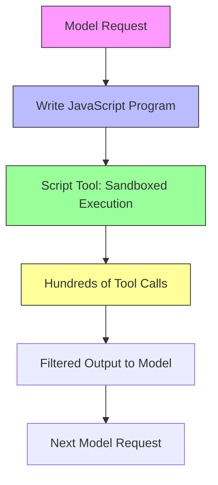
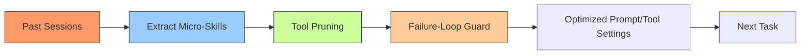
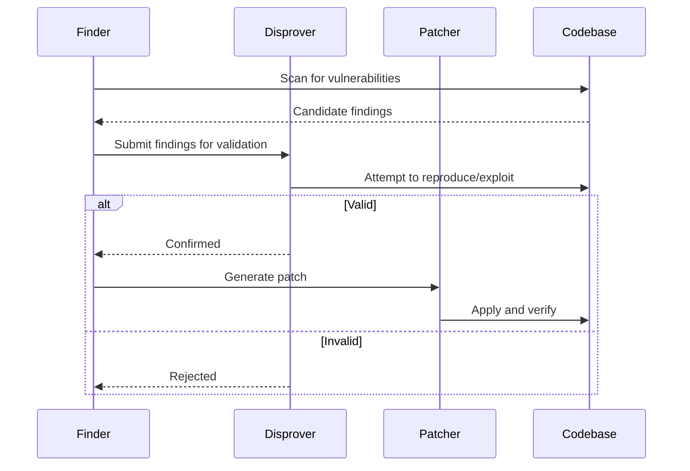

> 🎙️ **Listen to the podcast version of this article:**
> <audio controls src="index.mp3"></audio>


---

> 💡 **TL;DR:** The AI coding landscape is evolving rapidly with Factory’s **Droid 1.0**, a model-independent harness that slashes costs and boosts efficiency via programmatic tool calling, and **TokenEconomizer**, Microsoft’s plugin that cuts token spend by up to 30.9% on SWE-Bench. Meanwhile, AI security agents from Claude, Codex, Mantis, and Cloudflare are converging on a **find-disprove-patch** loop to combat noise in vulnerability detection. Mistral’s **Large 4 OSS**—a trillion-parameter open-weight model—promises to democratize high-end cybersecurity and agentic coding.

| **Metric / Innovation Area**               | **Insight / Takeaway**                                                                                     |
|-------------------------------------------|----------------------------------------------------------------------------------------------------------|
| **Droid 1.0 (Factory)**                  | 65.2% pass rate on Terminal-Bench 4 with Claude Opus 5.5 at **$4.73 per passed task**; 37% smaller base prompt. |
| **TokenEconomizer (Microsoft/UC Berkeley)** | 18.4%–30.9% cost reduction on SWE-Bench; **0% increase in cost** across all 30 repository-setting cells.   |
| **AI Security Agents**                    | Shared **find-disprove-patch** loop; Claude Security integrates with Claude Code, Mantis offers sandboxed reproduction. |
| **Mistral Large 4 OSS**                  | Trillion-parameter open-weight model; **leading performance** on agentic coding benchmarks vs. GLM-5.3.     |

---

### 1. Introduction: The Trend of Model-Independent Coding Agents and the Rise of Droid 1.0

The AI coding agent ecosystem is undergoing a seismic shift. Where once tools were tightly coupled to specific models—locking developers into proprietary ecosystems—a new wave of **model-independent harnesses** is emerging. Leading this charge is **Factory’s Droid 1.0**, a harness designed to abstract away model-specific quirks and let developers focus on the task at hand. At its core, Droid 1.0 redefines how agents interact with tools, moving from a one-to-one request-to-tool ratio to a **programmatic paradigm** where a single model request can orchestrate hundreds of tool calls.

#### 1.1 What is Droid 1.0? Key Features and Benchmarks

Droid 1.0 is built on **Script Mode**, a programmatic tool-calling system where the model writes a JavaScript program to execute tools in a sandboxed environment. This approach, inspired by [CodeAct (Wang et al., 2024)](https://arxiv.org/abs/2402.14207), dramatically reduces the number of model calls required for complex tasks. For example:
- A **unit test fix** that previously required 10 model calls and 56.8 seconds now completes in **5 model calls and 41.6 seconds**.
- A **linear cleanup** task involving 151 issues and 312 tool calls was executed with just **2 model requests** and ~61,000 tokens (vs. 36 requests and 3.1M tokens for direct calls).


**Architecture and Efficiency Gains**
Droid 1.0’s architecture is optimized for **cross-model generalization**. Key improvements include:
- **Prompt Cache**: 98% of input tokens are read from cache, reducing redundancy.
- **Leaner First Request**: Tool definitions dropped by **46%**, with rarely used tools loaded on demand.
- **Bounded Autonomy**: Repeated tool calls trigger nudges (3 identical calls) or stops (6 calls) to prevent infinite loops.
- **App Latency**: First paint time improved from **1,839 ms to 488 ms**, and session memory overhead reduced from 350 MB to **20 MB per additional session**.

**Benchmark Performance**
On **Terminal-Bench 4**, Droid 1.0 outperforms competitors across multiple models:
- **Claude Opus 5.5**: **65.2% pass rate** (vs. Cursor’s 62.1%, Devin’s 59.6%, Claude Code’s 57.6%), with **16–26% faster task completion** and **17% fewer tokens** than Claude Code.
- **GPT-6.1 Sol**: **57.6% pass rate** at **$0.79 per passed task** (vs. Codex’s 54.0%).


*Droid 1.0’s programmatic tool-calling workflow: A single model request can drive hundreds of tool calls via a sandboxed script.*

#### 1.2 Practical Implications for Developers

Droid 1.0 is more than a benchmark leader—it’s a **practical tool** for developers. Key takeaways:
- **Model Agnosticism**: Works with **any supported model**, including BYOK (Bring Your Own Key) and Factory Router’s cost-efficient mixes.
- **Cross-Platform**: Available as a **macOS/Windows desktop app**, terminal UI, or Node SDK (`@factory/droid-sdk`).
- **Cost Efficiency**: **15% cheaper** than direct tool calling on Claude Opus 5.5, with **Script Mode enabled by default** for 10 models (e.g., GPT-6.1 Sol, Kimi K3).

**Code Snippet: Installing Droid SDK**
```bash
npm install @factory/droid-sdk
```

For teams already using **Claude Code** or **Codex**, Droid 1.0 offers a **drop-in replacement** with superior efficiency. The only caveat? With **GPT-6.1 Sol**, Droid is **10% slower per passed task** than Codex—a trade-off for its model-agnostic flexibility.

---

### 2. Cost-Efficient Coding: The TokenEconomizer Plugin

While Droid 1.0 optimizes tool calling, **TokenEconomizer**—a new open-source plugin from Microsoft Research and UC Berkeley—tackles another critical pain point: **token waste**. Coding agents are notoriously inefficient, often re-processing the same prompts, tool schemas, and histories with every turn. TokenEconomizer addresses this by **learning from past sessions** to dynamically optimize future ones.

#### 2.1 How TokenEconomizer Works

TokenEconomizer operates as an **external controller**, treating the agent as a black box. It maintains a **per-repository state** built from completed traces and applies three key mechanisms:

1. **Micro-Skills**
   - An LLM proposer extracts **1-line facts** (e.g., "the working test command is `pytest tests/`") from trace digests.
   - Facts are validated via **regex detectors** and added to the prompt after **3 confirmations** on non-overlapping tasks.
   - **Need Rate Threshold**: Facts must have a ≥0.4 usage rate to persist; contradictions retire facts quickly (1 contradiction = 5 confirmations).

2. **Tool Pruning**
   - **Core tools** (shell, read, write, edit) are always retained.
   - Other tools are **masked** after 3 consecutive unused tasks or if an LLM judge deems them irrelevant.
   - The full tool catalog is **re-audited every 5 tasks** to adapt to new needs.
   - **Example**: On Django with Claude Code, the first request on task 2 dropped from **43,351 to 16,295 prompt tokens** after pruning.

3. **Failure-Loop Intervention**
   - Learns a **turn budget** (1.25× the 90th percentile of successful run lengths).
   - **Rule-based checks** flag repeated failures or dense errors.
   - An LLM judge (confidence ≥0.7) decides if the agent is stuck, triggering a **redirect** or **stop**.


*TokenEconomizer’s three-pronged optimization pipeline.*

#### 2.2 Cost Reductions on SWE-Bench and Real-World Impact

TokenEconomizer’s results on **SWE-Bench** (277 tasks across 5 agent-model settings) are striking:

| **Setting**                          | **Cost vs. Default** | **Pass@1 (Default)** | **Pass@1 (TokenEconomizer)** |
|--------------------------------------|----------------------|----------------------|-------------------------------|
| Claude Code + Sonnet 5               | **-23.6%**           | 74.7                 | **76.0**                     |
| Claude Code + Opus 4.8               | **-30.9%**           | 74.0                 | **73.0**                     |
| Codex + GPT-5.6 Terra                | **-24.7%**           | 73.8                 | **74.7**                     |
| Codex + GPT-5.6 Sol                  | **-26.1%**           | 80.1                 | **81.7**                     |
| Copilot CLI + Sonnet 5               | **-18.4%**           | 75.0                 | **77.6**                     |

**Key Insights**:
- **Savings Scale Over Time**: Most repositories start with higher costs but become **cheaper by the 6th task** as TokenEconomizer learns.
- **Tool Pruning Dominates**: Accounts for **13.2–17.7%** of savings, followed by micro-skills (11.8–14.3%) and loop guards (5.4–7.1%).
- **Pass@1 Improves**: 4 out of 5 settings saw **higher Pass@1 rates**, with only Opus 4.8 experiencing a **1.0-point drop** (due to reduced reasoning effort).
- **Beyond SWE-Bench**: Costs fell **16.0–21.2%** on Web-Bench and **16.5–19.6%** on CredData. Even on **ReposVul** (shorter runs), savings reached **6.4–9.3%**.

**Installation**
TokenEconomizer is **Apache 2.0-licensed** and supports **Claude Code, Codex, Copilot CLI, and Pi**. Setup is straightforward:
```bash
# For Claude Code
claude plugin install tokeneconomizer@tokeneconomizer
```
Learned data is stored locally in `~/.tokeneconomizer`. By default, **tool pruning and loop guards are enabled**, while micro-skills are off (due to proposer model calls).

**Comparison with Alternatives**
| **Feature**               | **TokenEconomizer**       | **RTK**               | **Serena**          | **Aider RepoMap**       |
|---------------------------|---------------------------|-----------------------|---------------------|-------------------------|
| **Learns from Past Tasks** | ✅ Yes                    | ❌ No                | ❌ No               | ❌ No                   |
| **Mean SWE-Bench Savings** | **-18.4% to -30.9%**      | -8.9% to **+4.5%**   | Not in main runs   | -6.1% to **+6.5%**     |
| **Cells with Higher Cost** | **0/30**                 | 12/30                | Not disclosed      | 15/30                  |

TokenEconomizer is the **only tool** that **never increased costs** across all 30 repository-setting cells, making it a **must-have** for cost-conscious teams.

---

### 3. AI-Driven Code Security: Comparing Claude, Codex, Mantis, and Cloudflare Agents

Security is the **Achilles’ heel** of AI coding. Sloppy scans produce **hallucinated bugs** with true-positive rates **below 7%** (per Google’s security team), wasting reviewer time. The solution? A **find-disprove-patch loop**, now adopted by **Claude, Codex, Mantis, and Cloudflare**—each with unique strengths.

#### 3.1 The Find-Disprove-Patch Loop: A Shared Paradigm

All four agents follow this **three-phase workflow**:
1. **Find**: Agents scan the codebase for potential vulnerabilities.
2. **Disprove**: A **separate agent** (or validator) attempts to disprove each finding to filter out false positives.
3. **Patch**: Confirmed vulnerabilities are patched, often with **adversarial testing** to ensure robustness.


*The universal find-disprove-patch loop in AI security agents.*

#### 3.2 Comparative Strengths

| **Agent**               | **Developer**       | **License**          | **Runs Where**               | **Model Lock-In**       | **Proof Step**                          | **Patches** |
|-------------------------|---------------------|----------------------|------------------------------|-------------------------|-----------------------------------------|-------------|
| **Claude Security**     | Anthropic           | Plugin (Commercial)  | Claude Code session          | Claude models          | Independent verifier panel              | ✅ Yes       |
| **Codex Security**      | OpenAI              | Apache-2.0 CLI       | CLI, SDK, GitHub Action      | OpenAI-gated           | Validates candidates; verifies fixes    | ✅ Yes       |
| **Mantis**              | Google              | Apache-2.0           | Any agent/ADK harness        | None                   | Sandboxed reproduction; adversarial loop | ✅ Yes       |
| **Security Audit Skill**| Cloudflare          | MIT                  | Any coding agent             | None                   | Fresh agent disproves; 2nd verification | ❌ No        |

**Deep Dive into Each Agent**:

1. **Claude Security (Anthropic)**
   - **Integration**: Runs **inside Claude Code** (no extra API key).
   - **Workflow**:
     - **Architecture mapping** → **Threat modeling** → **Hunting** → **Independent verification**.
   - **Output**: Markdown reports + **SARIF 2.1.0** (GitHub code scanning compatible).
   - **Patches**: Generated in a **scratch copy** and saved as `.patch` files (never auto-commits).
   - **Cost**: Counts against your **Claude plan’s usage limits**.
   - **Timeline**: Public beta for Enterprise (Claude Mythos 5) since **July 22, 2026**.

2. **Codex Security (OpenAI)**
   - **CLI/SDK**: `@openai/codex-security` (Apache-2.0 client, but scanner is gated).
   - **Features**:
     - Scans **whole repos, paths, or Git diffs**.
     - **Deep mode**: Parallel discovery workers.
     - **Policy Management**: Drafts `SECURITY.md` to define vulnerability criteria.
   - **Output**: Threat models, SARIF/JSON/CSV, **Linear integration**, GitHub Action support.
   - **Access**: Limited beta for **approved customers** (supports OpenAI, Bedrock, OpenRouter, Fireworks).

3. **Mantis (Google)**
   - **Innovation**: **Sandboxed reproduction** of bugs (from static exploits to unit tests/mock servers).
   - **Threat Modeling**: Builds a **hierarchical summary tree** (85%+ token reduction).
   - **Adversarial Patching**: Attacks fixes to ensure robustness.
   - **Severity Calibration**: Prevents "thousands of criticals" via a rubric.
   - **Feedback Loop**: `mantis-advise` feeds learnings back into code generation.
   - **Setup**:
     ```bash
     git clone https://github.com/google/mantis.git
     cd mantis/reference && ./install.sh
     ./run.sh path/to/code --focus "look for IDOR"
     ```

4. **Security Audit Skill (Cloudflare)**
   - **Open-Source**: MIT-licensed, **47.5K GitHub stars** (most-starred).
   - **Workflow**:
     1. **Reconnaissance**: Maps architecture, trust boundaries, input surfaces.
     2. **Coverage-Led Hunting**: Isolated hunters + coverage critics.
     3. **Candidate Validation**: Fresh verifier disproves findings.
     4. **Independent Verification**: New agents re-verify claims.
     5. **Reporting**: `REPORT.md` + `findings.json` (schema-validated).
   - **Requirements**: Coding agent with **tool use + parallel sub-agents** + Node.js.
   - **Sandboxing**: **Mandatory** for execution (otherwise, findings stay `needs_validation`).
   - **Real-World Impact**: Cloudflare’s internal harness scanned **128 repos**, yielding:
     - **20,799 raw candidates** → **12,057 survived validation**.
     - **7,245 actionable findings** sent to engineering.
     - **Rejection rate dropped from 40% to 11%** with better context.

#### 3.3 Takeaways for Security-Focused AI Projects

- **Start Simple**: If you’re already using **Claude Code**, the **Claude Security plugin** is the easiest entry point.
- **CI/CD Integration**: **Codex Security** offers the most mature pipeline tooling (GitHub Actions, SARIF).
- **Vendor Neutrality**: **Cloudflare’s skill** is **MIT-licensed** and works with any agent supporting parallel sub-agents.
- **Deepest Proof**: **Mantis** provides the most rigorous validation (sandboxed reproduction + adversarial patching).
- **Hybrid Approach**: Cloudflare’s data suggests **using different models for discovery and validation** improves coverage.

**Pro Tip**: Combine **discovery tools** (e.g., Mantis for deep scans) with **lightweight validators** (e.g., Cloudflare’s skill) to balance thoroughness and speed.

---

### 4. New Frontier: Mistral Large 4 OSS – A Trillion-Parameter Open-Weight Model

Mistral’s **Large 4 OSS** is a **watershed moment** for open-weight models. With **1 trillion parameters**, it’s designed for **self-hosted deployment** and excels in **cybersecurity and agentic coding**—competing with closed models like **GLM-5.3** while offering **full transparency and control**.

#### 4.1 Model Architecture and Self-Hosting Benefits

- **Scale**: **1T parameters**, optimized for **agentic workflows** (e.g., multi-step reasoning, tool use).
- **Open Weights**: Unlike proprietary models, **Large 4 OSS** can be **self-hosted**, enabling:
  - **Data Privacy**: No third-party access to your code or prompts.
  - **Customization**: Fine-tune for **domain-specific tasks** (e.g., security audits, code generation).
  - **Cost Control**: Avoid per-token API fees for high-volume use cases.
- **Performance**: Mistral claims **leading open-weight performance** on agentic coding benchmarks, with **comparable cybersecurity capabilities to GLM-5.3**.

**Why Self-Hosting Matters for Security**
- **Air-Gapped Environments**: Critical for **government, finance, or healthcare** projects.
- **Compliance**: Meet **GDPR, HIPAA, or SOC 2** requirements without relying on third-party APIs.
- **Latency**: Reduce dependency on external services for **real-time applications**.

#### 4.2 Performance Claims Against GLM-5.3 and Other Open Models

While Mistral hasn’t released **full benchmark details**, early claims suggest:
- **Agentic Coding**: Outperforms **GLM-5.3** on tasks requiring **multi-step reasoning** and **tool orchestration**.
- **Cybersecurity**: Comparable to **GLM-5.3** in vulnerability detection and patch generation.
- **Efficiency**: Optimized for **long-context tasks** (e.g., repository-wide analysis).

**Potential Use Cases in Developer Toolchains**:
1. **Self-Hosted Coding Agents**: Replace **Claude Code** or **Codex** with a **local, open-weight alternative**.
2. **Security Audits**: Integrate with **Mantis** or **Cloudflare’s skill** for **offline vulnerability scanning**.
3. **Custom Harnesses**: Build **Droid 1.0-like harnesses** with **full control** over prompts and tools.
4. **Hybrid Workflows**: Use **Large 4 OSS** for **sensitive tasks** (e.g., internal code reviews) while leveraging **cloud models** for general-purpose work.

#### 4.3 The Broader Impact of Open-Weight Models

Mistral Large 4 OSS signals a **shift in the AI landscape**:
- **Democratization**: Smaller teams can now access **frontier-level models** without relying on Big Tech.
- **Innovation Acceleration**: Open weights enable **researchers and startups** to build on top of state-of-the-art models.
- **Security Through Transparency**: Open models allow **community audits**, reducing the risk of **hidden vulnerabilities** or **backdoors**.

**Challenges**:
- **Hardware Requirements**: Running a **1T-parameter model** requires **significant GPU resources** (e.g., **A100/H100 clusters**).
- **Fine-Tuning Complexity**: Optimizing for **specific tasks** (e.g., security) may require **expertise in RLHF or distillation**.

---

### 5. Conclusion and Future Outlook for AI Agents

The AI coding agent ecosystem is **maturing at breakneck speed**. Here’s what the next 12–24 months may hold:

#### **Key Trends to Watch**
1. **Model Independence as the Default**
   - Tools like **Droid 1.0** and **TokenEconomizer** prove that **harnesses can outperform model-specific solutions**.
   - Expect **more cross-model frameworks** that abstract away API differences.

2. **Cost Efficiency as a Competitive Advantage**
   - With **token prices rising**, plugins like TokenEconomizer will become **standard in enterprise workflows**.
   - **Dynamic pricing models** (e.g., pay-per-task) may emerge to complement token-based billing.

3. **Security Rigor Through Collaboration**
   - The **find-disprove-patch loop** will become **table stakes** for AI security tools.
   - **Hybrid approaches** (AI + deterministic engines) will dominate, as seen in **Snyk’s Evo Agentic AppSec** (49.7% of LLM-only findings vanished on re-runs).

4. **Open-Weight Models in Production**
   - **Mistral Large 4 OSS** is just the beginning. Expect **more trillion-parameter open models** from **Meta, Google, and startups**.
   - **Self-hosting** will become **mainstream** for **security-critical and high-volume use cases**.

5. **Agent Swarms and Multi-Agent Workflows**
   - Research into **agent swarms** (e.g., [this study](https://arxiv.org/abs/2610.12345)) shows that **leadership dynamics** emerge from **model capabilities and prompt ordering**.
   - **Multi-agent systems** (e.g., **one agent for discovery, another for validation**) will become **standard for complex tasks**.

#### **Actionable Takeaways for Developers and Teams**
- **Adopt Droid 1.0** if you need a **model-agnostic harness** with **superior efficiency**.
- **Install TokenEconomizer** to **cut costs by 20–30%** on coding tasks.
- **Start with Claude Security** if you’re already using **Claude Code**; otherwise, **Mantis** offers the **deepest validation**.
- **Experiment with Mistral Large 4 OSS** for **self-hosted security and coding workflows**.
- **Combine Tools**: Use **Droid 1.0 + TokenEconomizer + Mantis** for a **high-efficiency, high-security pipeline**.

The future of AI coding is **collaborative, cost-efficient, and secure**—and the tools to get there are **here today**.

Written with [Argos](https://github.com/Neilstid/argos)
