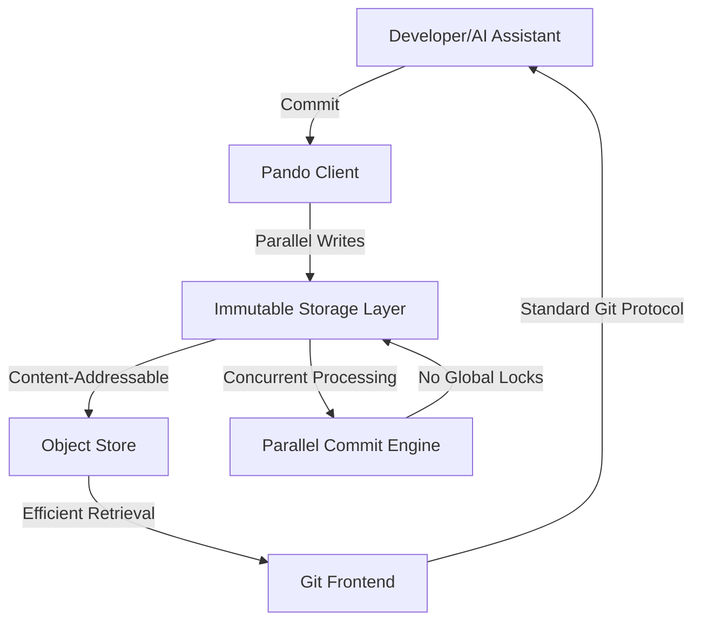
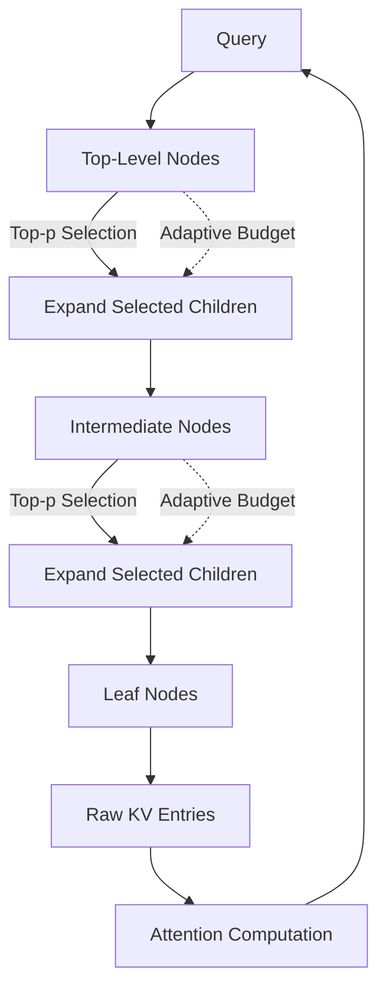
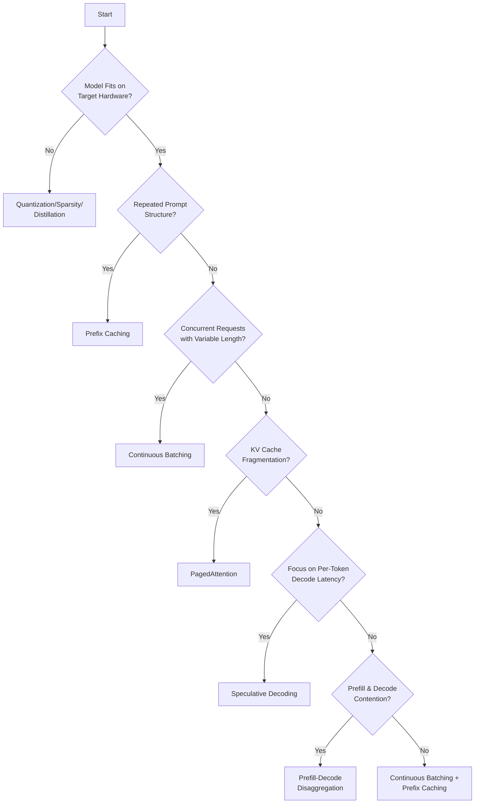

> 🎙️ **Listen to the podcast version of this article:**
> <audio controls src="index.mp3"></audio>

---

> 💡 **TL;DR:** This article explores three groundbreaking advancements in AI development and deployment: OpenAI's Pando, a Git-compatible backend designed for Codex-scale workflows; Zyphra Hierarchical Attention (ZHA), a tree-indexed sparse attention method achieving true subquadratic complexity; and a practical decision-tree framework for selecting optimal LLM inference optimization techniques based on workload characteristics.

| Metric / Innovation Area | Insight / Takeaway |
|-------------------------|---------------------|
| **Pando (OpenAI)** | Git-compatible backend with immutable storage and parallel commit processing, reducing median push latency by ~80% |
| **ZHA (Zyphra AI)** | Tree-indexed sparse attention with 0.00024% additional parameters, matching dense attention on reasoning tasks at 256K context |
| **Inference Optimization** | Decision-tree approach identifies bottleneck-specific techniques, from quantization to prefill-decode disaggregation |

---

### Scaling Git at OpenAI: Building Pando for Massive Developer Workflows

The rise of AI-assisted coding tools like Codex has fundamentally changed the scale of software development. Where traditional version control systems were designed for human developers working at human speeds, AI coding assistants can generate, modify, and commit code at machine speed—creating workflows that push existing Git implementations to their limits. OpenAI's response to this challenge is **Pando**, a Git-compatible backend engineered to handle the unprecedented scale of AI-driven development.

At its core, Pando reimagines Git's storage model with **immutable, content-addressable objects** and **parallel commit processing**. Traditional Git repositories store objects in a flat namespace, which becomes a bottleneck when thousands of commits are happening simultaneously. Pando's architecture, by contrast, treats every object as immutable and referenced by its content hash, enabling true parallelism in commit processing. This design eliminates the need for global locks during writes, allowing multiple developers (or AI assistants) to push changes concurrently without contention.

The impact on development throughput is substantial. OpenAI reports that Pando reduces **median push latency by approximately 80%** compared to traditional Git backends. For AI-assisted coding workflows where Codex might generate hundreds of commits per hour, this reduction in latency translates directly to faster iteration cycles and higher developer productivity. Moreover, Pando's design maintains full compatibility with existing Git clients, meaning developers can continue using familiar tools while benefiting from the backend's scalability.

The implications for the broader developer ecosystem are significant. As AI coding assistants become more prevalent, the limitations of traditional version control systems will become increasingly apparent. Pando demonstrates that it's possible to retain Git's familiar interface while completely rethinking the backend architecture to handle modern workloads. The open-source community will likely benefit from these innovations as well, as the principles behind Pando—immutable storage, content-addressable objects, and parallel processing—can be applied to other version control systems facing similar scaling challenges.

---

### Zyphra Hierarchical Attention (ZHA): Achieving True Subquadratic Attention

Attention mechanisms have been the cornerstone of transformer architectures since their inception, but their quadratic complexity $O(N^2)$ with respect to sequence length has become a major bottleneck for long-context applications. While sparse attention methods have emerged as a solution, most still suffer from a critical limitation: the indexer that selects relevant tokens must scan the entire context, resulting in linear or near-linear complexity for the selection process itself. **Zyphra Hierarchical Attention (ZHA)** addresses this gap with a novel tree-indexed approach that achieves true subquadratic complexity for both selection and attention computation.

ZHA's innovation lies in its **multi-level tree structure** for indexing keys. The method begins by splitting keys into contiguous chunks and compressing each chunk into a summary key using a small set of learned reference queries. These summaries are then grouped and compressed recursively, forming a hierarchical tree where each level represents a progressively coarser granularity of the original sequence. For a chunk size of 4 and 6 levels, a single top-level node can represent 4,096 tokens. This hierarchical compression enables efficient, sparse traversal of the key space.

At decode time, ZHA employs a **top-p routing mechanism** that adaptively expands only the most relevant branches of the tree. For each query, the algorithm scores the top-level nodes and keeps the smallest set that holds a fraction $p$ of the estimated attention mass (typically $p = 0.95$). It then recursively expands only the children of these selected nodes until reaching the raw KV entries. This adaptive approach ensures that queries requiring only a few specific tokens (e.g., fact lookup) traverse minimal branches, while queries needing scattered information expand more broadly. The first token is always retained as an attention sink to maintain stability.

The mathematical foundation of ZHA's efficiency can be understood through its complexity analysis. For a sequence of length $N$ with $L$ tree levels and chunk size $C$, the number of nodes at each level decreases exponentially. The selection process at each level operates on $O(N/C^l)$ nodes at level $l$, resulting in a total selection complexity of $O(N \log N)$—a significant improvement over the $O(N^2)$ of dense attention and the $O(N)$ of flat sparse attention indexers. The attention computation itself remains sparse, operating only on the selected subset of keys.

ZHA's performance on benchmarks is impressive. When applied to **Qwen3.6-35B-A3B**, the method adds only **81,920 trainable parameters** (approximately 0.00024% of the model's size) and achieves results within a few points of dense attention across seven reasoning, coding, and retrieval benchmarks. On **LongBench v2**, ZHA's deep tree configuration scores **63.4%** compared to dense attention's 58.0%, while using only about 1.1% of the keys. Perhaps most notably, on the **RULER-13** benchmark at 256K context, ZHA's wide tree achieves **96.2%** accuracy versus dense attention's 96.0%, demonstrating that sparse attention can match or exceed dense performance on long-context tasks.

The training process for ZHA is equally innovative. The base model remains **frozen**, with only the reference queries trained via a KL divergence loss that matches the dense attention mass per chunk at every tree level. Using approximately **4B tokens** of distillation data at 32K context length, Zyphra's team successfully converted models as large as 35B parameters. The method struggled with models under 1B parameters but showed sharp improvements at 4B and above, suggesting a scaling threshold for effective distillation.

Looking ahead, ZHA represents a significant step toward **true subquadratic attention** in production-scale models. While the reported speedups (projected at 373-417x over dense attention at 1B tokens) are currently based on roofline modeling rather than empirical measurements, the method's ability to maintain accuracy while drastically reducing the number of attention computations is a promising development. As the industry pushes toward million-token contexts, innovations like ZHA will be critical in making such models practically deployable.

---

### Choosing an LLM Inference Optimization Technique: A Decision-Tree Approach

As large language models (LLMs) become more capable, the computational cost of serving them at scale has emerged as a primary concern. Inference latency, memory usage, and throughput bottlenecks can quickly turn a cutting-edge model into an impractical deployment. The challenge is compounded by the fact that **no single optimization technique works universally**—each approach addresses specific bottlenecks and makes different trade-offs. A new decision-tree framework provides a systematic way to match optimization techniques to the actual constraints of your workload.

The framework begins with a fundamental insight: **inference optimization must start with bottleneck identification**. LLM inference pipelines can be constrained by model size, memory bandwidth, compute throughput, or request patterns. The decision tree guides practitioners through six key questions to diagnose their primary bottleneck and select the most appropriate optimization technique.

The first question—**"Does the model fit comfortably on your target hardware?"**—addresses the most fundamental constraint. If the model itself is too large for the available GPU memory, techniques like **quantization**, **sparsity**, or **distillation** become necessary. These methods reduce the model's memory footprint and computational requirements, often at the cost of some accuracy. For example, quantization reduces the precision of weights and activations from 32-bit floating point to lower precision formats like INT8 or FP4, which can reduce memory usage by 4-8x with minimal accuracy loss. The trade-off is expressed mathematically: while the model size reduces from $S$ to $S/k$ for a $k$-fold quantization, the accuracy may degrade by $\Delta A$, where $\Delta A$ is typically small for well-calibrated quantization schemes.

If the model fits with room to spare, the next question examines **prompt structure**: **"Do your requests share repeated prompt structure?"** In many applications—chatbots, agent frameworks, or RAG pipelines—requests often share identical prefixes (e.g., system prompts or conversation history). **Prefix caching** exploits this redundancy by storing the KV cache for shared prefixes, allowing subsequent requests to skip recomputing attention for these tokens. The efficiency gain can be expressed as:

$$\text{Compute Savings} = 1 - \frac{\text{Unique Tokens}}{\text{Total Tokens}}$$ 

For a chatbot handling a conversation with 100 shared tokens and 10 unique tokens per request, prefix caching can reduce computation by 90% for the shared portion.

For workloads without repeated prefixes, the next consideration is **request concurrency**: **"Are requests arriving concurrently with variable output lengths?"** Traditional batching waits for all requests in a batch to complete before starting new ones, which can lead to GPU idle time when requests have varying generation lengths. **Continuous batching** (also known as in-flight batching) solves this by allowing requests to join and leave the batch dynamically. The throughput improvement can be modeled as:

$$\text{Throughput Gain} = \frac{\text{Avg. Request Length}}{\text{Max. Request Length in Batch}} \times \text{Batch Size}$$

This technique is particularly effective for workloads with high variance in output lengths, such as code generation or creative writing tasks.

When memory fragmentation is the bottleneck—**"Is KV cache fragmentation limiting your batch size?"**—**PagedAttention** provides a solution. Traditional KV cache implementations often reserve contiguous memory blocks sized for the maximum possible sequence length, leading to wasted memory when most requests are shorter. PagedAttention divides the KV cache into fixed-size pages, allowing memory to be allocated in smaller, non-contiguous chunks. This approach can increase effective batch size by 2-4x with minimal overhead, as the memory utilization approaches the theoretical maximum:

$$\text{Memory Utilization} \approx 1 - \frac{\text{Page Size}}{\text{Avg. Sequence Length}}$$

For latency-sensitive applications where **per-token decode time** is critical, **speculative decoding** offers an elegant solution. A smaller "draft" model generates multiple candidate tokens, which are then verified in parallel by the larger model. When the draft model's predictions are correct (which happens with probability $p$), the effective decode latency reduces by a factor of $k$, where $k$ is the number of tokens predicted by the draft model. The speedup can be expressed as:

$$\text{Speedup} = \frac{1}{(1-p) + \frac{p}{k}}$$

However, the overhead of running the draft model and verification process means speculative decoding only pays off when $p \times k > 1 + \text{Overhead}$.

At scale, **prefill and decode contention** can become a bottleneck, as both phases compete for the same GPU resources. **Prefill-decode disaggregation** separates these phases onto dedicated hardware: prefill nodes handle the initial prompt processing (which is compute-intensive but short), while decode nodes focus on token generation (which is memory-intensive but longer). This separation can improve both time-to-first-token (TTFT) and inter-token latency, though it introduces additional complexity in KV cache transfer and request routing. The optimal split point can be determined by solving for the equilibrium where:

$$\text{Prefill Throughput} = \text{Decode Throughput}$$

Finally, for **non-interactive workloads** where response latency is less critical than total throughput, **offline batch inference** can maximize GPU utilization by processing requests in large batches without real-time constraints.

The decision-tree framework also includes guidance on **recognizing when a chosen technique isn't working**. For example, if prefix cache hit rates are near zero despite repeated prompts, the issue might be non-deterministic serialization or dynamic content placed early in the prompt. Similarly, if speculative decoding is slower than plain decoding, the draft model's acceptance rate may be too low. These diagnostic insights help practitioners iterate on their optimization strategies effectively.

The practical implications of this framework are substantial. Rather than applying optimization techniques haphazardly, developers can systematically identify their primary bottlenecks and select techniques that directly address them. This approach not only improves performance but also reduces unnecessary complexity. For instance, a model that fits comfortably in memory with no repeated prompts and low concurrency might benefit most from continuous batching and PagedAttention, while a latency-sensitive application with high prompt redundancy would prioritize prefix caching and speculative decoding.

As LLM deployments continue to scale, frameworks like this decision-tree will become essential tools in the developer's toolkit. The ability to diagnose bottlenecks and apply targeted optimizations will separate high-performance deployments from those struggling with inefficiency. Moreover, as new optimization techniques emerge, they can be incorporated into the decision-tree, ensuring its continued relevance in a rapidly evolving landscape.

---

*This article synthesizes insights from OpenAI's Pando architecture, Zyphra AI's ZHA research, and practical inference optimization frameworks to provide a comprehensive view of the innovations shaping AI development and deployment at scale.*

Written with [Argos](https://github.com/Neilstid/argos)
