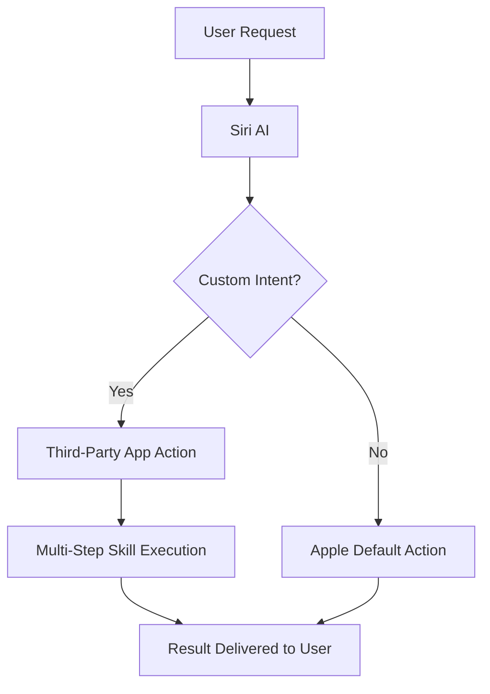
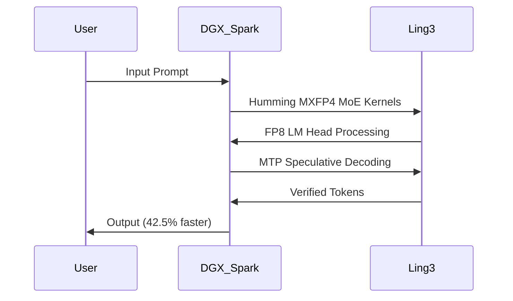

> 🎙️ **Listen to the podcast version of this article:**
> <audio controls src="index.mp3"></audio>


---

> 💡 **TL;DR:** This week marks a turning point for AI integration and performance: Apple finally opens Siri AI to third-party developers, OpenAI acquires Pierre Computer Company to supercharge Codex’s code-building capabilities, Tencent unveils WeVisOne-VL—a unified 2B/4B parameter model tackling detection, OCR, segmentation, and matting—and NVIDIA demonstrates a 42.5% throughput boost for MoE models like Ling-3.0-flash on DGX Spark. These advancements signal a new era of accessibility, specialization, and raw performance in AI systems.

| **Metric / Innovation Area** | **Insight / Takeaway** |
|-----------------------------|------------------------|
| **Siri AI Developer Access** | Apple’s walled garden cracks open: third-party apps can now integrate custom actions and multi-step "skills" into Siri, though public rollout waits until spring 2025. |
| **OpenAI + Pierre Computer Co.** | Acquisition fuels Codex’s evolution, expanding tools for code building, understanding, and review—potentially accelerating AI-assisted development workflows. |
| **Tencent WeVisOne-VL** | 2B/4B parameter model unifies detection, OCR, segmentation, and matting with a 9.6M-parameter pixel decoder, outperforming baselines on 30+ benchmarks under Apache 2.0 license. |
| **NVIDIA MoE Optimizations** | Three stacked techniques (Humming kernels, FP8 LM head, MTP speculative decoding) lift Ling-3.0-flash throughput by 42.5% on DGX Spark with no accuracy loss. |

---

### Apple Opens Siri to AI: What's New?


Apple’s long-awaited pivot toward an AI-native ecosystem took a concrete step forward this week: **Siri AI is now open to third-party developers**. For years, Apple’s approach to AI has been characterized by cautious, controlled rollouts—often leaving its massive user base feeling a step behind the cutting edge. But with the latest developer preview, the company is finally allowing external apps to plug directly into Siri, enabling custom actions and multi-step "skills" that could redefine how users interact with their devices.

The technical underpinnings are straightforward yet transformative. Developers can now define **custom intents** and **multi-step workflows** that Siri can execute, moving beyond Apple’s predefined set of actions. For example, a productivity app could teach Siri to "summarize my emails and schedule a meeting with the team," a task that previously required manual intervention or third-party automation tools. This shift is powered by Siri’s rebuilt architecture, which now includes **screen awareness** and **message-reading capabilities**—features first introduced in iOS 27’s waitlisted beta. The system leverages on-device processing to maintain privacy while enabling richer contextual interactions.

However, the rollout is not without caveats. For now, developers can only test these integrations internally, with App Store submissions slated to begin in **spring 2025**. Apple has also hinted at forthcoming guidelines for developers, leaving some uncertainty about the approval process. Moreover, the initial beta is limited to internal testers, meaning consumers won’t see the fruits of this labor for months. Critically, this delay risks Apple falling further behind competitors like Google and Microsoft, who have aggressively integrated AI into their ecosystems with tools like **Gemini** and **Copilot+**.

Why does this matter? Apple’s decision to open Siri to developers is a **crack in its famously walled garden**, signaling a recognition that AI’s potential cannot be fully realized in isolation. For developers, this represents an unprecedented opportunity to create deeply integrated, voice-first experiences. For users, it could mean a Siri that finally feels as capable as its rivals. Yet, the slow rollout and lack of clarity around developer constraints leave questions about whether Apple can execute at the speed the AI era demands.



---

### OpenAI Acquires Pierre Computer Company: Expanding Codex Capabilities

OpenAI’s acquisition of **Pierre Computer Company, Inc.** marks a strategic move to bolster its **Codex** platform, the AI-powered toolchain designed to assist developers in building, understanding, and reviewing code. While details of the acquisition remain sparse, the implications are clear: OpenAI is doubling down on its vision of AI as a **collaborative coding partner**, capable of handling everything from debugging to full-stack development.

Codex, already a cornerstone of OpenAI’s developer tools, has demonstrated remarkable proficiency in generating and refining code across multiple languages. The integration of Pierre Computer Company’s technology is expected to enhance Codex’s ability to **contextualize codebases**, **automate repetitive tasks**, and **provide real-time feedback**—effectively turning it into a more autonomous and intelligent pair programmer. This aligns with OpenAI’s broader mission to make AI a **force multiplier** for software development, reducing the time and cognitive load required to ship high-quality code.

The acquisition also underscores the growing importance of **AI-native development environments**. As models like Codex become more sophisticated, they are increasingly capable of handling complex workflows that traditionally required human intervention. For instance, Codex can now:
- **Generate boilerplate code** from natural language prompts.
- **Debug and optimize** existing codebases.
- **Review pull requests** and suggest improvements.
- **Automate testing** and validation processes.

This evolution is particularly significant for startups and solo developers, who can leverage Codex to **scale their output** without proportionally increasing their headcount. For larger organizations, it offers a way to **accelerate development cycles** and **reduce technical debt** by automating low-value tasks.

The long-term vision is clear: OpenAI is positioning Codex as the **central nervous system** of AI-assisted development, capable of integrating with a wide range of tools and platforms. With Pierre Computer Company’s expertise, Codex could soon support even more advanced features, such as **multi-repository analysis** and **cross-language refactoring**, further solidifying its role as an indispensable tool for modern software engineering.

```python
# Example of Codex-assisted development
# Prompt: "Write a Python function to reverse a linked list"
def reverse_linked_list(head):
    prev = None
    current = head
    while current:
        next_node = current.next
        current.next = prev
        prev = current
        current = next_node
    return prev
```

---

### Tencent WeVisOne-VL: A Unified Vision-Language Model for Detection, OCR, Segmentation, and Matting


Tencent’s WeChat Vision team has unveiled **WeVisOne-VL**, a groundbreaking **vision-language model (VLM)** that consolidates multiple computer vision tasks—**detection, referring, counting, pointing, OCR, segmentation, and alpha matting**—into a single, cohesive architecture. Available in **2B and 4B parameter variants**, WeVisOne-VL is designed to replace the need for separate specialized models (e.g., SAM for segmentation, dedicated OCR engines) with a **unified, end-to-end solution**.

#### Architecture and Innovation
At the heart of WeVisOne-VL is a **9.6M-parameter pixel decoder**, which enables the model to generate **fine-grained outputs** like masks and alpha mattes without relying on external tools. The model is built on **Qwen3-VL**, Tencent’s advanced vision-language foundation, and employs a **structured next-token prediction** approach. Here’s how it works:

1. **Input Processing**: The model takes an image and a query (e.g., "detect all cars" or "segment the person") as input.
2. **Coordinate Tokens**: For localization tasks, WeVisOne-VL uses **normalized coordinate tokens** (`<0>` to `<1000>`) to represent bounding boxes, points, or polygons.
3. **Pixel Decoder**: For segmentation and matting, the model emits an `<OBJ>` token after predicting a box. The hidden state of this token is then used as a query for the **pixel decoder**, which consists of:
   - A **Visual Feature Adapter** that reuses multi-level features from Qwen3-VL’s ViT backbone.
   - A **Box-Guided Query Decoder** with 6 deformable cross-attention blocks, seeded by the `<OBJ>` state and the predicted box.
   - A **Dense Prediction Head** that refines the output at multiple resolutions (S/4, S/2, S/1) to produce full-resolution masks or mattes.

This architecture allows WeVisOne-VL to handle **absent targets gracefully** by outputting `None` instead of guessing, a critical improvement over traditional models that often hallucinate detections.

#### Training and Performance
WeVisOne-VL was trained using a **three-stage supervised fine-tuning (SFT) process**:
1. **Stage 1**: Aligned output formats on 90M examples.
2. **Stage 2**: Increased input to 1,960 visual tokens and up to 500 boxes per response.
3. **Stage 3**: Trained the pixel decoder, followed by specialization for matting on 130M samples.

The training data was annotated using a **knowledge-graph-driven engine**, which generated over **100M images with 3.6B bounding boxes**. Models like SAM3, Rex-Omni, and an in-house detector proposed regions, while Qwen3-VL verified them.

On benchmarks, WeVisOne-VL **outperforms same-scale baselines** across 30+ tasks. Key highlights include:
- **Detection**: 71.3 F1 Mean on **Dense200** (vs. 58.7 for LocateAnything-3B).
- **Referring**: 81.8 F1 on **RefCOCOg test** (vs. 77.6 for LocateAnything-3B).
- **OCR**: 52.0 F1 on **TotalText** (vs. 25.7 for PP-OCRv5).
- **Segmentation**: 71.2 gIoU on **ReasonSeg val** (vs. 65.0 for LISA-13B).
- **Matting**: 7.3 MAD on **P3M-500-NP** (vs. 15.4 for SAM2-Matting).

The model is **Apache 2.0 licensed**, making it accessible for commercial use—a significant advantage over non-commercial alternatives like LocateAnything-3B.

#### Practical Usage
WeVisOne-VL can be run on a **single GPU** (e.g., RTX 2060 with 6GB VRAM for object-level tasks) via **Transformers** or **vLLM** in BF16. The `wevisone_vl` Python package simplifies deployment:

```python
from wevisone_vl import WeVisOneVL

# Initialize the model
model = WeVisOneVL("tencent/WeVisOne-VL-4B", backend="transformers")  # or "vllm"

# Run detection
result = model.predict(image, task="detection", query="person")

# Run matting
matting_result = model.predict(image, task="matting", query="person")
```

Hosted demos for both the 2B and 4B models are available, and Tencent has open-sourced **Mask2Alpha**, the matting annotator used in its data engine. Fine-tuning code is on the roadmap.


---

### NVIDIA's Three Optimizations for MoE Inference on DGX Spark

NVIDIA has demonstrated a **42.5% throughput boost** for **Mixture-of-Experts (MoE) inference** on its **DGX Spark** desktop system, using **Ant Group’s Ling-3.0-flash** (a 124B-parameter MoE model with 5.1B active parameters). The breakthrough comes from stacking **three key optimizations**: a new MoE kernel backend, an FP8 output layer, and built-in speculative decoding. These improvements collectively reduce latency and increase efficiency **without sacrificing accuracy** (96.89% vs. 96.82% on GSM8K).

#### Why DGX Spark?
DGX Spark is NVIDIA’s **desktop-grade inference powerhouse**, built on the **GB10 Grace Blackwell Superchip**. It offers:
- **128GB unified memory** and **273 GB/s memory bandwidth**.
- **1 petaFLOP of sparse FP4 compute**.
- Support for models up to **200B parameters**.

Despite its compact form factor, DGX Spark is **memory-bound** for MoE inference. Profiling Ling-3.0-flash revealed that **reading model weights** was the primary bottleneck, particularly for the **MoE computation** and **LM head** (which scores the vocabulary). NVIDIA’s optimizations directly address these pain points.

#### The Three Optimizations

1. **Humming MXFP4 MoE Kernels**
   - Replaces **FlashInfer’s MoE backend** with **Humming**, a runtime-compiled kernel library.
   - Uses **NVRTC** to compile kernels on-the-fly for the actual matrix shapes, data types, and GPU.
   - Supports narrow **768-wide expert layers** (vs. FlashInfer’s pre-compiled 97 targets).
   - **Result**: +9.3% throughput (from 36.09 to 39.45 tokens/s).

2. **Online FP8 LM Head**
   - The LM head is a **157,184 × 2,560 matrix** stored in BF16.
   - Quantizing **only this layer to FP8** at load time **halves memory reads**.
   - Enabled via `SGLANG_ENABLE_FP8_LM_HEAD=1`.
   - **Result**: +21.7% throughput over baseline (43.94 tokens/s).

3. **MTP Speculative Decoding with NEXTN**
   - Ling-3.0-flash includes a **built-in NEXTN prediction layer**, eliminating the need for a separate draft model.
   - Drafts **3 tokens**, and the model verifies **4 positions at once**.
   - Verification costs **~2.26x a normal decode step** (due to MoE activation of up to 32 experts).
   - **Result**: +185.1% throughput on synthetic tests (102.88 tokens/s).

#### Real-World Performance
On the **GSM8K benchmark** (1,319 questions, 5-shot CoT prompting):
- **Throughput**: +42.5% (37.81 → 53.89 tokens/s).
- **Latency**: -24.5% (15.21 → 11.49 seconds).
- **Accuracy**: Flat (96.89% → 96.82%).

The **accept length** dropped from 3.90 (synthetic) to 2.68 (GSM8K) due to:
- Less repetitive outputs in GSM8K.
- Sampling (vs. greedy decoding in synthetic tests).
- Shorter answer lengths (median ~310 tokens vs. fixed 2K).

#### Ling-3.0-flash: The Testbed
Ling-3.0-flash is an **MIT-licensed MoE model** from Ant Group’s **inclusionAI**, optimized for efficiency:
- **Sparse MoE**: 8 of 512 routed experts + 1 shared expert per token (**4.1% active weights**).
- **Hybrid Linear Attention**: 35 **Kimi Delta Attention (KDA)** layers + 7 **Gated MLA** layers (5:1 ratio).
- **Built-in MTP**: Trained with multi-token prediction (NEXTN layer).
- **Agent Focus**: Trained on **10,000+ interactive environments** for coding, general, and deep-research agents.

Performance highlights:
- **SWE-Bench Pro**: 56.6
- **MathArena AIME 2026**: 93.2
- **GPQA Diamond**: 85.5% (Artificial Analysis)
- **API Pricing**: $0.075 per 1M input tokens, $0.22 per 1M output tokens.

#### Key Takeaway
NVIDIA’s optimizations prove that **MoE inference can be both fast and accurate** on desktop-grade hardware. The stacked approach—**Humming kernels + FP8 LM head + MTP speculative decoding**—sets a new standard for **single-user MoE serving**, making models like Ling-3.0-flash viable for **low-latency, high-throughput applications**.



---

*This article synthesizes the latest developments in AI, from consumer-facing integrations to cutting-edge research. As the field continues to evolve, these innovations underscore the importance of **accessibility, specialization, and performance** in shaping the next generation of intelligent systems.*

Written with [Argos](https://github.com/Neilstid/argos)
