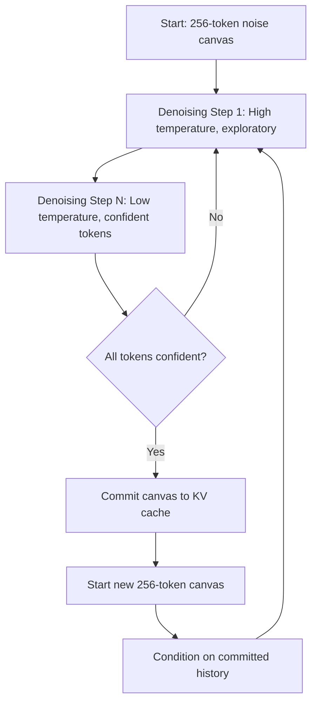
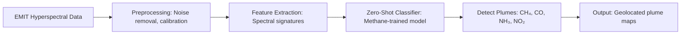
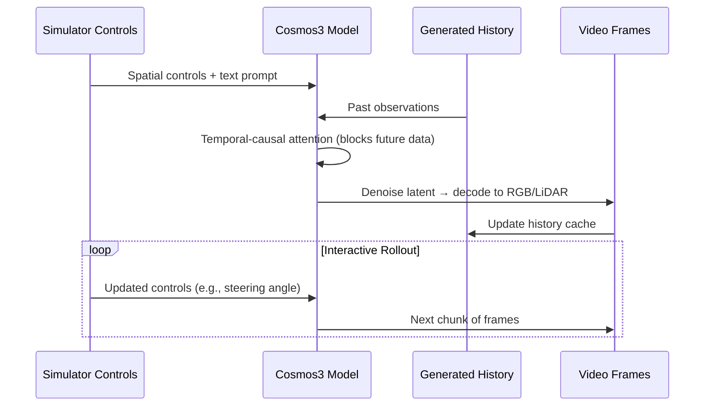
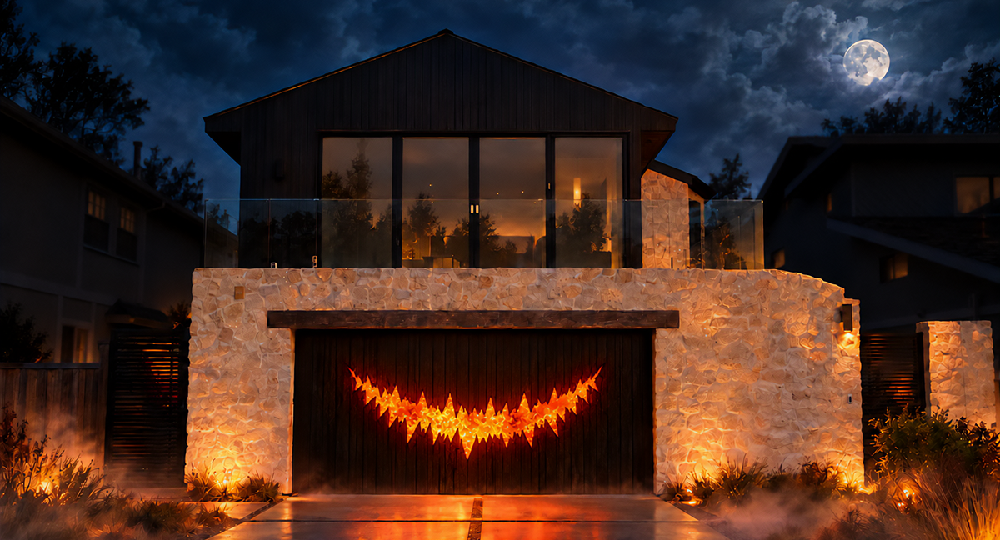

> 🎙️ **Listen to the podcast version of this article:**
> <audio controls src="index.mp3"></audio>


---

> 💡 **TL;DR:** This week, Google unveiled DiffusionGemma, a diffusion-based text model that generates entire blocks of text in parallel, and slashed prices for its Gemini Omni 1.2 Flash video model to $0.07/second for 15-second clips. Meanwhile, NASA demonstrated a zero-shot detector for gas leaks that generalizes from methane to CO, ammonia, and NO₂, and NVIDIA released four open-weight Cosmos 3 checkpoints for interactive world simulation in robotics and autonomous driving.

| **Metric / Innovation Area**               | **Insight / Takeaway**                                                                                     |
|-------------------------------------------|-----------------------------------------------------------------------------------------------------------|
| **DiffusionGemma**                        | Parallel block-based denoising shifts bottleneck from memory bandwidth to compute; 256-token canvas.     |
| **Gemini Omni 1.2 Flash**                 | 15-second native clips, 30% price cut to $0.07/s (720p), multi-turn editing without re-renders.          |
| **NASA Zero-Shot Detector**               | Single methane-trained model generalizes to CO, NH₃, NO₂; first automated CO detections from EMIT.      |
| **NVIDIA Cosmos 3**                       | Four 16B-parameter checkpoints for synchronized camera/LiDAR, text-guided video, and bimanual manipulation. |

---

### Google’s DiffusionGemma: Diffusion-Based Text Generation That Writes All at Once

For years, the paradigm of text generation has been dominated by autoregressive models—GPT, Claude, and even Google’s own Gemma—each producing text one token at a time, left to right, with each new word conditioned on all previous ones. This approach, while effective, suffers from a critical inefficiency: **memory bandwidth becomes the bottleneck**. The GPU spends most of its time waiting for model weights to load from memory, leaving compute cores underutilized. Enter **DiffusionGemma**, Google DeepMind’s experimental open model that flips the script by generating and refining *entire blocks of text in parallel* using a diffusion process.

#### How Diffusion Text Generation Works
DiffusionGemma starts with a canvas of 256 placeholder tokens (essentially random noise) and iteratively denoises the entire block simultaneously. This is enabled by **Uniform State Diffusion**, where tokens the model is confident about help resolve less certain ones, allowing the sequence to "snap into focus" holistically. For longer sequences, the model uses **block-autoregressive denoising**: once a 256-token canvas is resolved, it’s committed to the KV cache using causal attention, and a new canvas begins denoising, conditioned on the committed history. This hybrid approach combines the stability of sequential attention for long-form generation with the parallelism (and self-correction capability) of bidirectional attention within each block.

The mathematical intuition behind diffusion for text mirrors its use in imaging. In imaging, diffusion models iteratively denoise a Gaussian noise tensor to produce an image. For text, DiffusionGemma applies a similar process to a tensor of token embeddings. The denoising step can be conceptualized as:
$$x_{t-1} = \sqrt{\frac{\alpha_t}{\alpha_{t-1}}} \left( x_t - \frac{1 - \alpha_t}{\sqrt{1 - \bar{\alpha}_t}} \epsilon_\theta(x_t, t) \right) + \sigma_t z$$
where $x_t$ is the noisy token embedding at step $t$, $\epsilon_\theta$ is the model’s prediction of the noise, and $\alpha_t$ controls the noise schedule. Unlike autoregressive models, this process allows for **self-correction**: tokens with low confidence can be re-noised and re-sampled.

#### Why It Matters
DiffusionGemma’s parallel denoising shifts the bottleneck from memory bandwidth to compute, making it ideal for **local, low-concurrency inference** where GPUs are often idle. For example, on a single RTX 4090 (18GB VRAM), the quantized model can generate text efficiently, while a full unquantized run requires an A100/H100 (60GB+ VRAM). The model also supports **multimodal inputs** (text, images, video) and includes a **thinking mode** for step-by-step reasoning.



#### Getting Started
DiffusionGemma is built on the **Gemma 4 26B Mixture-of-Experts architecture** (26B total parameters, 3.8B active per token) and is released under Apache 2.0. Below is a minimal example to load the model and generate text:

```python
from transformers import DiffusionGemmaForBlockDiffusion, AutoProcessor

MODEL_ID = "google/diffusiongemma-26B-A4B-it"
model = DiffusionGemmaForBlockDiffusion.from_pretrained(
    MODEL_ID, dtype="auto", device_map="auto"
)
processor = AutoProcessor.from_pretrained(MODEL_ID)

message = [{"role": "user", "content": "Why is the sky blue?"}]
input_ids = processor.apply_chat_template(
    message, tokenize=True, add_generation_prompt=True, return_dict=True, return_tensors="pt"
).to(model.device)
output = model.generate(**input_ids, max_new_tokens=512)
print(processor.decode(output[0], skip_special_tokens=False))
```

For **streaming the denoising process**, use `TextDiffusionStreamer`:
```python
from transformers import TextDiffusionStreamer
streamer = TextDiffusionStreamer(tokenizer=processor.tokenizer)
output = model.generate(**input_ids, max_new_tokens=512, streamer=streamer)
```

**Key Sampling Parameters**:
| Parameter               | Recommended Value | Purpose                                                                 |
|-------------------------|-------------------|-------------------------------------------------------------------------|
| Max denoising steps    | 48                | Upper bound per canvas (adaptive stopping often halts at 12-16 steps). |
| Temperature schedule    | Linear 0.8 → 0.4  | Starts exploratory, ends decisive.                                      |
| Adaptive early stopping| Entropy < 0.005   | Stops when confidence is high and consecutive passes agree.            |
| Token selection        | Entropy bound 0.1 | Commits only the most confident tokens per step.                       |

---

### Gemini Omni 1.2 Flash: Google’s Leap in Video Generation and Editing

Google’s **Gemini Omni 1.2 Flash** is a multimodal video model that generates and edits **15-second clips natively**—a 50% increase over its predecessor’s 10-second limit. The model also introduces **multi-turn conversational editing**, allowing users to iteratively refine clips (e.g., swapping backgrounds, products, or lighting) without regenerating the entire video. Pricing has dropped by **30% to $0.07 per second of 720p video**, making a 15-second clip cost ~$1.05.

#### What’s New?
1. **Longer Clips**: Native support for 15-second generation/editing (vs. 10s in Omni 1.1).
2. **Duration Control**: Set length in 1-second increments (3–15s).
3. **Reference Adherence**: Combine character/style images with motion clips (up to 3s) for consistency.
4. **Improved Audio**: More natural dialogue, better lip-sync, and multi-speaker conditioning.
5. **Camera Control**: Smoother FPV flythroughs, zoom-outs, and orbits with fewer jump cuts.

#### Cost-Effective Workflow
Google advocates a **draft-edit-upscale** pipeline:
1. **Draft**: Generate at 360p/720p.
2. **Edit**: Use multi-turn conversational editing to tweak details (e.g., `previous_interaction_id` avoids re-uploading the video).
3. **Upscale**: Finalize at 1080p or 4K.

#### Comparison with Competitors
| Feature               | **Gemini Omni 1.2 Flash** | **Gemini Omni 1.1 Flash** | **Veo 3.1**       | **Seedance 2.0**  |
|-----------------------|----------------------------|----------------------------|--------------------|--------------------|
| Max Clip Length       | 15s                        | 10s                        | 8s                 | 15s                |
| Duration Options      | 3–15s (1s steps)           | Not disclosed              | 4/6/8s             | 4–15s              |
| 720p Price            | $0.07/s                    | ~$0.10/s                   | Not disclosed      | Token-based        |
| Multi-Turn Editing    | Yes (15s)                  | Yes                        | No                 | Not disclosed      |
| Native Audio          | Yes                        | Yes                        | Yes                | Yes                |

#### Why It Matters
Gemini Omni 1.2 Flash lowers the barrier for **high-quality, iterative video generation**, particularly for applications like:
- **Advertising**: QuickFrame AI notes that 15s at 1080p can produce a full CTV ad in one generation.
- **Content Creation**: Google Vids users can generate 15s clips at no extra cost.
- **Prototyping**: Available via the **Gemini API** and **Google Cloud** with enterprise SLAs.


---

### NASA’s Zero-Shot Detector: One Model to Find Them All (Gas Leaks)

Climate monitoring took a giant leap with NASA’s **zero-shot detector for gas leaks**, a single model trained on **methane** that generalizes to detect **carbon monoxide (CO), ammonia (NH₃), and nitrogen dioxide (NO₂)** without retraining. This breakthrough, deployed on NASA’s **EMIT instrument**, marks the **first automated CO detections from space**, enabling real-time mapping of previously undetectable plumes.

#### How It Works
The model leverages **hyperspectral imaging** from EMIT, which captures hundreds of spectral bands. By training on methane’s spectral signature, the model learns a **generalizable representation of gas plumes** that transfers to other gases. This is a classic example of **zero-shot learning**, where the model recognizes patterns in new classes (gases) without explicit training data.

The workflow can be visualized as:


#### Why It Matters
- **Climate Action**: CO, NH₃, and NO₂ are potent greenhouse gases or pollutants. Detecting them at scale enables targeted mitigation.
- **Efficiency**: A single model replaces multiple specialized detectors, reducing computational and operational overhead.
- **Automation**: EMIT’s automated pipeline can now flag CO plumes in real time, a task previously requiring manual analysis.

#### Limitations and Future Work
While the zero-shot approach is powerful, it relies on **spectral similarity** between gases. Future work may involve:
- **Fine-tuning** for gases with weaker spectral signatures.
- **Multi-modal fusion** (e.g., combining hyperspectral with thermal data) to improve accuracy.

---

### NVIDIA Cosmos 3 Open Models: Simulating Worlds for Robotics and Autonomous Driving

NVIDIA’s **Cosmos 3** platform introduces four new **open-weight checkpoints** (16B parameters each) for **interactive world simulation**, targeting robotics and autonomous driving research. These models generate **multi-sensor data** (e.g., synchronized camera video and LiDAR) and support **text-guided photorealistic video prediction**, enabling researchers to build and test policies in simulated environments.

#### The Four Checkpoints
| Model                          | Use Case                                                                                     | Key Features                                                                 |
|--------------------------------|---------------------------------------------------------------------------------------------|------------------------------------------------------------------------------|
| **Cosmos3-Nano-Transfer-Auto** | Offline synthetic driving data generation                                                   | Multi-view (11 cameras), joint RGB-LiDAR, WSM controls for scene/traffic. |
| **Cosmos3-Nano-Sim-Auto**      | Streaming driving simulation                                                                | Fast, chunked generation of camera/LiDAR with updated controls.            |
| **Cosmos3-Nano-Sim-Transfer**  | Simulator controls → photorealistic video                                                   | Text-guided, depth/segmentation/edge/blur controls.                         |
| **Cosmos3-Nano-Sim-Bimanual**  | Bimanual robot manipulation simulation                                                      | Supports YAM/AgiBot embodiments, mixed-action control.                       |

#### How Streaming Generation Works
Cosmos 3’s **Mixture-of-Transformers** backbone connects text-processing and visual-generation networks via attention. The generator predicts short segments from prompts, controls, and history, refining noisy **latent video representations** into frames. Temporal-causal attention ensures the model only uses past observations and controls, preventing future data leakage.



#### Training Recipe
The models follow a **4-stage training pipeline**:
1. **Bidirectional Adaptation**: Learn domain/control-to-video relationships from full clips.
2. **Teacher Forcing**: Predict chunks from recorded observations + controls (future targets masked).
3. **Consistency Distillation**: Train a student model to generate chunks in **4 denoising steps** (vs. 50+ for the teacher).
4. **Self-Forcing**: Train on the student’s generated history to handle compounding errors.

#### Why It Matters
- **Robotics**: Sim-Bimanual enables testing of **two-arm manipulation policies** (e.g., assembly tasks) in simulation before real-world deployment.
- **Autonomous Driving**: Sim-Auto’s synchronized camera/LiDAR generation allows **closed-loop testing** of perception and planning stacks.
- **Open Ecosystem**: All models are released under **OpenMDW1.1**, permitting commercial and non-commercial use. Researchers can adapt them to custom sensor rigs or domains via post-training.



#### Getting Started
To run inference with `Cosmos3-Nano-Transfer-Auto`:
```python
# Example: Generate multi-view driving data
from cosmos3 import TransferAutoModel

model = TransferAutoModel.from_pretrained("nvidia/cosmos3-nano-transfer-auto")
output = model.generate(
    wsm_controls={"camera_0": {"pose": [0, 0, 0]}, ...},  # World Scenario Map
    text_prompt="Rainy day in Tokyo",
    num_frames=100
)
```

---

### The Big Picture: Where These Innovations Converge

These four advancements highlight a broader trend in AI: **the shift from static, single-modal models to dynamic, multi-modal, and interactive systems**.

- **DiffusionGemma** reimagines text generation as a parallel, self-correcting process, addressing the inefficiencies of autoregressive models.
- **Gemini Omni 1.2 Flash** democratizes high-quality video generation with cost-effective, iterative editing.
- **NASA’s Zero-Shot Detector** showcases the power of transfer learning for real-world impact (climate monitoring).
- **NVIDIA Cosmos 3** provides the tools to build **interactive, multi-sensor simulations**, bridging the gap between virtual and physical worlds.

As these technologies mature, we can expect:
- **Faster, more efficient local inference** (DiffusionGemma).
- **Lower-cost, higher-fidelity content creation** (Gemini Omni).
- **Scalable, automated environmental monitoring** (NASA).
- **More robust, generalizable robotics/autonomous systems** (Cosmos 3).

The future of AI is not just about bigger models—it’s about **smarter, more adaptable, and more interactive systems**.

Written with [Argos](https://github.com/Neilstid/argos)
