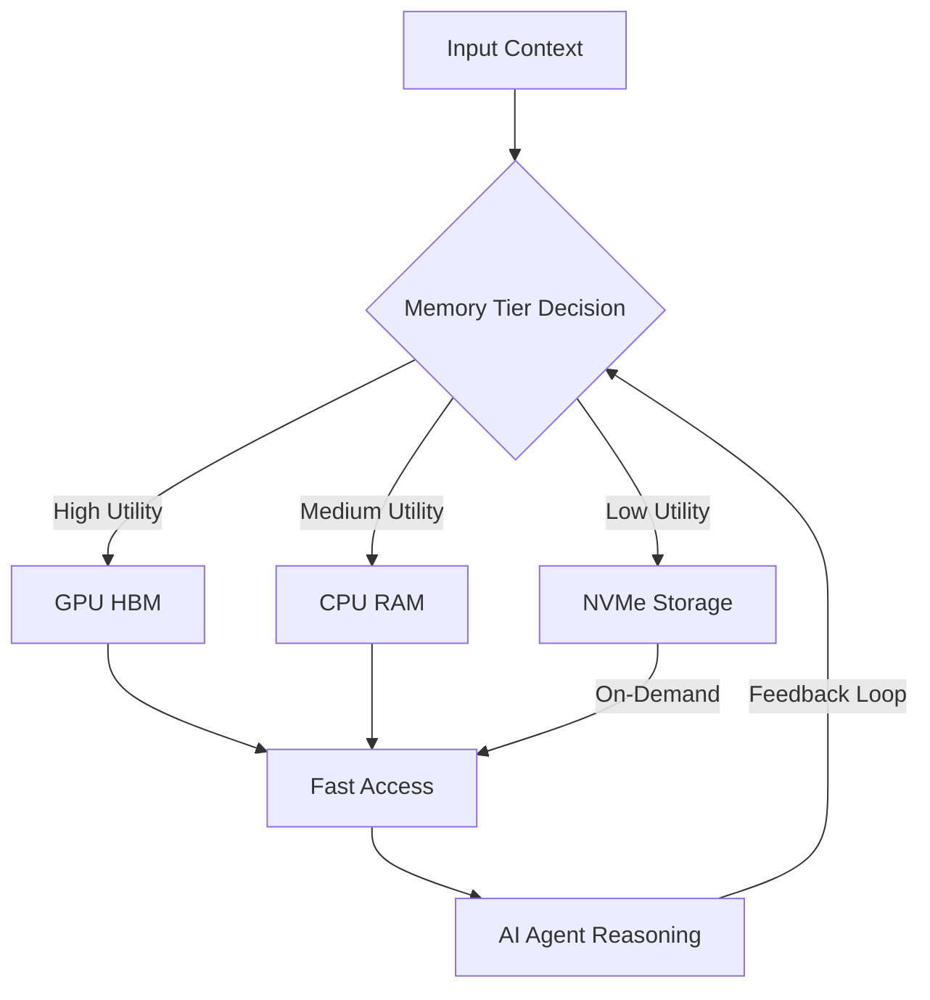
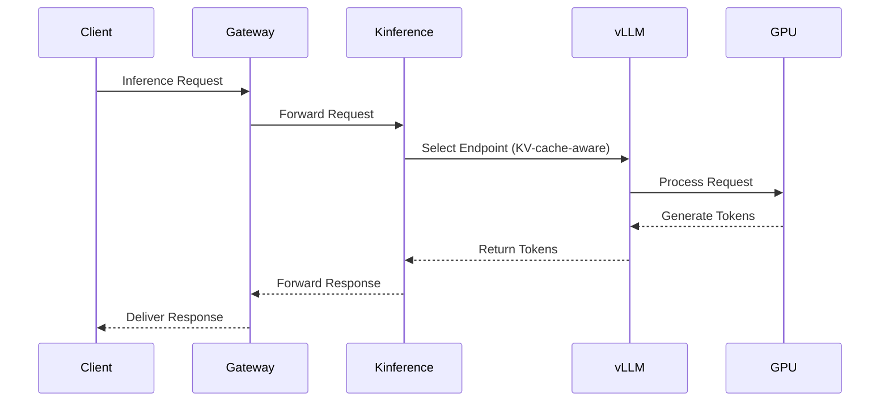
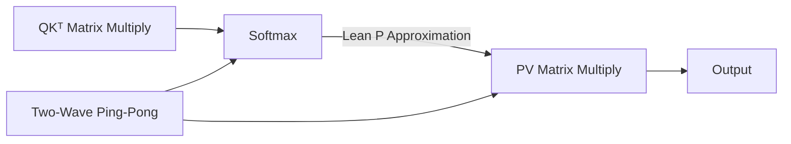

> 🎙️ **Listen to the podcast version of this article:**
> <audio controls src="index.mp3"></audio>

---

> 💡 **TL;DR:** This article dives into three groundbreaking advancements in AI efficiency: NVIDIA’s memory strategy for cost-effective AI agents, Buoyant’s Kinference control plane for Kubernetes and vLLM that slashes median TTFT by 95%, and Zyphra’s ZYFA FP8 FlashAttention kernels for AMD MI355X, delivering up to 1.76× speedups and 78% lower error rates. These innovations collectively redefine how AI systems manage memory, routing, and computation for next-gen performance.

| **Metric / Innovation Area**               | **Insight / Takeaway**                                                                                     |
|--------------------------------------------|-----------------------------------------------------------------------------------------------------------|
| **NVIDIA Memory Strategy**                 | Optimizes AI agent memory usage by deciding *what* to store, *where* to store it, and *when* to reuse it. |
| **Kinference (Buoyant)**                  | 95% reduction in median TTFT for shared-prefix workloads; 7.4× higher goodput on shared-prefix traffic.   |
| **ZYFA (Zyphra)**                          | 1.16–1.76× speedup over AMD’s AITER; 62–78% lower FP8 error at head dimension 128.                       |
| **FP8 Softmax Optimization**               | Lean P replaces exponential with 1 multiply-add, reducing softmax vector cycles by 57%.                   |
| **Multi-Tenant Inference**                 | Kinference enables declarative routing policies, KV-cache-aware load balancing, and per-tenant metrics.   |

---

### NVIDIA’s Memory Strategy for AI Agents: Making Context Affordable

AI agents are transforming industries by autonomously reading, reasoning, and using tools—but their insatiable appetite for context memory comes at a steep cost. NVIDIA’s latest research tackles this challenge head-on with a **memory strategy** that answers three critical questions: *what* to store, *where* to store it, and *when* to reuse it. This isn’t just about squeezing more data into limited memory; it’s about *intelligently* managing context to make AI agents economically viable at scale.

At its core, NVIDIA’s approach treats memory as a **tiered resource**, where frequently accessed or high-value context is retained in fast, expensive memory (e.g., GPU HBM), while less critical data is offloaded to slower, cheaper storage (e.g., CPU RAM or NVMe). The system dynamically evaluates the *utility* of each piece of context—prioritizing information that enhances reasoning accuracy or reduces redundant computations. For example, if an agent repeatedly references a specific dataset or tool output, the strategy ensures it remains in high-speed memory, avoiding costly re-fetching or recomputation.

The implications are profound. By reducing memory waste, NVIDIA’s strategy lowers the **total cost of ownership (TCO)** for deploying AI agents, making them accessible to a broader range of applications. This is particularly critical for enterprises running multiple agents in parallel, where memory inefficiencies can quickly balloon into prohibitive expenses. The approach also aligns with the growing trend of **sparse attention mechanisms**, where only the most relevant parts of the context are processed, further optimizing resource usage.

Why does this matter? As AI agents become more sophisticated, their memory demands will only grow. NVIDIA’s strategy provides a **scalable framework** for managing this growth without proportional increases in cost or latency. For researchers, this opens new avenues for exploring **adaptive memory hierarchies** and **context-aware caching**. For practitioners, it offers a practical path to deploying agents in resource-constrained environments without sacrificing performance.

---

### Buoyant Kinference: The Open-Source Inference Control Plane for Kubernetes and vLLM

In the world of large-scale AI inference, **latency and throughput** are the twin pillars of performance. Buoyant’s **Kinference**, an open-source control plane for Kubernetes and vLLM, addresses both with a declarative, policy-driven approach that delivers **dramatic improvements** in time-to-first-token (TTFT) and goodput. In benchmarks, Kinference achieved a **95% reduction in median TTFT** for shared-prefix workloads and a **7.4× increase in goodput** compared to plain Kubernetes Service routing.

Kinference operates as a **control plane** sitting atop vLLM’s data plane, acting as the brain that orchestrates how inference requests are routed, balanced, and prioritized. Its architecture consists of two key components: a **traffic gateway** and an **inference handler**. The gateway manages incoming requests, while the handler—exposing a gRPC interface—selects the optimal endpoint for each request, potentially modifying the request body to optimize performance. This separation of concerns allows Kinference to apply **KV-cache-aware load balancing**, where requests are routed based on the state of the key-value cache, minimizing redundant computations and maximizing efficiency.

The magic happens through **declarative routing policies**, defined using Kubernetes Custom Resource Definitions (CRDs). These policies allow teams to specify rules for routing, such as:
- **Cost Optimization**: Route low-complexity prompts to smaller models unless cache overlap makes a larger model faster.
- **Burst Handling**: Skip overloaded workers (e.g., those with >2 queued prompts) and fall back to external providers like Bedrock.
- **Data Privacy**: Ensure prompts tagged with PII (Personally Identifiable Information) stay within local, secure environments.
- **Batch Processing**: Direct batch requests only to workers with <70% KV-cache usage to avoid contention.

Kinference’s policies are **git-ops friendly**, meaning they can be version-controlled, validated offline using the `kinfctl` CLI, and deployed seamlessly. This ensures consistency and reproducibility across environments, a critical requirement for enterprise-grade AI deployments.

In Buoyant’s benchmarks, Kinference was tested against a baseline of plain Kubernetes Service routing using **3 L40S GPUs** and the **Qwen3.8-27B-FP8** model. The results were striking:
- **Shared-prefix workloads**: Median TTFT dropped from **6.88s to 0.31s** (95% reduction).
- **Multiturn workloads**: Median TTFT improved from **1.70s to 0.59s** (65% reduction).
- **Goodput**: Peak requests per minute meeting TTFT SLOs increased **7.4× for shared-prefix** and **3.5× for multiturn** workloads.

Kinference’s strength lies in its **governance capabilities**. While other solutions like **llm-d** or **NVIDIA Dynamo** focus on raw serving performance, Kinference excels in **multi-tenant controls**, including per-tenant metrics, rate limits, and provider fallback. This makes it ideal for organizations serving multiple models to diverse internal or external clients, where **policy enforcement** and **resource isolation** are paramount.

For teams already invested in Kubernetes and vLLM, Kinference offers a **drop-in solution** to supercharge inference performance. Its Apache 2.0 license and Rust-based implementation ensure it’s both **open and performant**, while its integration with Prometheus and Grafana provides out-of-the-box observability.

---

### Zyphra ZYFA: FP8 FlashAttention for AMD MI355X – Speed and Precision Redefined

Attention mechanisms are the **beating heart** of transformer models, but their computational intensity—especially during the **prefill phase**—can be a bottleneck. Zyphra’s **ZYFA (Zyphra FlashAttention on AMD)** tackles this challenge with a set of **FP8 and BF16 prefill attention kernels** optimized for AMD’s Instinct MI355X GPUs. The results? **1.16–1.76× speedups** over AMD’s default **AITER** kernel library and **62–78% lower error rates** at head dimension 128.

ZYFA’s breakthrough lies in its **Lean P** softmax approximation, which replaces the computationally expensive **exponential function** with a single multiply-add operation. Here’s the intuition: in FP8 (e4m3 format), the bit pattern of a number grows linearly as its value doubles. Lean P exploits this by approximating the exponential as:

$$ P(x) \approx 8x + c $$ 

where $c$ is a constant. This reduces the softmax’s vector cycles per block from **896 to 384**—a **57% reduction**—freeing up the matrix units to focus on the heavy lifting: the **QKᵀ** and **PV** matrix multiplications.

But Lean P is just one piece of the puzzle. ZYFA employs a **two-wave ping-pong schedule**, where two waves of threads share each SIMD (Single Instruction, Multiple Data) unit. One wave issues matrix instructions while the other computes probabilities, then they swap roles. This keeps the matrix pipeline **86% busy** during steady-state cycles, up from 60% with exact softmax. Additionally, ZYFA uses **per-block scaling** and a **rounded row sum** to maintain numerical stability without sacrificing performance.

The performance gains are impressive. On **real model activations** (Mistral-7B, Qwen3-8B, DeepSeek-V2-Lite), ZYFA’s FP8 kernels deliver:
- **1.16× speedup** on Mistral-7B (16K tokens).
- **1.17× speedup** on Qwen3-8B (16K tokens).
- **1.76× speedup** on DeepSeek-V2-Lite (16K tokens).

On **Gaussian benchmarks** (32K tokens), ZYFA achieves **2,672 TFLOP/s** in FP8, compared to AITER’s **1,944 TFLOP/s**—a **37% improvement**. At the MLA (Mixed-Length Attention) shape, the gap widens to **1.99×**. These gains come despite ZYFA running at **lower clock speeds** (1,628 MHz vs. AITER’s 2,108 MHz on Mistral-7B), as AITER’s higher clock is offset by its less efficient use of cycles.

Accuracy is another win. ZYFA’s FP8 attention reduces error by **62–78%** compared to AITER at head dimension 128. Against fp64 attention, ZYFA’s KL divergence is **3.4×10⁻³** (Mistral-7B) vs. AITER’s **5.9×10⁻³**. For context, this places ZYFA within a few percent of **Composable Kernel** and **Triton**, two of the most accurate attention implementations available.

ZYFA’s kernels are **hand-scheduled assembly**, generated by a Python script to ensure optimal performance on AMD’s CDNA4 architecture (gfx950). The library is **Apache 2.0 licensed** and integrates seamlessly with PyTorch 2.12 and ROCm 7.2.3. While it currently supports **prefill only** (no decode or paged KV), its focus on **long-context prefill** makes it ideal for applications like **RAG (Retrieval-Augmented Generation)** or **long-document processing**, where the prefill phase dominates the runtime.

For researchers, ZYFA demonstrates that **FP8 attention is softmax-bound, not matrix-bound** on MI355X. This insight could inspire further optimizations in softmax approximations or scheduling strategies. For practitioners, ZYFA offers a **drop-in replacement** for AITER, with immediate gains in speed and accuracy. The code is available on [GitHub](https://github.com/zyphra/zyfa), and the technical details are outlined in [Zyphra’s blog post](https://www.zyphra.com/blog/zyfa).

---

### The Big Picture: Where Do These Innovations Fit?

The three advancements highlighted here—**NVIDIA’s memory strategy**, **Buoyant’s Kinference**, and **Zyphra’s ZYFA**—each address a critical bottleneck in AI inference:

1. **Memory Efficiency**: NVIDIA’s approach ensures AI agents can **scale without prohibitive memory costs**, making them viable for real-world deployment.
2. **Inference Orchestration**: Kinference provides the **control plane** needed to manage multi-tenant, high-throughput inference workloads on Kubernetes, with policies that optimize for latency, cost, and privacy.
3. **Computational Efficiency**: ZYFA’s FP8 kernels **accelerate attention** on AMD GPUs, delivering speedups and accuracy improvements that were previously out of reach.

Together, these innovations form a **holistic toolkit** for building next-generation AI systems that are **faster, cheaper, and more scalable**. For enterprises, this means the ability to deploy **more agents, serve more users, and process more data** without proportional increases in cost or complexity. For researchers, it opens new frontiers in **adaptive memory management, policy-driven inference, and low-precision computation**.

As AI continues to evolve, the focus will increasingly shift from **model size** to **system efficiency**. The work being done by NVIDIA, Buoyant, and Zyphra today is laying the groundwork for this transition—ensuring that the AI of tomorrow is not just smarter, but also **more accessible and sustainable**.

Written with [Argos](https://github.com/Neilstid/argos)
