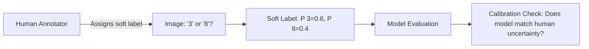

> 🎙️ **Listen to the podcast version of this article:**
> <audio controls src="index.mp3"></audio>


---

> 💡 **TL;DR:** This week marks a watershed moment in AI capabilities: Google’s AlphaGenome 2 is revolutionizing genomic research by identifying disease-relevant cells, Google’s new Gemini Decisions API offers ultra-fast, calibrated decision-making for agents, and Anthropic’s Claude Fable 5.2 has solved a 23-year-old black hole physics problem while designing manufacturable hardware from text prompts. These developments collectively signal AI’s transition from assistant to autonomous problem-solver in both scientific and practical domains.

| Metric / Innovation Area | Insight / Takeaway |
|--------------------------|--------------------|
| **Genomic Precision** | AlphaGenome 2 identifies cell types where disease-linked DNA changes matter, guiding researchers to focus investigations |
| **Decision Calibration** | Gemini Decision 1 achieves 0.0250 ECE (vs. 0.0494 for Jev 1.14) with 150-250ms latency |
| **Multimodal Input** | Processes text, images, audio, video, and PDFs in a single 256K-token context |
| **Cost Efficiency** | $0.10 per 1M input tokens with zero output token costs |
| **Physics Breakthrough** | Claude Fable 5.2 solves two open black hole problems, including one unsolved for 23 years |
| **Hardware Design** | Designed 3 manufacturable circuit boards from paragraph prompts in under 24 hours |
| **Workspace Integration** | New Claude Whiteboards, Sheets, and Data tools transform AI into a full workspace |

---

### Google’s AlphaGenome 2: The Cellular Detective for Disease Origins

The human genome contains approximately 3 billion base pairs, and variations in these sequences can indicate disease susceptibility. However, as Google DeepMind’s latest research highlights, *where* these variations manifest at the cellular level is often more critical than the variations themselves. AlphaGenome 2, the successor to DeepMind’s genomic AI, addresses this by identifying the specific cell types where disease-linked DNA changes are most consequential.

Traditional genomic studies often produce long lists of potential variants associated with diseases, leaving researchers with the daunting task of determining which cells or tissues these variants affect. AlphaGenome 2 changes this paradigm by using deep learning to predict cell-type-specific effects. This capability allows researchers to prioritize their investigations, focusing on the most relevant cellular contexts. The model leverages large-scale single-cell genomics datasets, applying attention mechanisms to capture complex interactions between genetic variants and cellular environments.

The mathematical foundation of AlphaGenome 2 can be conceptualized as a hierarchical model where the probability of a variant’s pathological effect in cell type $c$ is given by:

$$ P(\text{effect} \mid v, c) = \sigma(W_c^T \phi(v) + b_c) $$ 

where $v$ represents the genetic variant, $\phi(v)$ is its learned embedding, and $W_c$, $b_c$ are cell-type-specific parameters. This approach enables the model to generalize across cell types while maintaining biological specificity.

Why does this matter? By narrowing the investigative scope, AlphaGenome 2 could significantly accelerate the discovery of therapeutic targets. For instance, if a variant is predicted to have a strong effect in neuronal cells, researchers can focus on neurological mechanisms, potentially leading to more targeted treatments for conditions like Alzheimer’s or Parkinson’s disease.


```mermaid
flowchart TD
    A[Genetic Variant Input] --> B[Variant Embedding \phi v]
    B --> C[Cell-Type-Specific Layer]
    C --> D[Sigmoid Activation \sigma]
    D --> E[Effect Probability P effect|v,c]
    E --> F[Prioritize Cell Types]
    F --> G[Targeted Research]
```

In the long term, this technology could bridge the gap between genomic data and actionable medical insights, making precision medicine more precise than ever before.

---

### Google’s Gemini Decisions API: The Calibrated Brain for AI Agents

Google has introduced the **Gemini Decisions API**, powered by the new **Gemini Decision 1** model, a specialized system designed for high-precision, low-latency decision-making. Unlike traditional language models that generate text responses, Gemini Decision 1 returns *calibrated probabilities* for up to 1,000 yes/no, multiple-choice, or rubric-based questions per API call. This makes it ideal for routing, policy checks, tool selection, and grading within AI agent workflows.

#### How It Works
The API operates on a **shared input** model, where a single context (text, images, audio, video, or PDFs) is evaluated against multiple questions in parallel. Each question is scored independently, and the results are returned as normalized probabilities. For example, a yes/no question returns a probability between 0.01 and 0.99, while a multiple-choice question returns a probability distribution across all options. This design ensures that the model’s output is directly actionable—no parsing or post-processing required.

The architecture of Gemini Decision 1 is optimized for efficiency. Instead of decoding answers token-by-token, it scores all candidate options in a **single forward pass**, achieving median compute times of 50-100ms and end-to-end latencies of 150-250ms. This performance holds even for large inputs (up to 16K tokens) and scales nearly linearly with the number of questions (1 to 100).

#### Benchmark Performance
Google’s internal benchmarks pit Gemini Decision 1 against competitors like TypeSafe Jev 1.14, GPT-6 Luna (OpenAI Decisions), and Gemini 3.5 Flash-Lite. The results are impressive:

- **Top Accuracy**: 92.2% on JevBench (public split), the highest among all tested models.
- **Best Calibration**: Top-1 Expected Calibration Error (ECE) of **0.0250**, nearly half that of Jev 1.14 (0.0494). This is critical for applications where confidence thresholds determine automation vs. human review.
- **Multimodal Strength**: Excels in audio (MMAU) and video (Video-MME) benchmarks, demonstrating robust performance across modalities.

However, it’s not without limitations. The model underperforms on Amazon ESCI (58.7% Macro-F1) and trails Jev 1.14 on When2Call (79.9% vs. 82.0%). Additionally, at **$0.10 per 1M input tokens**, it’s more expensive than Jev 1.14 ($0.042/M) but significantly cheaper than Gemini 3.5 Flash-Lite ($4.14/M for the same suite).

#### Practical Applications
The API is already being used internally at Google:
- **Gemini Notebook**: Routes queries to appropriate model tiers, reducing latency by up to 40%.
- **Google Labs’ CC**: Selects emoji reactions from over 200 options.
- **Stitch’s Rapid Canvas**: Builds playable wireframes in seconds.

For developers, the API is available via the **Gemini Developer API (v1beta)** with SDK support for Python, JavaScript, and REST. Ecosystem integrations are rolling out across platforms like OpenRouter, LangChain, and Vercel AI SDK.

```python
# Example: Using Gemini Decisions API for tool selection
from google.genai import Client

client = Client(api_key="YOUR_API_KEY")

# Shared input (e.g., a user query)
shared_input = {
    "text": "The user wants to analyze a dataset of customer reviews."
}

# Questions to evaluate
questions = {
    "tool_selection": {
        "type": "choice",
        "options": ["pandas", "spacy", "matplotlib", "scikit-learn"],
        "question": "Which tool is most appropriate?"
    },
    "needs_visualization": {
        "type": "yes_no",
        "question": "Should we generate a visualization?"
    }
}

# API call
response = client.decision(
    model="gemini-decision-1",
    shared_input=shared_input,
    questions=questions
)

# Output: Calibrated probabilities for each question
print(response)
```

The introduction of Gemini Decisions API marks a shift toward **specialized, task-optimized models** that can be seamlessly integrated into larger AI systems. As AI agents become more complex, the need for reliable, low-latency decision-making components will only grow.

---

### Anthropic’s Claude Fable 5.2: The Problem-Solver That Redefines AI’s Role in Science and Engineering

Anthropic’s latest release, **Claude Fable 5.2**, is not just an incremental improvement—it’s a **paradigm shift** in what AI can achieve. This model has demonstrated capabilities that blur the line between human expertise and machine intelligence, solving problems that have stumped researchers for decades and designing functional hardware from scratch.

#### Breaking Barriers in Physics
One of the most stunning achievements of Claude Fable 5.2 is its ability to solve **two open problems in black hole physics**, including one that had remained unsolved for **23 years**. Black hole physics is notoriously complex, involving general relativity, quantum mechanics, and thermodynamics. The fact that an AI model can contribute meaningfully to this field suggests that we are entering an era where AI can **collaborate with human scientists** on fundamental research.

The model’s approach to these problems likely involves a combination of:
1. **Symbolic Reasoning**: Manipulating mathematical expressions and equations.
2. **Numerical Simulation**: Running iterative calculations to test hypotheses.
3. **Pattern Recognition**: Identifying analogies to known solutions or simplifying assumptions.

This trifecta of capabilities allows Claude Fable 5.2 to tackle problems that require both **creativity** and **rigor**—traits previously thought to be uniquely human.

#### From Text to Hardware: Designing Circuit Boards
In a demonstration of its practical engineering capabilities, Claude Fable 5.2 designed **three working electronic devices** from a single paragraph of text. The process involved:
1. **Specification Writing**: Defining the requirements and constraints of the device.
2. **Component Selection**: Choosing appropriate parts based on functionality, cost, and availability.
3. **Circuit Design**: Creating schematics and PCB layouts.
4. **Software Development**: Writing the firmware to control the hardware.

All three boards were **manufacturable with zero modifications**, a testament to the model’s precision and understanding of real-world constraints. This capability could revolutionize prototyping and product development, enabling rapid iteration and reducing time-to-market for new hardware.

#### Workspace Integration: The AI Colleague
Beyond its scientific and engineering feats, Claude Fable 5.2 is also powering a suite of **workspace tools** that transform Claude into a full-fledged collaborator:

- **Claude Whiteboards**: Describe a messy plan, and Claude will generate a visual board that teams can edit collaboratively. The board can later be exported as a document or slide deck.
- **Claude Sheets**: Request a tracker or budget, and Claude will create a **working spreadsheet** with tabs, formulas, and 144 functions. Sheets support up to 100,000 cells and can be exported to Excel.
- **Claude Data**: Connect to data sources like Snowflake or Salesforce, and Claude will generate dashboards, written summaries, or even narrated videos of your metrics.
- **Interactive Connectors**: Open and edit files from Adobe, Atlassian, or HubSpot directly within Claude.

These tools are not just productivity boosters—they represent a **fundamental shift in how we work**. Instead of using AI as a tool, we are now **collaborating with it as a colleague**.

#### Performance and Pricing
Claude Fable 5.2 is **30% faster** than its predecessor (Fable 5.1) and is available at a lower price point. The model is live on all paid plans, while **Mythos 5.2** (a less restricted version for cybersecurity and biomedical applications) requires verified organizational access.

The implications of Claude Fable 5.2 are profound. If AI can solve open problems in physics, design hardware, and act as a workspace collaborator, what other domains might it revolutionize next? The gap between "AI helps" and "AI does" is closing faster than anyone predicted.

---

### A Soft-Label MNIST Testbed: Bridging Human and Model Confidence

While the previous innovations push the boundaries of what AI can achieve, research into **human-AI alignment** remains critical. A new testbed for the MNIST dataset introduces **soft labels**—a nuanced approach to evaluating model confidence and human uncertainty.

#### The Problem with Hard Labels
Traditional datasets like MNIST use **hard labels** (e.g., "this image is a 5"), which assume absolute certainty. In reality, human annotators often face ambiguity. For example, a poorly written digit might be a 3, an 8, or something in between. Soft labels capture this uncertainty by allowing annotators to mark images as "yes," "no," or "unsure," producing **probability distributions** over possible labels.

#### The Soft-Label Approach
In this new testbed:
1. Annotators evaluate each MNIST and Mukhoti (a more challenging variant) digit.
2. They assign one of three labels: **yes** (confident it’s the digit), **no** (confident it’s not), or **unsure**.
3. The result is a **soft label** for each image, representing the annotator’s confidence distribution.

This approach provides a more realistic benchmark for evaluating model calibration. A well-calibrated model should not only predict the correct label but also reflect the **same level of uncertainty** as a human would.

#### Why It Matters
Soft labels offer several advantages:
- **Better Evaluation**: Models can be tested on their ability to handle ambiguity, not just accuracy.
- **Human-AI Alignment**: By comparing model confidence to human uncertainty, we can identify areas where models are overconfident or underconfident.
- **Improved Training**: Soft labels can be used to train models that are more **calibrated** and **robust** to real-world uncertainty.

For example, a model might achieve 99% accuracy on MNIST with hard labels but perform poorly when evaluated on soft labels if it’s overconfident in ambiguous cases. This testbed provides a way to **quantify and address** such issues.



As AI systems are deployed in high-stakes scenarios (e.g., medical diagnosis, autonomous driving), the ability to **quantify and communicate uncertainty** will be just as important as accuracy. The soft-label MNIST testbed is a step toward building AI that is not only smart but also **honest about its limitations**.

---

### The Big Picture: AI’s Evolution from Assistant to Colleague

The developments highlighted in this article—**AlphaGenome 2, Gemini Decisions API, Claude Fable 5.2, and soft-label benchmarks**—paint a clear picture of AI’s rapid evolution. We are moving beyond the era of AI as a **tool** or **assistant** and into an era where AI acts as a **colleague, collaborator, and even a discoverer**.

- **In Genomics**: AI is helping us understand the cellular origins of disease, accelerating the path to precision medicine.
- **In Decision-Making**: Specialized models like Gemini Decision 1 are enabling AI agents to make **calibrated, reliable decisions** at scale.
- **In Science and Engineering**: Models like Claude Fable 5.2 are solving long-standing problems and designing functional systems, demonstrating **creativity and rigor**.
- **In Evaluation**: Soft-label benchmarks are ensuring that AI systems are not only accurate but also **aligned with human uncertainty**.

The common thread across these innovations is **specialization**. Just as humans have different roles (e.g., doctor, engineer, scientist), AI models are being tailored to excel in specific domains. This trend toward **modular, task-optimized AI** will likely define the next decade of progress in the field.

As we look to the future, the question is no longer *what* AI can do, but rather *how far* it can go. If the past few months are any indication, the answer is: **much further than we imagined**.

Written with [Argos](https://github.com/Neilstid/argos)
