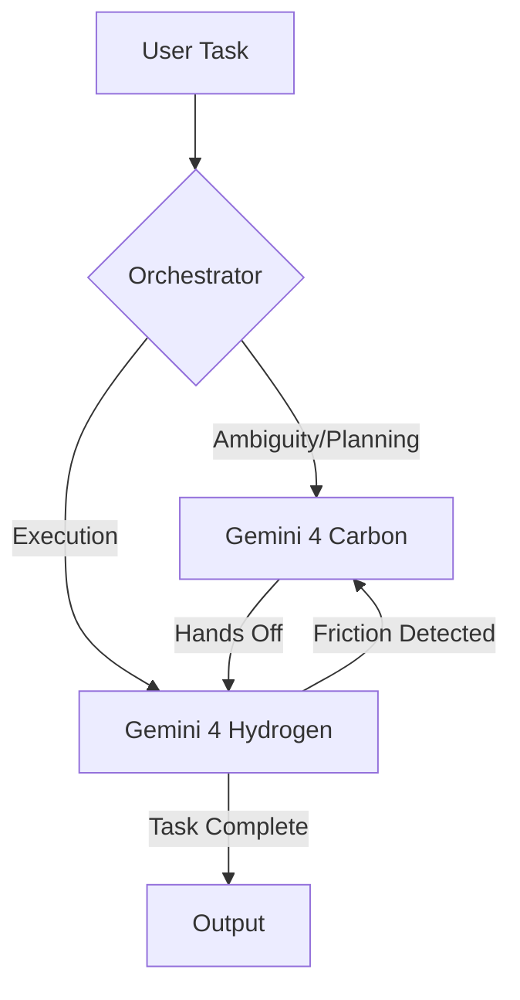

> 🎙️ **Listen to the podcast version of this article:**
> <audio controls src="index.mp3"></audio>


---

> 💡 **TL;DR:** Google’s Gemini 4 Hydrogen redefines agentic AI with a 1M-token window, 4 thinking levels, and frontier-class benchmarks at $1.50/$7.50 pricing, while a new guide demystifies LLM evaluation—from scorers to RAG diagnostics—and a study reveals how distracting passages can collapse RAG retrieval performance by 40 points. These developments underscore the urgency of robust evaluation and retrieval in the next wave of AI agents.

| **Metric / Innovation Area**               | **Insight / Takeaway**                                                                                     |
|--------------------------------------------|----------------------------------------------------------------------------------------------------------|
| **Gemini 4 Hydrogen**                     | 2.5x faster than Gemini 3.8 Flash, 51 AA Index score, 57% on Terminal-Bench 4.1, 1M-token unified window. |
| **LLM Evaluation Frameworks**              | Systematic scorers (code, reference-based, LLM-judge), QAG/G-Eval for stability, Cohen’s kappa for calibration. |
| **RAG Retrieval Challenges**               | 40-point performance drop with 2.68M distracting passages; author-written evals overrate search.          |
| **Agentic Workflows**                      | Role-splitting (Carbon for planning, Hydrogen for execution) reduces quota use by 24% and speeds up tasks by 19%. |
| **Pricing & Efficiency**                   | Hydrogen’s $1.50/$7.50 pricing matches post-intro Gemini 3.8 Flash, with implicit caching for large prompts. |

---

### Gemini 4 Hydrogen: Google’s Fastest Agentic Model Yet

Google’s latest release, **Gemini 4 Hydrogen**, is a proprietary model designed as the "daily driver for agentic workflows." Positioned below the frontier models **Gemini 4 Carbon** and **Gemini 4 Argon**, Hydrogen is optimized for speed, efficiency, and scalability in multi-step tasks. Its standout features include a **1,048,576-token unified window** (shared across input, thinking, and output), **four thinking levels** (low, medium, high, and xhigh), and a pricing model of **$1.50 per 1M input tokens / $7.50 per 1M output tokens**—flat across the entire context window.

#### **Architecture and Capabilities**
Hydrogen is a closed-weights model served exclusively via the **Gemini API** and Google products (e.g., AI Studio, Android Studio, Google Search). While its parameter count and architecture remain undisclosed, it inherits adaptations from **Gemini 4 Carbon** and supports multimodal inputs (text, images, audio, video, PDFs, tables, and charts). The **1M-token window** is a game-changer for agentic tasks, enabling longer conversations, deeper reasoning, and more complex workflows without truncation. However, synchronous output is capped at **65,536 tokens**, a limitation for some use cases.

The **four thinking levels** are configurable via `generation_config.thinking_level` and directly impact token usage and performance. Google’s benchmarks show that higher thinking levels (e.g., `xhigh`) improve scores on the **Artificial Analysis Intelligence Index** (54 at xhigh vs. 51 at high) but consume more tokens. The default is `high`, a shift from Gemini 3.8 Flash’s `medium` default.

#### **Benchmark Performance**
Hydrogen shines in agentic and coding benchmarks:
- **Artificial Analysis Intelligence Index**: 51 (high) / 54 (xhigh), surpassing **Gemini 4 Argon’s 50**.
- **Terminal-Bench 4.1**: **57% task success**, a staggering leap from **Gemini 3.8 Flash’s 18.2%**.
- **HLE-Diamond**: 58.8% (class-leading).
- **Vals Tax/Legal Research Benches**: 52.3% and 55.8%, respectively (ranked #1 or tied).
- **Agent Arena**: Ranked #5 (a rare underperformance).

Speed is Hydrogen’s hallmark: it completes tasks **2.5x faster** than Gemini 3.8 Flash at the default `high` thinking level. Partner tests reported **2x–2.8x speedups** with **12–23% fewer tokens**. Additionally, Google claims **5x fewer fabricated claims** than 3.8 Flash and a **96.7% score** on internal agent honesty evaluations.

#### **Role-Splitting with Carbon and Argon**
Google’s **Antigravity** framework introduces a **multi-agent orchestration** system where models specialize in roles:
- **Carbon** handles exploration, ambiguity resolution, and planning.
- **Hydrogen** executes tasks (e.g., editing files, running tests).
- Control switches back to Carbon when Hydrogen encounters friction.

This division of labor achieves **near-Carbon task success rates** while using **24% less quota** and finishing **19% faster** than Carbon alone. The Antigravity SDK allows developers to implement custom multi-agent systems with similar role-splitting.



#### **Pricing and Availability**
Hydrogen’s pricing is competitive but not cheap:
- **Input**: $1.50 per 1M tokens.
- **Output**: $7.50 per 1M tokens (includes thinking tokens).
- **Implicit caching**: Reduces input costs to **$0.075 per 1M tokens** for prompts ≥4,096 tokens.

For comparison:
- **Gemini 3.8 Flash**: $0.75/$3.75 (intro pricing until Dec 31, 2026), then matches Hydrogen’s $1.50/$7.50.
- **Gemini 4 Argon**: $2/$10 (intro), rising to $4/$20 on Dec 1, 2026.
- **Claude Haiku 5.5**: $0.10–$0.50 (input) / $0.50–$2.50 (output).

Hydrogen is available via the **Gemini API** (`gemini-4-hydrogen` model ID), **Google AI Studio**, **Android Studio**, and integrated into **Gemini for Business**, **Google Search**, and **Sheets**. Migration from 3.8 Flash requires removing deprecated parameters (`temperature`, `top_p`, `top_k`) and updating `max_output_tokens` caps to 65,536.

#### **Why It Matters**
Gemini 4 Hydrogen represents a **paradigm shift** in agentic AI:
1. **Speed and Efficiency**: 2.5x faster task completion with fewer tokens makes it viable for real-time applications.
2. **Scalability**: The 1M-token window enables handling of **long-form documents, multi-turn conversations, and complex workflows** without context fragmentation.
3. **Cost-Performance Tradeoff**: While not the cheapest, its benchmark performance justifies the cost for high-stakes agentic tasks.
4. **Multi-Agent Synergy**: Role-splitting with Carbon/Argon demonstrates how **specialized models** can collaborate to optimize performance and cost.

For AI practitioners, Hydrogen is a **compelling choice** for agentic workflows where speed and reliability are paramount. Its limitations (closed weights, output cap) are offset by its **frontier-class performance** and seamless integration with Google’s ecosystem.

---

### The Complete Guide to LLM Evaluation: Systematic Scorers, Reliable Judges, and RAG Diagnostics

Evaluating Large Language Models (LLMs) is no longer a niche concern—it’s a **critical discipline** for ensuring reliability, safety, and performance in production systems. The *Complete Guide to LLM Evaluation* provides a **framework for systematic testing**, covering everything from **scorer selection** to **RAG system diagnostics** and **release-cycle strategies**. Here’s how to build an evaluation pipeline that catches regressions before users do.

#### **The Problem with Spot-Checking**
Traditional software testing relies on **deterministic unit tests**, but LLM outputs are **non-deterministic** and context-dependent. For example:
- "You can return shoes within 30 days" and "Returns are accepted for a month after delivery" are **semantically equivalent** but fail string comparison tests.
- A prompt tweak or model swap might break edge cases that were never explicitly tested.

**Evaluation** fills this gap by:
1. **Measuring relative quality** (e.g., is version B better than A on specific inputs?).
2. **Gating releases** with binary checks (e.g., valid JSON, no banned phrases).

Every evaluation pipeline has three core components:
1. **Dataset**: A curated set of inputs (normal, edge, adversarial).
2. **Scorers**: Methods to grade outputs (code, reference-based, LLM-judge).
3. **Score Tracking**: Logging metrics over time to detect regressions.

#### **Choosing the Right Scorer**
Scorers fall into three categories, each suited to different use cases:

| **Scorer Type**       | **How It Grades**                          | **Best For**                          | **Example**                          |
|------------------------|--------------------------------------------|---------------------------------------|--------------------------------------|
| **Code**               | Deterministic logic (regex, schema checks) | Format, length, required strings      | JSON parsing, word count ≤ 120       |
| **Reference-Based**    | Compares output to a known answer          | Questions with one right answer       | Exact match, F1, BERTScore           |
| **LLM-Judge**          | A model applies a rubric                   | Tone, groundedness, helpfulness       | "Is every claim supported by context?" |

**Key Insights**:
- **Code scorers** are **zero-cost, deterministic**, and ideal for rule-based checks (e.g., "Does the output contain a banned phrase?").
- **Reference-based scorers** (e.g., BLEU, ROUGE) struggle with **paraphrasing** because they rely on n-gram overlap. **BERTScore** improves this by using embedding similarity but still requires a reference.
- **LLM-judges** are flexible but **costly and non-deterministic**. Use them only for criteria that **cannot be expressed as rules** (e.g., "Is this answer helpful?").

#### **LLM-as-a-Judge: Designing Reliable Rubrics**
An LLM judge is a model prompted to **grade another model’s output** against a rubric. It operates in three modes:
1. **Pointwise**: Scores a single output against a rubric (e.g., PASS/FAIL or 1–5 scale).
2. **Pairwise**: Compares two outputs for the same input and picks the better one.
3. **Reference-Guided**: Uses a gold answer to check the output (useful for factual questions).

##### **Writing Effective Rubrics**
A well-designed rubric has four parts:
1. **Criterion Definition**: What are you evaluating (e.g., "faithfulness to context")?
2. **Inputs**: What data can the judge use (e.g., context, input, answer)?
3. **Procedure**: Step-by-step instructions for the judge.
4. **Output Format**: Strict formatting (e.g., JSON with reasoning and verdict).

**Example Rubric for Faithfulness**:
```python
import json

RUBRIC = """
You are grading a customer-support answer for faithfulness.
Policy: {context}
Question: {input}
Answer: {answer}
Steps:
1. List each factual claim in the Answer.
2. For each claim, decide whether the Policy supports it.
3. Verdict: PASS if every claim is supported, otherwise FAIL.
Respond with JSON only: {{"claims": [{{"text": "...", "supported": true}}], "verdict": "PASS"}}
"""

def judge(case, answer):
    response = call_llm(RUBRIC.format(answer=answer, **case), temperature=0)
    return json.loads(response)
```

**Design Choices That Matter**:
- **Reasoning Before Verdict**: The judge lists claims before deciding, ensuring the verdict is **evidence-based**.
- **Structured Output**: JSON parsing enables **automated logging** and debugging.
- **Temperature = 0**: Reduces sampling noise (though floating-point nondeterminism may still cause flips).
- **Majority Voting**: For borderline cases, run the judge an **odd number of times** and take the majority verdict.

##### **Scoring Methods**
1. **QAG (Question-Answer Generation)**:
   - Decomposes criteria into **yes/no questions** (e.g., "Does the policy support this claim?").
   - The score is the **fraction of supported claims**:
     $$\text{score} = \frac{\sum_{c \in \text{claims}} \mathbb{I}(c.\text{supported})}{\text{len(claims)}}$$.
   - **Advantage**: Reproducible and stable (classification is LLMs’ most consistent task).
   - **Use Case**: Faithfulness, factual accuracy.

2. **G-Eval**:
   - Targets **subjective criteria** (e.g., coherence, helpfulness) where discrete claims are impractical.
   - Uses **Auto-CoT (Automatic Chain-of-Thought)** to decompose the criterion into steps.
   - The final score is a **probability-weighted average** of tokens (e.g., if the model outputs "4" with 60% probability and "5" with 40%, the score is **4.4**).
   - **Advantage**: Finer resolution, avoids collapsing to a favorite number.
   - **Limitation**: Requires **token log-probabilities**, which not all APIs provide. Without them, approximate by **sampling multiple judgments and averaging**.

3. **Pairwise Comparisons**:
   - The judge answers: **"Is A or B better?"**
   - **Position Bias Mitigation**: Run each comparison **twice** (swapping A and B) and keep only **consistent verdicts**.
   - **Tie Handling**: If the judge’s preference follows position (e.g., always picks the first option), count it as a tie.

```python
def prefer(case, a, b):
    first = pairwise(case, a, b)  # returns "A" or "B"
    second = pairwise(case, b, a)
    if first == "A

Written with [Argos](https://github.com/Neilstid/argos)
