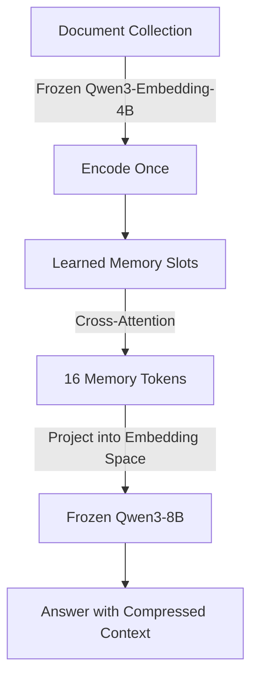

> 🎙️ **Listen to the podcast version of this article:**
> <audio controls src="index.mp3"></audio>


---

> 💡 **TL;DR:** Stanford’s **Memorilla** compresses entire document collections into 16 latent tokens for frozen LLMs, achieving 84.33% accuracy on FactKG with 108x fewer tokens. Meanwhile, **2026’s AI video generation leaderboard** is dominated by Alibaba’s Wan 3.0 (1175 Elo) and open-weights MiniMax H3, while practical **computer vision tools** demonstrate how Python can classify, score, and analyze images for real-world decision-making.

| **Metric / Innovation Area**               | **Insight / Takeaway**                                                                                     |
|--------------------------------------------|----------------------------------------------------------------------------------------------------------|
| **Memorilla (Latent Memory)**             | 16 tokens replace 108x document tokens; 84.33% FactKG accuracy with frozen Qwen3-8B.                     |
| **Top Video Model (Wan 3.0)**              | 1175 Elo (T2V), $0.20/sec, closed weights; best for document-to-video.                                   |
| **Best Open-Weights Video Model**          | MiniMax H3 (1161 Elo, $0.08/sec), restricted license (no US/EU/UK/SK deployment).                        |
| **Best Value Video Model**                 | HeyGen Video 1 (1152 Elo, $0.04/sec), post-trained on H3.                                               |
| **Computer Vision Practicality**           | Python-based image classification, sharpness scoring, and damage detection for real-world applications. |

---

### **Memorilla: Stanford’s Latent Memory Module for Frozen LLMs**

Large Language Models (LLMs) are transformative, but their utility is often constrained by context window limitations. Traditional methods like full-context prompting or retrieval-augmented generation (RAG) struggle with scalability—either slowing down as history grows or missing subtle contextual clues. Enter **Memorilla**, a latent memory module developed by Stanford’s SNAP group in collaboration with researchers from Toronto, Penn, and MIT. This open-source innovation compresses entire document collections into **just 16 memory tokens**, enabling frozen LLMs to retain high accuracy without the computational overhead of processing full contexts.

#### **How Memorilla Works**
Memorilla’s pipeline is elegantly simple yet powerful:
1. **Encode Once**: A frozen `Qwen3-Embedding-4B` model embeds each document in the collection **once**, eliminating the need for re-encoding as new documents are added.
2. **Read Per Question**: For each query, 16 learned slots attend to both the question and the full document store using **2 cross-attention layers with 8 heads**. This dynamic attention mechanism ensures the model focuses on the most relevant information.
3. **Inject**: The 16 memory tokens are projected into the input embedding space of the frozen `Qwen3-8B` LLM and prepended to the question, effectively providing the model with a compressed yet rich contextual summary.

The memory module itself is trainable, with **194,123,776 parameters**, while the encoder and decoder remain frozen. Training occurs in three stages:
- **Stage 1**: 1.98M Wikipedia paraphrase-reconstruction examples.
- **Stage 2**: 1.34M examples from 10 QA and summarization datasets.
- **Stage 3**: Fine-tuning on all 8 benchmarks.
The entire process takes ~19 hours on 4 H100 GPUs.



#### **Performance and Benchmarks**
Memorilla’s efficiency is staggering. On the **FactKG** benchmark, it achieves **84.33% accuracy** compared to 80.43% for full-context prompting, using **108x fewer document tokens**. Across 8 benchmarks, it holds the **highest average score (49.68%)**, topping 5 out of 8 leaderboards. Notably, on **NarrativeQA**, 16 tokens replace **67,385 document tokens**—a **4,212x compression**—while maintaining competitive performance.

However, Memorilla isn’t without limitations. On **PubMedQA**, where documents are short (~324 tokens), compression offers minimal benefit, and it scores **59.00%** versus **69.00%** for `LLMLingua-2`. Similarly, `MemoRAG` outperforms it on **PersonalizationV4** and **NarrativeQA ROUGE-L**, albeit using **690x and 50x more tokens**, respectively.

#### **Speed and Deployment**
Memorilla is **blazingly fast**. On a single H100 GPU:
- **0.74 seconds** for 512 documents (~128K tokens).
- Full context slows to **19.9 seconds** (27x slower).
The memory module itself adds just **2 ms** of latency. With an optional **memory cache** (precomputed cross-attention keys/values), response times drop further:
- **8.1 ms** for 1M documents on a B200.
- **5.0 ms** with `torch.compile`.

Memorilla is open-source under **Apache 2.0**, with checkpoints available on Hugging Face. Installation is straightforward via `uv` on Linux with CUDA GPUs and Python 3.11. The first run downloads ~25 GB of models, and custom datasets require `parquet` files with `collection_id`, `question`, `answer`, and `documents` columns.

```python
# Example: Loading Memorilla with MemoryVLLM
from memorilla import MemoryVLLM

# Load pre-trained model
model = MemoryVLLM.from_pretrained("memorilla/Memorilla-Qwen3-8B")

# Query with compressed memory tokens
response = model.generate(
    question="What is the capital of France?",
    documents=["Paris is the capital of France.", "France is a country in Europe."]
)
print(response)
```

#### **Why It Matters**
Memorilla represents a paradigm shift in **contextual efficiency** for LLMs. By decoupling memory from the frozen model, it enables:
- **Scalability**: Handle massive document collections without exploding compute costs.
- **Speed**: Near-instantaneous responses even with millions of documents.
- **Flexibility**: Works with any frozen LLM, making it a plug-and-play solution for long-context tasks.

For enterprises and researchers, Memorilla could unlock new applications in **legal document analysis, medical record summarization, and multi-turn conversational agents** where context retention is critical.

---

### **2026 AI Video Generation Leaderboard: Elo, Price, and Open Weights**

The AI video generation landscape has evolved dramatically in the past year. **Native audio** is now a baseline expectation, clips routinely span **15–30 seconds**, and—perhaps most surprisingly—**open-weights models** are competing at the top tier. This section breaks down the **Artificial Analysis Video Arena** leaderboard (as of November 13, 2026), where models are ranked by **blind human-preference Elo scores** for both text-to-video (T2V) and image-to-video (I2V) tasks.

#### **Methodology**
- **Quality**: Models are ranked by Elo scores from pairwise human votes. The anchor is **Kling 3.0 1080p (Pro)** at **1000 Elo**.
- **Price**: Cost per second is normalized to 1080p where possible. Vendor rates at 720p are often lower.
- **Confidence**: Most top-10 scores have a **±13 to ±15 Elo** margin of error. Models within ~25 Elo points are statistically indistinguishable.

#### **Top Performers**

| **Rank** | **Model**               | **Developer**          | **T2V Elo** | **I2V Elo** | **$/sec** | **10-sec Clip Cost** | **Open Weights**          |
|----------|-------------------------|------------------------|-------------|-------------|-----------|----------------------|----------------------------|
| 1        | Wan 3.0                 | Alibaba                | 1175        | 1108        | $0.200    | $2.00                | No                         |
| 2        | Utopai X                | Utopai Studios         | 1170        | 1151        | No API     | —                    | No                         |
| 3        | MiniMax H3 (768p)       | MiniMax                | 1161        | 1133        | $0.080    | $0.80                | Yes (restricted)          |
| 4        | Dreamina Seedance 2.5   | ByteDance Seed         | 1155        | 1161        | $0.569    | $5.69                | No                         |
| 5        | Gemini Omni Flash 1.2   | Google                 | 1154        | 1086        | $0.104    | $1.04                | No                         |

##### **1. Alibaba Wan 3.0: The T2V King**
Wan 3.0 leads the **text-to-video** category with a **1175 Elo score**, backed by **7,651 votes**. Launched on August 24, 2026, it generates **30-second 1080p clips** from text, PDFs, or slide decks at **$0.20 per second**. Its standout feature is **document-to-video input**, allowing users to upload a deck and receive a structured video output.

**Trade-offs**:
- **Closed weights**: No downloadable models.
- **I2V Gap**: Drops to **11th place (1108 Elo)** on image-to-video.

**Best for**: Long single takes, explainer videos from existing documents.

##### **2. Utopai X: The Post-Train Powerhouse**
Utopai X is the **only model in the top 2 for both T2V and I2V** (1170 and 1151 Elo, respectively). Developed by **Utopai Studios** (a Mountain View film studio), it’s a **post-train of MiniMax H3**, outperforming its base model. However, access is limited to Utopai’s **PAI platform** (93 credits/sec, $15 for 1,000 credits), making it unsuitable for programmatic use.

**Best for**: Filmmakers working within a studio tool.

##### **3. MiniMax H3: The Open-Weights Trailblazer**
MiniMax H3 is the **first open-weights model in the top tier**, ranking **3rd in T2V (1161 Elo)** and **4th in I2V (1133 Elo)**. Launched on July 31, 2026, it’s a **33B dense single-stream Transformer** using `Qwen3-VL-32B` as its encoder. Key features:
- **Native 32 kHz stereo audio**.
- **$0.08/sec** pricing.
- **Restricted license**: Blocks deployment in the **US, EU, UK, and South Korea**; capped at **768p** (2K upscaling is API-only).

H3 has become the **base layer for 2026 video models**, with **Utopai X, HeyGen Video 1, fal’s H3 Max, and Pika H3 Flex** all built on it.

**Best for**: Teams outside restricted regions wanting to fine-tune a frontier model.

##### **4. ByteDance Seedance 2.5: The I2V Leader**
Seedance 2.5 **dominates image-to-video** with a **1161 Elo score** (1st place). Released on July 31, 2026, it supports **30-second generations** with up to **30 image, 10 video, and 10 audio references**. However, it’s **the most expensive model on the board** ($0.569/sec).

**Best for**: Reference-heavy, image-led ad and character work.

##### **5. Google Gemini Omni Flash 1.2: The Price-to-Quality Champion**
Launched on November 5, 2026, **Gemini Omni Flash 1.2** offers **1154 T2V Elo** at **$0.104/sec** (or **$0.07/sec at 720p**). It’s a **27 Elo improvement** over version 1.1 and includes **3–15 second clips** with a **30% price cut**.

**Best for**: Teams already on the Gemini API seeking top-5 quality under **$0.11/sec**.

#### **Open-Weights Leaderboard**
For those prioritizing **self-hosting and customization**, the open-weights landscape is as follows:

| **Model**               | **T2V Elo** | **License**                     | **Key Limits**                                  |
|-------------------------|-------------|---------------------------------|------------------------------------------------|
| MiniMax H3 (768p)       | 1161        | MiniMax H3 Community License    | No US/EU/UK/SK deployment; 768p ceiling        |
| Pika H3 Flex            | 1124        | MiniMax H3 Community License    | LoRA adapters on H3; same territory terms      |
| LTX-2.5 Fast            | 943         | LTX-2.x Community License       | Paid license at $10M+ annual revenue           |
| Wan 2.2                 | Not ranked  | Apache 2.0                      | Older (2025); no native audio                  |

**Key Insights**:
- **MiniMax H3** is the **best open-weights option** but is **geographically restricted**.
- **LTX-2.5** is a viable alternative for **US/EU teams** (no territory restrictions, but revenue-based gating).
- **Wan 2.2** and **HunyuanVideo 1.5** are **Apache 2.0** options for permissive licensing.

#### **Price-to-Quality Analysis**
The **cheapest top-tier models** are all **H3 derivatives or H3 itself**:

| **Model**               | **T2V Elo** | **$/sec** | **Elo per $1/sec** |
|-------------------------|-------------|-----------|--------------------|
| HeyGen Video 1          | 1152        | $0.040    | 3,800              |
| Pika H3 Flex            | 1124        | $0.035    | 3,543              |
| MiniMax H3 (768p)       | 1161        | $0.080    | 2,012              |
| Gemini Omni Flash 1.2   | 1154        | $0.104    | 1,476              |

**Value = (Elo – 1000) / price per second**. HeyGen Video 1 offers the **best value**, delivering **near-frontier quality at half the cost of Wan 3.0**.

#### **What About Veo, Kling 4.0, Sora, and Runway?**
- **Google Veo 3.1**: Scores **964 T2V Elo** (below Kling 3.0 anchor). **Veo 3.1 Lite** matches H3’s price ($0.08/sec) but trails by **213 Elo**.
- **Kling 4.0**: Generally available on [klingai.com](https://klingai.com) with **30-second native clips**, but **no API pricing yet**.
- **OpenAI Sora 2 / Runway Gen-4.5**: Not yet on the **AA with-audio boards**.

#### **How to Choose the Right Model**
| **Use Case**                          | **Recommended Model**               |
|---------------------------------------|-------------------------------------|
| Highest T2V quality, API access       | Wan 3.0                             |
| Image-to-video with heavy references  | Seedance 2.5                        |
| Best quality per dollar               | HeyGen Video 1 or Gemini Omni Flash 1.2 |
| Speed for iteration                   | FLUX 3 Max or H3 Max (fal)          |
| Self-hosting (non-US/EU/UK/SK)        | MiniMax H3 or Pika H3 Flex          |
| Self-hosting (US/EU)                  | LTX-2.5 or Wan 2.2 (Apache 2.0)     |

---

### **Practical Computer Vision: Decision-Making with Python**

While high-profile AI models dominate headlines, **practical computer vision** remains a cornerstone of real-world applications. A recent deep dive into **Jev’s image-based decision-making tools** showcases how Python can be leveraged for **classification, quality assessment, and damage detection**—tasks critical in industries like **e-commerce, manufacturing, and automotive**.

#### **1. Fabric Classification Against Reference Photos**
**Use Case**: Automatically classify fabric types (e.g., cotton, silk, polyester) by comparing them to a reference database.

**Approach**:
- Use **feature extraction** (e.g., `ResNet50`, `EfficientNet`) to embed fabric images.
- Compare query fabric embeddings to reference embeddings using **cosine similarity**.
- Classify based on the nearest neighbor.

**Example Code**:
```python
import numpy as np
from tensorflow.keras.applications.resnet50 import ResNet50, preprocess_input
from tensorflow.keras.preprocessing import image
from sklearn.metrics.pairwise import cosine_similarity

# Load pre-trained ResNet50
model = ResNet50(weights='imagenet', include_top=False, pooling='avg')

# Extract features for reference and query images
def extract_features(img_path):
    img = image.load_img(img_path, target_size=(224, 224))
    img_array = image.img_to_array(img)
    img_array = np.expand_dims(img_array, axis=0)
    img_array = preprocess_input(img_array)
    features = model.predict(img_array)
    return features.flatten()

# Compare query to references
query_features = extract_features("query_fabric.jpg")
reference_features = [extract_features(f"ref_{i}.jpg") for i in range(5)]

similarities = cosine_similarity([query_features], reference_features)
predicted_class = np.argmax(similarities)
print(f"Predicted Fabric Class: {predicted_class}")
```

#### **2. Scoring Product Sharpness**
**Use Case**: Automatically assess the **sharpness** of product images to ensure quality control in e-commerce.

**Approach**:
- Use **Laplacian variance** (a measure of image sharpness) or **deep learning-based sharpness metrics** (e.g., `NIMA: Neural Image Assessment`).
- Define thresholds for **accept/reject** decisions.

**Example Code (Laplacian Variance)**:
```python
import cv2
import numpy as np

def calculate_sharpness(image_path):
    img = cv2.imread(image_path, cv2.IMREAD_GRAYSCALE)
    laplacian = cv2.Laplacian(img, cv2.CV_64F)
    sharpness = laplacian.var()
    return sharpness

sharpness_score = calculate_sharpness("product_image.jpg")
print(f"Sharpness Score: {sharpness_score}")
# Threshold example: Reject if score < 50
if sharpness_score < 50:
    print("Image is blurry. Reject.")
else:
    print("Image is sharp. Accept.")
```

#### **3. Cropping Shipping Labels**
**Use Case**: Automatically detect and crop **shipping labels** from product images for logistics processing.

**Approach**:
- Use **contour detection** (OpenCV) or **object detection models** (e.g., YOLO, Faster R-CNN) to locate labels.
- Crop the detected region and save it for further processing.

**Example Code (Contour Detection)**:
```python
import cv2
import numpy as np

# Load image and preprocess
img = cv2.imread("package_image.jpg")
gray = cv2.cvtColor(img, cv2.COLOR_BGR2GRAY)
blurred = cv2.GaussianBlur(gray, (5, 5), 0)
edged = cv2.Canny(blurred, 50, 150)

# Find contours
contours, _ = cv2.findContours(edged, cv2.RETR_EXTERNAL, cv2.CHAIN_APPROX_SIMPLE)

# Filter contours by area (assuming label is the largest rectangle)
label_contour = max(contours, key=cv2.contourArea)
x, y, w, h = cv2.boundingRect(label_contour)

# Crop and save label
label = img[y:y+h, x:x+w]
cv2.imwrite("shipping_label.jpg", label)
print("Shipping label cropped and saved.")
```

#### **4. Spotting Subtle Car Damage**
**Use Case**: Detect **minor scratches, dents, or paint chips** in automotive images for insurance or resale assessments.

**Approach**:
- Use **semantic segmentation** (e.g., U-Net, Mask R-CNN) to identify damaged regions.
- Apply **edge detection** or **anomaly detection** (e.g., autoencoders) to highlight subtle defects.

**Example Code (Edge Detection + Thresholding)**:
```python
import cv2
import numpy as np

# Load image
img = cv2.imread("car_image.jpg")
gray = cv2.cvtColor(img, cv2.COLOR_BGR2GRAY)

# Edge detection
edges = cv2.Canny(gray, 50, 150)

# Threshold to highlight damage (adjust based on lighting/background)
_, thresh = cv2.threshold(edges, 100, 255, cv2.THRESH_BINARY)

# Find contours of potential damage
contours, _ = cv2.findContours(thresh, cv2.RETR_EXTERNAL, cv2.CHAIN_APPROX_SIMPLE)

# Draw bounding boxes around detected damage
for contour in contours:
    if cv2.contourArea(contour) > 100:  # Filter small contours
        x, y, w, h = cv2.boundingRect(contour)
        cv2.rectangle(img, (x, y), (x+w, y+h), (0, 0, 255), 2)

cv2.imwrite("car_damage_detected.jpg", img)
print("Damage detected and highlighted.")
```

#### **Why It Matters**
These **practical computer vision techniques** demonstrate how AI can be **deployed today** to solve real-world problems without requiring cutting-edge models. For businesses, this means:
- **Cost Savings**: Automate quality control and classification tasks.
- **Scalability**: Process thousands of images per hour with minimal human intervention.
- **Accuracy**: Reduce human error in repetitive tasks like damage detection or label cropping.

Moreover, these examples serve as a **gateway** for developers to explore more advanced **deep learning-based solutions** (e.g., custom-trained CNNs or vision transformers) as their needs grow.

---

### **The Future of AI: Memory, Video, and Vision**

The innovations highlighted in this article—**Memorilla’s latent memory, 2026’s video generation leaders, and practical computer vision tools**—paint a picture of an AI landscape that is **rapidly maturing** in both **capability and accessibility**.

- **Memory Modules**: Memorilla’s ability to **compress context without sacrificing accuracy** could redefine how LLMs handle long-form interactions, from **legal document analysis** to **multi-turn chatbots**.
- **Video Generation**: The **democratization of high-quality video synthesis** (via open weights and affordable APIs) will unlock creative possibilities for **filmmakers, marketers, and educators**.
- **Computer Vision**: As tools become more **user-friendly and efficient**, businesses of all sizes can integrate **AI-driven image analysis** into their workflows.

The next frontier? **Unifying these advancements**. Imagine a **video generation model** that uses **Memorilla-like memory** to maintain consistency across long clips, or a **computer vision system** that leverages **LLM-based reasoning** to interpret complex scenes. The possibilities are as vast as the innovations themselves.

For now, developers and businesses have a **toolkit of cutting-edge solutions** to experiment with—each pushing the boundaries of what AI can achieve today.

Written with [Argos](https://github.com/Neilstid/argos)
