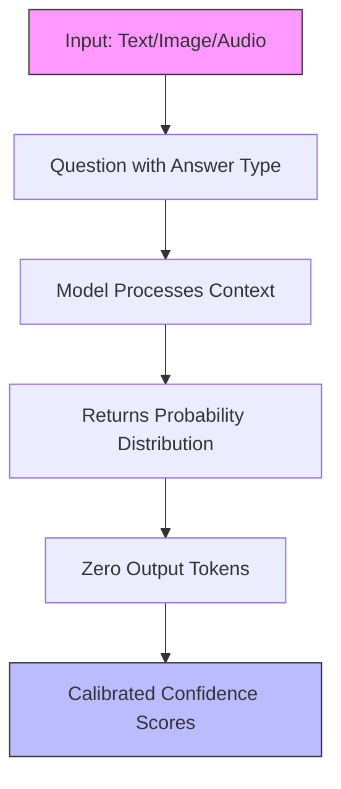
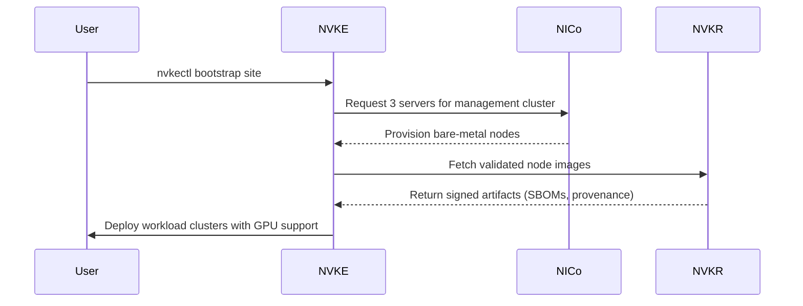
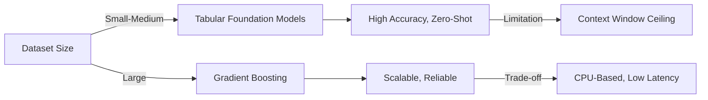
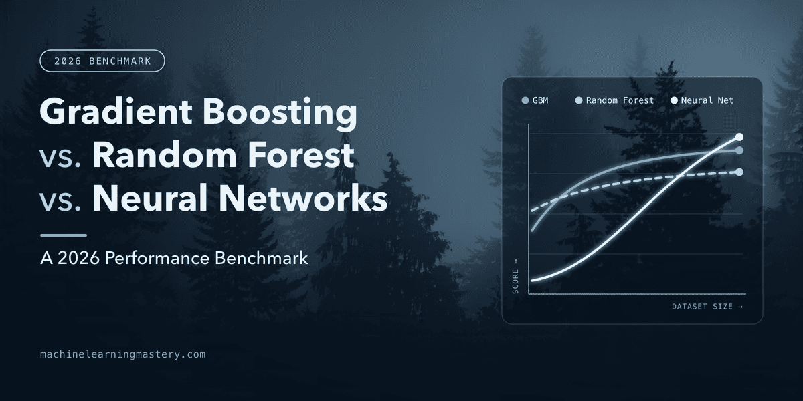

> 🎙️ **Listen to the podcast version of this article:**
> <audio controls src="index.mp3"></audio>

---

> 💡 **TL;DR:** Liquid AI’s d1.2-ultra sets a new standard in decision-making AI with a 75 score on the AA Decision Index, processing text, images, and audio with zero output tokens. NVIDIA open-sources NVKE and NVKR to bring managed Kubernetes to bare-metal GPU clusters, while 2026 benchmarks reveal tabular foundation models now lead on small-to-medium datasets—but gradient boosting remains king for large-scale tasks.

| Metric / Innovation Area | Insight / Takeaway |
|-------------------------|-------------------|
| **Liquid AI d1.2-ultra** | Scores 75 on AA Decision Index v2.1; omnimodal (text/image/audio) with 0.8-point calibration error |
| **NVIDIA NVKE/NVKR** | Open-source managed Kubernetes for GPU infrastructure; Apache 2.0; public preview |
| **Tabular ML 2026** | Tabular foundation models (TFMs) lead on small-to-medium datasets; gradient boosting dominates at scale |

---

### Liquid AI Releases d1.2 and d1.2-ultra: Omnimodal Decision Models That Redefine Precision

The era of "generative-first" AI is encountering a compelling counterpoint: **decision-first models** that prioritize accuracy, calibration, and efficiency over freeform text generation. Liquid AI’s latest release, the d1.2 family—comprising `d1.2` and `d1.2-ultra`—embodies this shift, delivering **omnimodal decision-making** with a focus on **calibrated probabilities** and **zero output tokens**. Unlike traditional LLMs that generate responses token-by-token, these models return precise probability distributions over predefined answer sets, billing only for input tokens. This design is a game-changer for applications where reliability and cost predictability are paramount.

At the heart of d1.2’s innovation is its **multimodal input capability**, accepting text, images, and audio in a single API call. The models introduce **five new answer types**, expanding their utility beyond simple classification:
- **Value extraction** (e.g., reading numbers/dates from receipts)
- **Span detection** (e.g., identifying PII like names or emails)
- **Object localization** (returning bounding boxes for visual queries)
- **Numerical estimation** (providing best-guess values with confidence ranges)
- **Multi-label selection** (supporting "pick all that apply" scenarios)

Performance on the **Artificial Analysis (AA) Decision Index v2.1** cements d1.2-ultra’s leadership, scoring **75**—the highest among decision models. The index evaluates models across six benchmarks, including AA-Paperclip (30% weight) and EvalSafe-O*NET-AA (15%), penalizing overconfident incorrect answers. Calibration is a standout feature: d1.2-ultra achieves a **0.8-point calibration error** (vs. 3.7 for Perplexity’s Decider v1.3), meaning its 80% confidence predictions are correct ~79.2% of the time. For teams routing low-confidence cases to human reviewers, this reliability is invaluable.

**Why It Matters**: The rise of decision models signals a maturation of AI beyond generative hype. For enterprise use cases—fraud detection, medical diagnosis, or legal compliance—**calibrated probabilities** and **auditable reasoning** (via input-only billing) are often more valuable than creative text. Liquid AI’s omnimodal approach also eliminates the need for separate vision/audio pipelines, streamlining deployment. While weights remain closed for now, the promise of future open-source releases could democratize this capability.

---

### NVIDIA Open-Sources NVKE and NVKR: A Managed Kubernetes Revolution for GPU Infrastructure

NVIDIA’s latest open-source contributions, **NVIDIA Kubernetes Engine (NVKE)** and **NVIDIA Kubernetes Recipes (NVKR)**, address a critical gap in AI infrastructure: **managed Kubernetes for bare-metal GPU clusters**. Released under Apache 2.0, these tools enable organizations to deploy a **self-hosted, managed Kubernetes service** on their own NVIDIA GPU hardware, eliminating dependency on cloud providers for large-scale AI workloads. This is particularly transformative for "AI factories"—enterprises running massive training and inference pipelines on-premises.

#### Architecture and Workflow
NVKE serves as the **control plane** for managed Kubernetes, exposing a REST API and CLI (`nvkectl`) to provision and manage clusters. NVKR, meanwhile, is a **build system** that produces OS images, container images, and Helm charts, ensuring validated combinations of software versions and GPU generations. The workflow is elegantly modular:

Key technical highlights include:
- **SPIFFE/SPIRE attestation** with TPM for node identity verification
- **Per-cluster etcd encryption** for data security
- **OpenTelemetry-based observability** (logs, metrics, traces via OTLP)
- **Integration with NVIDIA Infra Controller (NICo)** for bare-metal lifecycle management

#### Comparison with Alternatives
| Feature | NVKE + NVKR | Gardener (SAP) | Kamaji (Clastix) |
|---------|-------------|----------------|------------------|
| **Control Plane Model** | Dedicated per cluster | Pods in seed clusters | Pods with shared datastore |
| **Target Infrastructure** | NVIDIA GPU bare-metal | Multi-cloud (AWS, Azure, etc.) | Cluster API providers |
| **Node Identity** | SPIFFE/SPIRE + TPM | Not disclosed | Not disclosed |
| **Signed Build Pipeline** | Yes (SBOMs, provenance) | Not disclosed | Not disclosed |
| **Kubernetes Conformance** | Certified v1.36 | Certified v1.35 | CNCF-compliant |

**Why It Matters**: For organizations with **GPU-dense infrastructure**, NVKE/NVKR provide a path to **cloud-like agility** without sacrificing control or incurring egress costs. Early adopters like **Firmus, SK Telecom, and Mirantis** are already integrating these tools into their AI factories. However, the public preview status means **production readiness is limited**—notable gaps include HTTP-only API endpoints (port 30080) without authentication and the absence of management-plane upgrade/backup procedures. For now, NVKE/NVKR are best suited for **evaluation and pilot deployments**, with the promise of hardening in future releases.

---

### Gradient Boosting vs. Random Forest vs. Neural Networks: The 2026 Tabular ML Benchmark Reckoning

The tabular machine learning landscape in 2026 is more **fragmented—and nuanced—than ever**. A new class of **tabular foundation models (TFMs)** has emerged, challenging the long-standing dominance of gradient boosting and random forests. The **TabArena benchmark**, developed by the AutoGluon team, now serves as the field’s gold standard, using nested cross-validation and Elo ratings to evaluate models across small-to-medium and large-scale datasets. The results? **No single algorithm rules them all.**

#### The Two Performance Regimes
The 2026 benchmarks reveal a **bifurcated reality**:

1. **Small-to-Medium Datasets (≤1M rows × 20K features)**:
   - **Tabular Foundation Models (TFMs) lead on accuracy**, with **TabPFN-3.5** topping the TabArena leaderboard. These models leverage **in-context learning**, treating the training data as context rather than performing gradient updates. For example, TabPFN uses binary missing-value indicators concatenated with cell values:
     $$\text{Input} = [x_1, m_1, x_2, m_2, \ldots]$$ where $m_i$ is a binary mask for missingness.
   - **Zero-shot prediction**: TFMs can make predictions immediately without fine-tuning, handling missing values natively.
   - **Limitations**: Context window constraints (e.g., TabPFN-3.5 supports up to 1M rows × 20K features) create a **scalability ceiling**.

2. **Large-Scale Datasets (>1M rows or >20K features)**:
   - **Gradient Boosting (XGBoost, LightGBM, CatBoost) reasserts dominance**, particularly for **regression tasks**. Modern implementations use **histogram-based methods** to accelerate training:
     $$\mathcal{L}(y, F(x)) = \sum_{i=1}^n l(y_i, F(x_i)) + \sum_{k=1}^K \Omega(f_k)$$ where $F(x) = \sum_{k=1}^K f_k(x)$ and $f_k$ are decision trees.
   - **Random Forest** remains the **most forgiving baseline**, requiring minimal tuning and degrading gracefully with noisy data.
   - **Specialized Neural Networks** (e.g., TabR, TabM, RealMLP) show promise but **require ensembling** to match gradient boosting’s performance.

#### Key Benchmark Insights
- **TFMs vs. Gradient Boosting**: On small-to-medium datasets, TFMs like TabPFN-3.5 outperform gradient boosting by **2–5% accuracy** (TabArena results). However, for **large-scale regression**, gradient boosting maintains a **consistent lead**.
- **Random Forest’s Niche**: While no longer the accuracy leader, random forest’s **robustness to noise and default hyperparameters** make it ideal for **exploratory analysis** and **baseline modeling**.
- **Neural Networks’ Resurgence**: Architectures like **TabR** (retrieval-based) outperform XGBoost on **classification tasks** with complex interactions, but **require extensive tuning and ensembling** to shine.

#### Production Considerations
- **Cost Efficiency**: Gradient boosting and random forest run on **CPU**, train in seconds, and offer **low inference latency**. TFMs require **GPU memory** to hold datasets in context, increasing costs.
- **Missing Data**: TFMs handle missing values **natively** (e.g., TabPFN’s binary indicators), while tree-based methods require **preprocessing pipelines**.
- **Feature Types**: TFMs excel with **text features or high-cardinality categoricals**, where tree-based methods struggle without manual encoding.

**When to Use Each Algorithm**
| Use Case | Recommended Algorithm | Why |
|----------|----------------------|-----|
| Small-to-medium datasets, high accuracy | **Tabular Foundation Models** (TabPFN, TabICL) | Zero-shot, handles missing data, top benchmark performance |
| Large-scale datasets, regression | **Gradient Boosting** (XGBoost, LightGBM) | Scalable, reliable, CPU-efficient |
| Noisy data, quick baseline | **Random Forest** | Robust, minimal tuning, interpretable feature importance |
| Large datasets, classification with complex interactions | **Specialized Neural Networks** (TabR, TabM) | Retrieval-based advantages, but requires ensembling |
| Unstructured data (images, text, audio) | **Transformers** (CNNs, etc.) | Tree-based methods require handcrafted features |

**Why It Matters**: The 2026 benchmarks underscore that **algorithm selection is now a data-driven decision**. The rise of TFMs doesn’t spell the end for gradient boosting—instead, it **expands the toolkit** for practitioners. For startups and enterprises, the message is clear: **match the algorithm to your data profile, not the hype cycle**. As TabArena continues to evolve, expect further specialization, with hybrid approaches (e.g., TFMs for small data + gradient boosting for scaling) gaining traction.

---

*Featured Image: *

Written with [Argos](https://github.com/Neilstid/argos)
