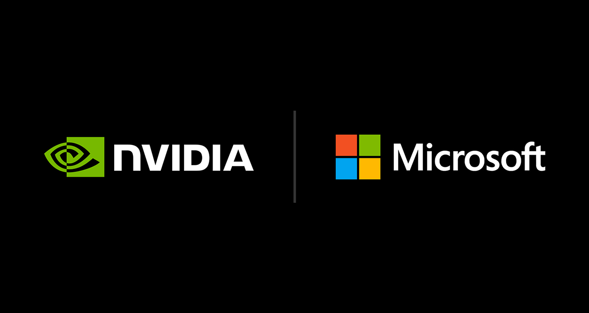
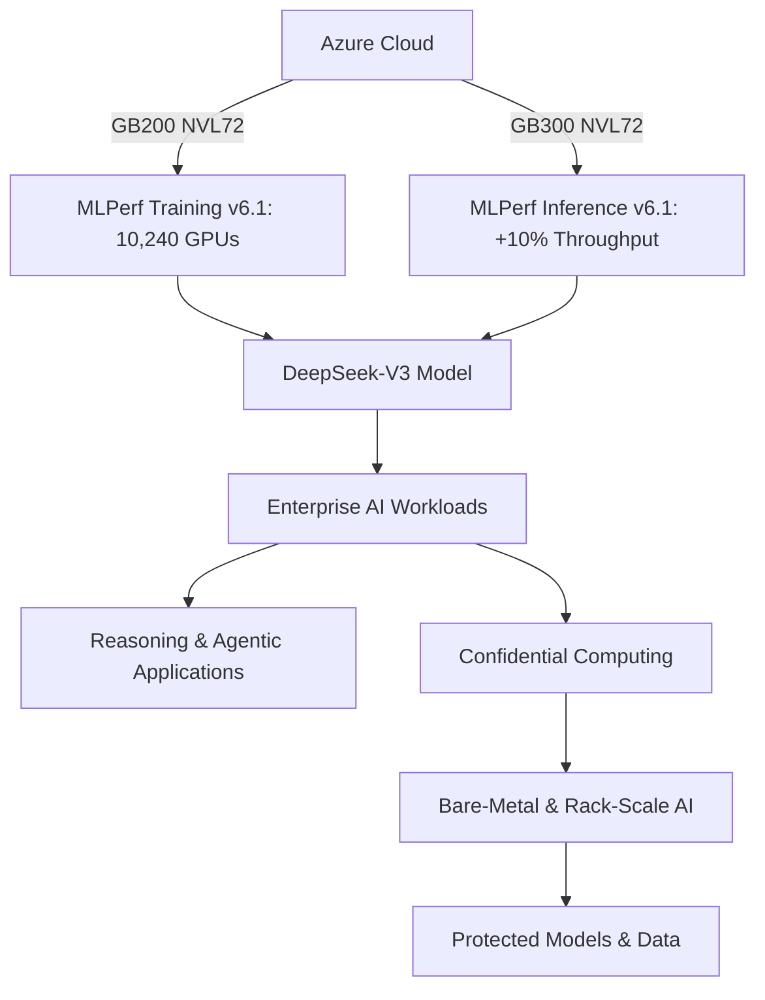
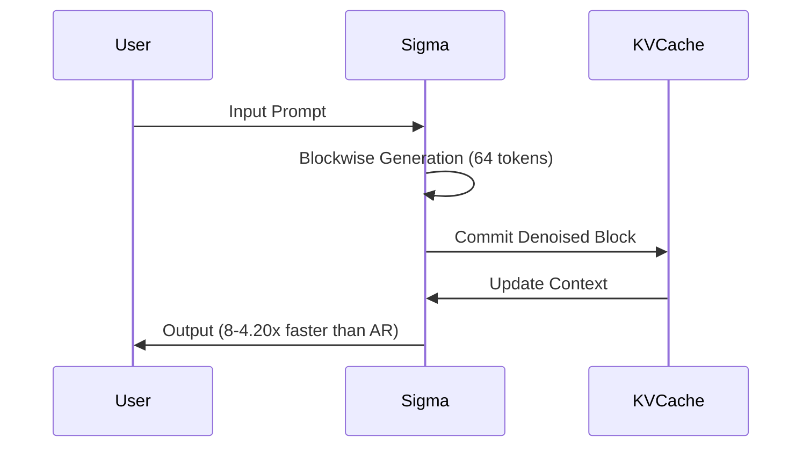
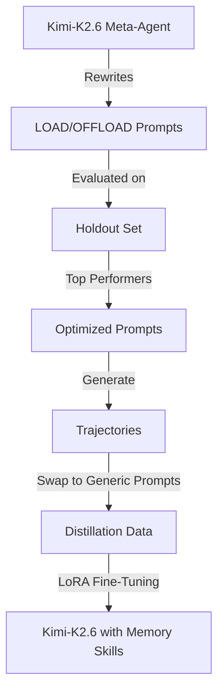
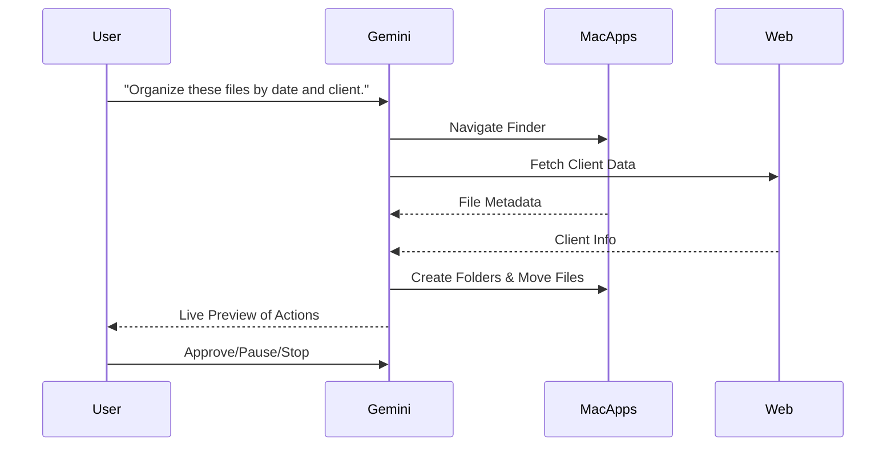

> 🎙️ **Listen to the podcast version of this article:**
> <audio controls src="index.mp3"></audio>


---

> 💡 **TL;DR:** This deep dive covers four major AI advancements: NVIDIA and Microsoft’s expansion of accelerated computing from Azure to Windows PCs with NVL72 systems and confidential computing; NVIDIA’s release of Nemotron-Labs-Sigma, a continuous diffusion language model family with 14 checkpoints that decodes up to 4.20x faster than autoregressive models; Meta FAIR’s Self-Improving Memory, where Kimi-K2.6 writes its own memory prompts to achieve 56.0 on Continual Learning Bench; and Google’s new computer-use feature for Gemini on macOS, enabling AI agents to navigate apps and complete multistep workflows autonomously.

| **Metric / Innovation Area** | **Insight / Takeaway** |
|-----------------------------|-------------------------|
| **Infrastructure Scale** | Azure scales to 10,240 NVIDIA GPUs with GB200 NVL72 systems on DeepSeek-V3, leading MLPerf Training v6.1 |
| **Confidential Computing** | NVIDIA and Microsoft extend protections across AI factory infrastructure for sensitive models and data |
| **Model Innovation** | Nemotron-Labs-Sigma introduces continuous diffusion in 16-D embedding space, enabling 4.20x faster decoding |
| **Agent Memory** | Meta’s Self-Improving Memory achieves 56.0 vs. 44.6 for best human-written harness on Continual Learning Bench |
| **Local AI** | Google’s Gemini now performs computer use on macOS, autonomously navigating apps and workflows |

---



### NVIDIA and Microsoft: Accelerated Computing From Cloud to Edge

The collaboration between NVIDIA and Microsoft has reached a new inflection point, extending their full-stack partnership to deliver accelerated computing capabilities from Azure’s next-generation infrastructure to industrial systems and Windows PCs. Announced at Microsoft Ignite, this expansion is not merely about scaling compute—it’s about redefining where and how intelligent applications can be built, customized, and deployed.

At the heart of this initiative are the **NVIDIA Vera Rubin NVL72 systems**, now running in Azure data centers. These systems are purpose-built for the most demanding AI workloads: reasoning, agentic applications, and large-scale model training and inference. The infrastructure is designed to handle the complexity of modern AI, where models don’t just predict but *reason*, *act*, and *adapt*. Azure’s preview of Vera Rubin builds on the companies’ codesign and performance optimization efforts, which were underscored in the latest **MLPerf results**. In MLPerf Training v6.1, Azure scaled to **10,240 NVIDIA GPUs** with GB200 NVL72 systems on the DeepSeek-V3 model—the largest scale in the round. In MLPerf Inference v6.1, Azure’s NVIDIA GB300 NVL72 systems led cloud submissions on DeepSeek-R1 interactive throughput by over 10%, per Signal65.



**Confidential Computing** is another critical pillar of this collaboration. NVIDIA and Microsoft are extending protections to bare-metal and rack-scale AI infrastructure, ensuring that sensitive models and data remain secure *while being processed*. This is particularly vital for organizations handling proprietary or regulated information. NVIDIA’s Confidential Computing and attestation mechanisms allow customers to verify the computing environment before releasing sensitive assets, and the companies are working to extend these protections across the entire AI factory infrastructure—a nod to the interconnected, multi-accelerator nature of modern AI workloads.

To address power efficiency, the collaboration leverages **NVIDIA MaxLPS**, helping data centers extract more performance from available power—a growing concern as AI workloads become more energy-intensive. Meanwhile, Microsoft is integrating NVIDIA technologies into its own models and services, including **NVIDIA Dynamo** for post-training inference and **RTX PRO 6000 Blackwell GPUs** for Bing search models. Dynamo, in particular, coordinates inference across large GPU fleets, optimizing performance and managing requests, model updates, and failure recovery—a testament to the operational complexity of modern AI systems.

**Why It Matters:** This partnership signals a shift toward *ubiquitous accelerated computing*. By bringing AI capabilities from the cloud to the edge (via **NVIDIA Jetson Thor/Orin** platforms) and even to Windows PCs (via **RTX Spark**), NVIDIA and Microsoft are democratizing access to high-performance AI. For enterprises, this means the ability to run models closer to their data, maintaining control over infrastructure and operations while unlocking new use cases in machine vision, robotics, and autonomous operations. The expansion of **Foundry Local** to support Nemotron 3.5 and NVIDIA’s physical AI models (like Cosmos) further underscores this trend.

---

### Nemotron-Labs-Sigma: Continuous Diffusion for Language Models

NVIDIA AI has released **Nemotron-Labs-Sigma**, a groundbreaking family of **continuous diffusion language models** with 14 open checkpoints at 3B and 8B parameters. Unlike traditional discrete diffusion models (e.g., LLaDA, Dream) that operate on token states, Sigma denoises text in a **learned 16-dimensional embedding space**, enabling smoother, more efficient trajectories that are easier to steer and distill.

#### How It Works
Sigma’s innovation lies in its **continuous latent space**. Each token is mapped to a point in a 16-D embedding space, and training involves adding Gaussian noise to these embeddings and teaching the model to remove it. The embedding geometry is learned jointly with the denoiser, and generation runs blockwise (default: 64 tokens per block), with each denoised block committed to a KV cache before the next begins. The backbone is a **Ministral-style decoder-only Transformer** with grouped-query attention, SwiGLU, and rotary embeddings. Training starts from an autoregressive warm start (~1T tokens), followed by ~0.3T tokens of diffusion training.

The mathematical foundation of Sigma’s diffusion process can be represented as:
$$ p_{\theta}(x_{t-1} | x_t) = \mathcal{N}(x_{t-1}; \mu_{\theta}(x_t, t), \Sigma_{\theta}(x_t, t)) $$
where $x_t$ is the noisy embedding at timestep $t$, and $\mu_{\theta}$, $\Sigma_{\theta}$ are the learned mean and covariance of the denoising distribution.

#### Performance and Benchmarks
Sigma-8B base averages **71.16** on NVIDIA’s 6-task suite, outperforming NLD-8B (70.22) and significantly leading Dream-7B (58.74) and LLaDA-8B (41.78). On coding tasks, Sigma-8B scores **65.12** on HumanEval (vs. 62.80 for NLD-8B) and **88.57** on GSM8K. After fine-tuning, Sigma-8B-instruct achieves **91.96** on GSM8K and **78.40** on MATH-500, though it struggles on harder reasoning tasks like AIME25 (17.00).

The real breakthrough, however, is in **speed**. Sigma’s distilled and speculative checkpoints enable dramatic acceleration:
- **Sigma-distill-8B-nfe8** decodes each 32-token block in 8 denoiser calls + 1 readout, achieving a 6-task mean of **70.34** (close to the 256-step teacher).
- **Self-speculative decoding** (diffusion head drafts, AR head verifies) delivers **3.46x faster decoding** than autoregressive baselines on average (peak: **4.20x** at 8B, **3.18x** at 3B).



#### Deployment and Accessibility
All 14 checkpoints are available on **Hugging Face** under the NVIDIA Nemotron Open Model License, ready for commercial use. The models require a **CUDA GPU** (Ampere, Lovelace, Hopper, or Blackwell) in bfloat16; CPU inference is not supported. On a single H100, the base model generates **120-140 tokens/s**. Supported serving frameworks include **vLLM, SGLang, and Docker Model Runner**.

**Code Snippet: Loading Sigma with Transformers**
```python
from transformers import AutoModelForCausalLM, AutoTokenizer
import torch

model_id = "nvidia/Nemotron-Labs-Sigma-8B"
tokenizer = AutoTokenizer.from_pretrained(model_id)
model = AutoModelForCausalLM.from_pretrained(
    model_id, 
    torch_dtype=torch.bfloat16, 
    trust_remote_code=True
).to("cuda")

input_text = "Explain the benefits of continuous diffusion for LLMs."
inputs = tokenizer(input_text, return_tensors="pt").to("cuda")
outputs = model.generate(**inputs, max_new_tokens=100)
print(tokenizer.decode(outputs[0], skip_special_tokens=True))
```

**Why It Matters:** Sigma’s continuous diffusion approach addresses a key limitation of discrete diffusion: the inability to steer trajectories effectively. By operating in a smooth embedding space, Sigma enables **few-step distillation** and **trajectory steering**, making it a compelling alternative to autoregressive models for tasks requiring speed and controllability. The 4.20x speedup over AR decoding could be a game-changer for latency-sensitive applications.

---

### Meta FAIR’s Self-Improving Memory: AI That Writes Its Own Playbook

Meta FAIR’s **Self-Improving Memory** introduces a paradigm shift in how AI agents manage long-term memory. Instead of relying on human-crafted memory prompts, the system enables **Kimi-K2.6** (a 1T-parameter Mixture of Experts model with 32B active parameters and 256K context) to *discover and optimize its own memory strategies*, then distill them into its weights.

#### The Two-Stage Process
1. **Harness Optimization**: A meta-agent (also Kimi-K2.6) rewrites **LOAD** and **OFFLOAD** memory prompts, which control how the agent retrieves and updates its persistent memory directory. The search starts from 4 human-written seeds (Summary, Retrieval, Skill, Hypothesis) and iteratively refines them based on performance on a holdout set. The best prompts are concrete and task-specific—for example, one Database prompt instructs the model to read `GUARDRAILS.md` before `SCHEMA.md`.

2. **Harness Distillation**: The optimized prompts are used to generate trajectories, which are then swapped back to generic prompts. The model is fine-tuned with **LoRA (rank 64)** on attention projection layers, covering only assistant tokens (including reasoning and tool calls). This distills the discovered memory skills directly into the model’s weights.



#### Benchmark Results
On the **Continual Learning Bench** (Database, Codebase, Spectrum tasks), Self-Improving Memory achieves an average score of **56.0**, compared to **44.6** for the best human-written harness. The gains are most pronounced in **Codebase** (+20.6 points, reaching **64.3**), where the optimized prompts include a quickstart file, an indexed fix registry, and separate fix files. After distillation, the model averages **43.1** with generic prompts—**5.5 points higher** than SFT on generic trajectories (37.6).

| **Test Score**       | **Database** | **Codebase** | **Spectrum** | **Average** |
|-----------------------|--------------|--------------|--------------|-------------|
| No Memory             | 7.5          | 31.8         | 21.9         | 20.4        |
| Best Human-Written    | 47.9         | 43.7         | 42.1         | 44.6        |
| Optimized Harness     | **53.8**     | **64.3**     | **49.9**     | **56.0**    |
| Distilled Model       | 37.7         | 45.1         | 46.5         | **43.1**    |

**Why It Matters:** Self-Improving Memory demonstrates that AI agents can *autonomously discover* better memory strategies than humans. The 20.6-point jump in Codebase is particularly notable, as it shows the potential for AI to optimize its own workflows for complex, multi-step tasks. The distillation step ensures these gains persist even when using generic prompts, making the approach scalable and practical. This work also highlights the importance of **evaluation and selection**: 37 of 44 meta-agent revisions failed to beat the previous best, underscoring the need for rigorous testing.

---

### Google’s Gemini: Computer Use Comes to macOS

Google has introduced **computer use** to its **Gemini desktop application on macOS**, enabling the AI to autonomously navigate native Mac apps and websites to complete multistep workflows. This feature, initially available in English in the U.S., requires a **Google AI Plus, Pro, or Ultra subscription** and marks Google’s entry into the **agentic desktop AI** space, following similar offerings from OpenAI, Anthropic, and Meta.

#### How It Works
Gemini’s computer use feature allows the AI to:
- **Organize files** into folders based on criteria
- **Fill out forms** and repeat tasks across batches of files
- **Create slideshows** from files or online dashboards
- **Navigate apps and the web** in the background while the user continues working

Users can **pause, stop, and approve** Gemini’s actions before they execute, providing a layer of control and transparency. The feature is designed for tedious, repetitive tasks—freeing users to focus on higher-value work. A live preview in the chat window shows the agent’s progress, while the user’s screen and cursor remain free for other tasks.



**Why It Matters:** This feature represents a significant step toward **autonomous AI agents** that can operate within a user’s local environment. By enabling Gemini to interact with native apps and the web, Google is blurring the line between *assistant* and *autonomous worker*. The ability to handle multistep workflows—such as extracting data from dashboards and compiling it into a presentation—could save users hours of manual work. While currently limited to macOS and the U.S., the implications for productivity are vast, especially as the feature expands to other platforms and regions.

---

### The Big Picture: AI Everywhere

These four developments paint a clear picture of AI’s trajectory: **ubiquity, autonomy, and speed**. NVIDIA and Microsoft are building the infrastructure to run AI anywhere—from cloud supercomputers to edge devices. NVIDIA’s Nemotron-Labs-Sigma is redefining how language models generate text, prioritizing speed and controllability. Meta’s Self-Improving Memory shows that AI can optimize its own cognitive processes, while Google’s Gemini is bringing autonomous agents to the masses via macOS.

The common thread? **AI is becoming more embedded in our workflows, more capable of operating independently, and more accessible across devices and contexts.** Whether it’s a supercomputer training the next frontier model or an AI agent organizing your local files, the future of AI is not just in the cloud—it’s everywhere.

Written with [Argos](https://github.com/Neilstid/argos)
