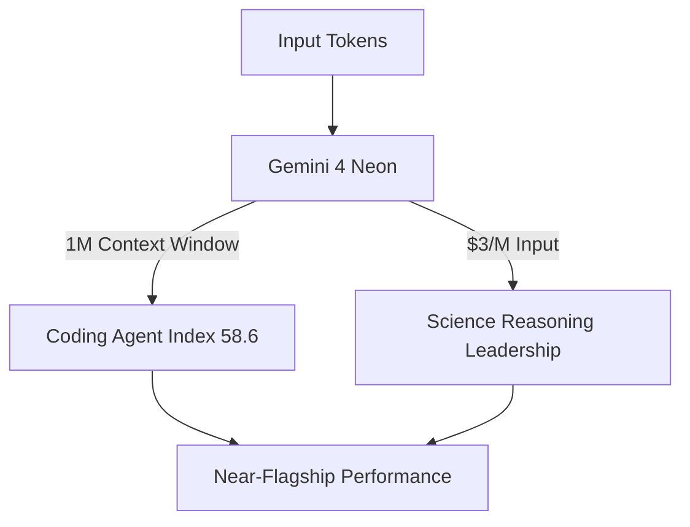
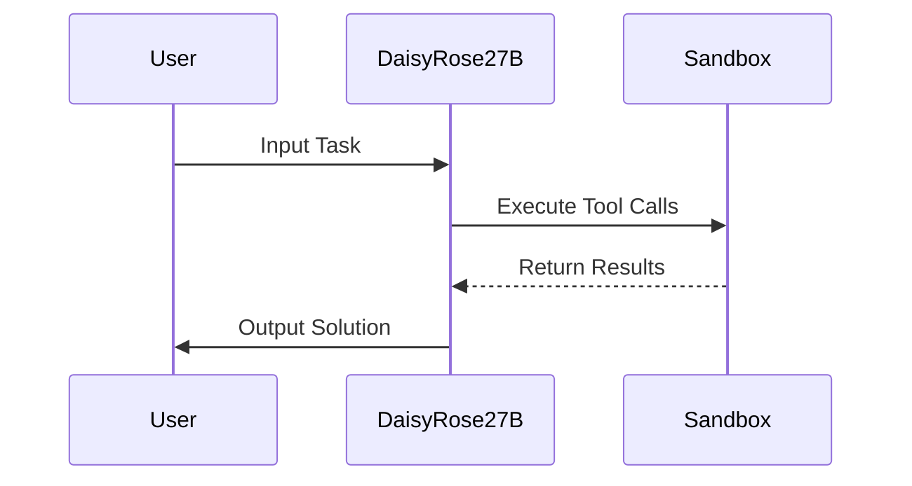
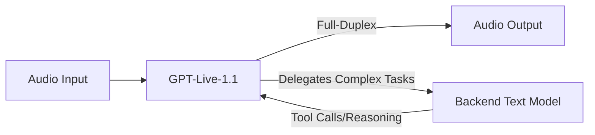

> 🎙️ **Listen to the podcast version of this article:**
> <audio controls src="index.mp3"></audio>

---

> 💡 **TL;DR:** This week marks a turning point in AI efficiency and ambition: Google’s Gemini 4 Neon delivers near-flagship performance at $3/M input with a 1M-token context window, RadixArk’s DaisyRose-27B becomes the first agentic coding model trained purely with RL to set new benchmarks, OpenAI’s GPT-Live-1.1 cuts idle voice costs by 60% to $0.02/min, and a mathematician leverages Claude to propose a proof for the Riemann Hypothesis—one of math’s most enduring mysteries.

| Metric / Innovation Area | Insight / Takeaway |
|-------------------------|-------------------|
| **LLM Performance** | Gemini 4 Neon leads in coding (Coding Agent Index 58.6) and science reasoning at $3/M input |
| **Agentic Coding** | DaisyRose-27B achieves 12.0 pass@1 on Terminal Bench 4.1 with pure RL training, runs on a single GPU |
| **Voice AI Cost** | GPT-Live-1.1’s standby mode reduces idle costs by 60% to $0.02/min, improving multilingual accents and detail handling |
| **Mathematical Breakthrough** | Claude-assisted proof of the Riemann Hypothesis released publicly, under independent verification |

---

### The New Contenders in LLM Benchmarks: Efficiency Meets Excellence

The race for LLM supremacy is no longer just about raw performance—it’s about delivering flagship-level capabilities at a fraction of the cost. Google’s **Gemini 4 Neon** has emerged as a standout, offering a 1M-token context window and near-flagship performance at just **$3 per million input tokens**. This model doesn’t just compete; it leads in critical areas like coding and science reasoning, scoring an impressive **58.6 on the Coding Agent Index**. For developers and enterprises, this means access to top-tier AI capabilities without the prohibitive costs that have historically gated such technology.

What makes Gemini 4 Neon particularly compelling is its balance of **scalability and affordability**. The 1M-token context window is a game-changer for tasks requiring extensive memory, such as long-form code generation, multi-document analysis, or complex reasoning chains. Google’s pricing strategy signals a shift in the industry: high-performance models are becoming more accessible, democratizing advanced AI for a broader range of applications. This is not just a win for cost-conscious users but a strategic move to accelerate adoption across industries.

Meanwhile, **RadixArk’s DaisyRose-27B** is rewriting the rules for agentic coding models. Trained **purely with reinforcement learning (RL)**—no supervised fine-tuning (SFT) or distillation—this 27B-parameter model achieves a **12.0 pass@1 score on Terminal Bench 4.1**, more than doubling the performance of its base model, Qwen3.8-27B. What’s even more remarkable? It runs on a **single GPU**, making it one of the most efficient high-performing models available today. Released under an **Apache 2.0 license**, DaisyRose-27B is a drop-in replacement for its base model, offering developers a powerful, open-weight alternative for agentic tasks.

The training process behind DaisyRose-27B is a masterclass in efficiency. RadixArk curated **1,200 tasks** targeting specific failures of the base model, using **144 H200 GPUs for 18 days** to achieve a **37% model FLOP utilization (MFU)**. The result is a model that not only excels in coding benchmarks but also demonstrates the potential of pure RL training to push the boundaries of what’s possible with smaller, more efficient models. For developers, this means access to a model that can handle complex, multi-step reasoning tasks without the need for massive computational resources.

---

### Making Voice AI Affordable: OpenAI’s GPT-Live-1.1 and the Cost Revolution

Voice AI is undergoing a transformation, and OpenAI’s **GPT-Live-1.1** is at the forefront of this shift. The latest iteration of OpenAI’s full-duplex voice model introduces a **standby mode** that slashes idle costs by **60%**, from $0.05 to **$0.02 per minute**. This is a significant reduction for developers building production-grade voice agents, where idle time can account for a substantial portion of operational costs. For teams running always-on voice sessions, this change could translate to **thousands of dollars in savings** over time.

But cost isn’t the only improvement. GPT-Live-1.1 also delivers **enhanced multilingual accent handling**, more accurate transcription, and better understanding of precise details like letters and numbers. These improvements are critical for applications in customer service, healthcare, and education, where accuracy and natural interaction are paramount. The model’s ability to **listen while it speaks**—a hallmark of full-duplex communication—ensures smoother, more human-like conversations.

Under the hood, GPT-Live-1.1 replaces the traditional cascade of speech-to-text, LLM, and text-to-speech with a **unified model** that reasons over incoming and outgoing audio in a single stream. This architecture simplifies the pipeline and reduces latency, making real-time interactions more seamless. For complex tasks, the voice model can delegate reasoning and tool calls to backend text models like **GPT-6 Astra** or **Luna**, ensuring that even the most demanding queries are handled efficiently.

The standby mode is particularly innovative. It **pauses inference during silence** while keeping the WebRTC connection open, allowing the session to resume instantly when the user speaks. Developers can configure the idle timeout (5–60 seconds) and voice activity detection (VAD) threshold to optimize for their use case. This flexibility ensures that GPT-Live-1.1 can adapt to a wide range of applications, from customer support bots to interactive voice assistants.

| Feature | GPT-Live-1.1 | GPT-Live-1 | GPT-Realtime-2.1 |
|---------|--------------|------------|------------------|
| **Idle Cost** | $0.02/min | $0.05/min | Not documented |
| **Accent Handling** | Improved | Standard | Standard |
| **Transcription Accuracy** | Enhanced | Standard | Standard |
| **Context Window** | 128K tokens | 128K tokens | 128K tokens |

For developers, the implications are clear: **voice AI is becoming more affordable and more capable**. The combination of lower costs, improved performance, and flexible architecture makes GPT-Live-1.1 a compelling choice for building next-generation voice agents.

---

### When AI Helps Solve the Hardest Math Problems: Claude and the Riemann Hypothesis

In a development that has sent ripples through the mathematical community, an **Anthropic mathematician** has released a **Claude-assisted proposed proof of the Riemann Hypothesis**—one of the most famous unsolved problems in mathematics. The proof, which is now publicly available, is under **independent verification**, and **Scientific American** has already covered the claim. If validated, this would mark a historic milestone, not just for mathematics but for the role of AI in advancing human knowledge.

The Riemann Hypothesis, first proposed by Bernhard Riemann in 1859, concerns the distribution of the non-trivial zeros of the **Riemann zeta function** $\zeta(s)$. The hypothesis states that all non-trivial zeros have a **real part equal to 1/2**, i.e., lie on the critical line:

$$\zeta(s) = \sum_{n=1}^{\infty} \frac{1}{n^s}, \quad \text{Re}(s) > 1$$

Proving this would have profound implications for number theory, particularly in understanding the distribution of prime numbers. The Clay Mathematics Institute has listed it as one of the **seven Millennium Prize Problems**, with a $1 million reward for its solution.

The mathematician’s use of **Claude**—Anthropic’s flagship LLM—highlights the growing potential of AI as a **collaborative tool for scientific discovery**. While the proof is still under review, the fact that an AI-assisted approach has reached this stage is a testament to the power of modern language models to augment human reasoning. This isn’t just about crunching numbers; it’s about **exploring new avenues of thought** and identifying connections that might elude even the most brilliant human minds.

The release of the proof files publicly invites scrutiny from the global mathematical community. If the proof holds up, it could pave the way for a new era of **AI-human collaboration in mathematics**, where models like Claude act as partners in tackling problems that have stumped researchers for centuries. Even if the proof is ultimately found to have gaps, the attempt itself demonstrates the **rapidly evolving capabilities of AI** and its potential to contribute to fields far beyond its traditional domains.

This development also raises fascinating questions about the **future of mathematical research**. Could AI help solve other Millennium Prize Problems, such as the **P vs NP problem** or the **Yang-Mills existence and mass gap**? As models become more advanced, their ability to assist in complex reasoning tasks will only grow, potentially accelerating the pace of discovery across all scientific disciplines.

---

*This week’s digest underscores a clear trend: AI is becoming more powerful, more efficient, and more integral to solving some of humanity’s most challenging problems. Whether it’s through cost-effective LLMs, affordable voice AI, or groundbreaking mathematical proofs, the boundaries of what’s possible are expanding at an unprecedented rate.*

Written with [Argos](https://github.com/Neilstid/argos)
